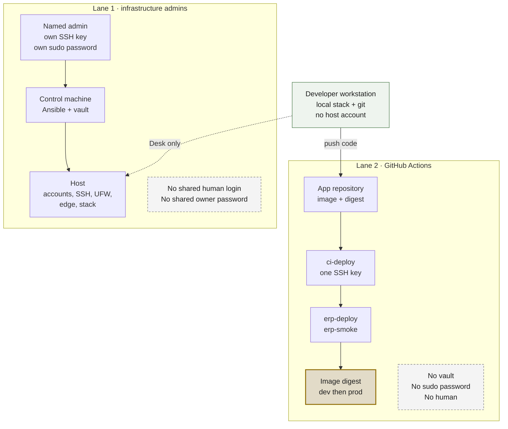
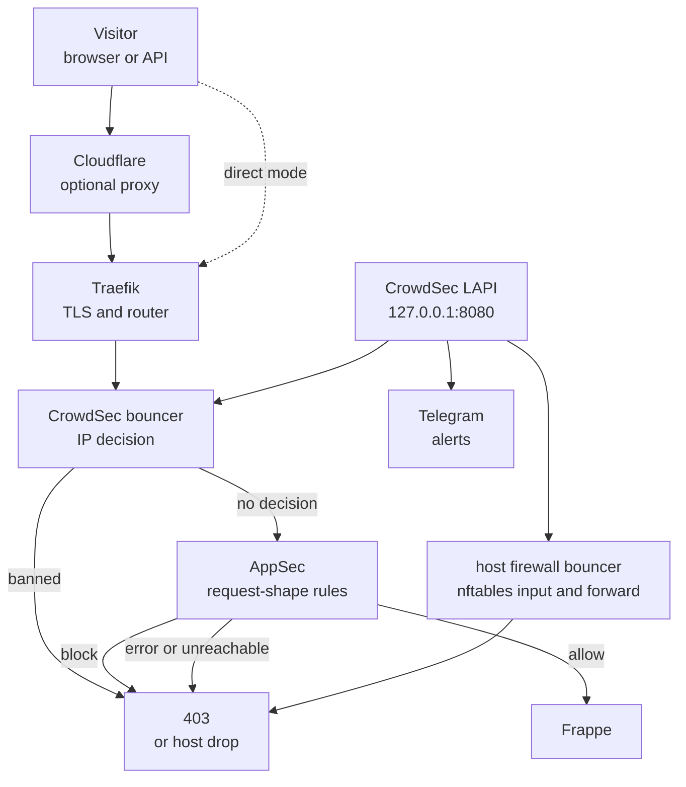

# Architecture

This document answers two questions:

1. **Who can change what** on a server, and with which credential.
2. **What can reach what** once the stack is running.

> **Target state.** This page describes the system as it is meant to be. The
> remaining code work is tracked in [`IMPLEMENTATION.md`](../IMPLEMENTATION.md).
> When this page and the code disagree, this page is authoritative.

If a term is unfamiliar, [`GLOSSARY.md`](GLOSSARY.md) defines it.

The design has **two privileged lanes**. Lane 1 is the set of named infrastructure admins. Lane 2 is the deployment pipeline. They share a repository and exactly one interface: the application image.

Developers are deliberately **outside both lanes**. They write code and use the deployed application, but they hold no Linux account on a shared host.

**Figure 1 — Two privileged lanes.** Developers are outside both lanes. The only
artefact the lanes share is the application image digest.

> **Trust levels.** Lane 1 can change anything on the host. Lane 2 can change one image digest. Developers can change code and use Desk, but cannot change a host. The lanes overlap on exactly one artefact: the application image. Everything else belongs to Lane 1: the host, firewall, edge, database and secrets.

---

## Lane 1 — server lifecycle

Lane 1 is a set of **named admins**, each with their own account and control machine. There is no shared human login.

Each admin:

- connects with their own SSH key;
- has their own Unix password, used only for `sudo`;
- may become `deployowner` with `sudo -u deployowner`;
- may also use ordinary `sudo` for system checks and repairs;
- is not in the `docker` group.

Admin access is granted per environment. Production has its own admin list; being an admin in development does not imply production access.

`deployowner` is a **service identity**, not a person:

- it has no SSH login;
- its password is locked;
- it owns the stack directories and `.env`;
- it is the only account in the `docker` group;
- it cannot `sudo` to another account.

> **How sudo works here.** `sudo` authenticates the admin running it, not the target account. `sudo -u deployowner` and ordinary `sudo` both ask for the admin's own password. `deployowner` has no usable password. `--become-password-file` therefore contains the admin's own sudo password. There is no shared owner password and no `targetpw` for admins.

Admins are root-equivalent by design: one sudoers rule gives them full `sudo`, and the normal target for stack work is `deployowner`, which owns Docker. The account model provides attribution, revocation and separation between people. It does not reduce the power of an admin.

Lane 1 runs in three phases, in order, with a person reading the output between them:

| Phase | Playbooks | What it establishes | Gate before the next phase |
|---|---|---|---|
| 1. Harden | `server.yml` | Named admin accounts, key-only SSH, UFW, kernel settings, unattended upgrades, Docker with a firewall that Docker cannot bypass | Each admin can log in with their own key and use `sudo` with their own password; `sudo -u deployowner` works for stack work; `sshd -T` shows no password auth |
| 2. Edge | `traefik.yml`, `crowdsec.yml` | TLS, routing, access log, LAPI, bouncer registration | The edge checks pass: LAPI reachable, log readable, AppSec answering and the test decision served. The site check is expected to fail until step 3, and development also expects the staging-CA trust failure |
| 3. Stack | `site.yml` | Networks, volumes, MariaDB, Redis, Frappe | `smoke.yml` passes every check except the expected staging-CA trust result in development. Production also requires public trust. In a production rollout, the Traefik bouncer is enabled only after the host layer and the development acceptance suite pass. The optional Cloudflare router allowlist is enabled only in proxy mode |
| 4. Backup | `backup.yml` | rclone, backup script, systemd service and timer, one verification run | The verification run succeeds and the remote prefix contains `mariadb.sql.gz`, `sites.tar.gz` and `manifest.json`. A fresh host has no backups before this phase |

It is not automated end to end for three reasons. Phase 1 changes the way you log in. Phase 2 is the first time a certificate is issued. Phase 3 writes secrets. Each step deserves human review before the next one starts.

Lane 1 is also the only path for configuration changes after go-live, such as a new Traefik middleware, a rate limit, a Redis setting or a new domain. The pipeline cannot make those changes.

Admins hold the production vault password according to the secret inventory. It is not available to Lane 2 or to developers.

### Bootstrap exception

The very first phase-1 run connects as `root`, because it creates the accounts it will later use. That is the only time the root account logs in over SSH. After that:

- root SSH is disabled;
- `AllowUsers` lists the admin accounts, plus `ci-deploy` once the pipeline is
  registered;
- `deployowner` is absent from `AllowUsers`;
- every Ansible run connects as an admin and becomes `root` with that admin's own password; `deployowner` is the owner of the application stack and is reached with `sudo -u deployowner` for stack work.

---

## Lane 2 — application deployment

Lane 2 is a pipeline, not a person. It has one SSH identity, `ci-deploy`, and one purpose: run the two root-owned deployment scripts.

- `ci-deploy` authenticates with a key stored in GitHub.
- It has no vault password and no sudo password.
- It can run `erp-deploy` and `erp-smoke` as root.
- It cannot get root through any command other than the two scripts, read `.env`, change the firewall or SSH configuration, or join the `docker` group.

Lane 2 begins when the application repository produces an image and ends when production runs it. The deployment repository owns the promotion, not the build.

### Flow

1. **Build:** the application repository builds and pushes the application image, then reads back the immutable `sha256:` digest.
2. **Dispatch:** it sends `repository_dispatch` to this repository with the version, digest, commit, actor and a link to the build.
3. **Prepare:** this repository validates the digest format and publishes a run summary. Nothing has been touched yet.
4. **Deploy development:** automatic. The runner connects as `ci-deploy` and runs `erp-deploy <digest>`.
5. **Smoke development:** `erp-smoke` checks that containers are up, the site answers through the edge, and the certificate is issued for the hostname. Public trust is asserted in production only, because development uses the staging CA. A failure in any other check ends the run, and the production job never appears.
6. **Approval:** the production job waits on the `production` GitHub Environment. The required reviewer is the designated release reviewer. They approve runs they did not trigger. Self-review is disabled, so the person who triggered the run cannot approve it.
7. **Deploy production:** the same digest, deployed by the same script.
8. **Smoke production:** the same health checks.
9. **Record:** the run summary and the host-side deploy log both name the digest, the actor and the workflow run.

### Why a digest and not a tag

A tag is a name; a digest is content. Approving a tag approves whatever that tag points at when the server pulls it. Approving a digest approves the exact bytes that already ran in development. If someone rebuilds and re-pushes the same tag, production does not silently change.

Rollback is the same pipeline with an older digest. There is no special rollback mechanism to keep in sync.

### What the pipeline cannot do

| Action | Lane 1 admins | Lane 2 |
|---|---|---|
| Change the application image | yes | yes |
| Run database migrations | yes | as part of the image rollout |
| Edit a compose file, role, or template | yes | **no** |
| Read or write `.env`, rclone config, or any vault | yes | **no** |
| Change firewall, SSH, users, or sudo | yes | **no** |
| Run `bench new-site`, restore a backup, rotate a secret | yes | **no** |
| Deploy to production without approval | yes, from a control machine (audited, not approval-gated) | **no** |

The last row matters most. A compromised pipeline can ship a bad image. It cannot read application secrets, open a port, or install a package.

---

## Users and identities

| Identity | Host account | Authenticates with | Can do | Cannot do |
|---|---|---|---|---|
| `root` | Yes, bootstrap and console only | Provider console | Everything | Log in over SSH after bootstrap |
| `<admin>` — for example `alice`, `alice` | Yes, one per admin | SSH key + own Unix password for `sudo` + own dashboard password | Administer the host; use full `sudo`; become `deployowner` for stack work; open the private dashboard | Log in as `deployowner` over SSH; use a shared credential; join `docker` |
| `deployowner` | Yes, service identity | None; password locked | Own the stack directories and `.env`; run Docker as the target of `sudo` | Log in over SSH; authenticate directly; `sudo` further |
| `ci-deploy` | Yes, pipeline identity | SSH key stored in GitHub | Run `erp-deploy` and `erp-smoke` as root | Get root through any other command; read secrets; join `docker` |
| Developer | **No** | Git access + Frappe Desk login | Work locally; push code; use CI; configure the app in Desk | SSH to any shared host; read the vault; use Docker; hold System Manager in production |

Production approval is a GitHub role held by the designated reviewer. It is a release decision, not a separate host identity, and it does not grant extra access.

Two details are easy to get wrong:

- `AllowUsers` names the admin accounts, plus `ci-deploy` once the pipeline is registered. `deployowner` is deliberately absent.
- No human account is in the `docker` group. Membership in that group is equivalent to root.

### Developers are not a host identity

Developers work on their own machines and use the shared development host only as an integration environment:

- they run the stack locally;
- they push code, and CI builds and deploys the image to shared development;
- they use Frappe Desk for configuration and data in development;
- they do not receive a Linux account on development, production, or a control machine.

A Frappe user is not a Linux account. A developer can have System Manager in the development Desk and still have no SSH access to the host. In production, developers have no System Manager role and no host account; production changes go through Lane 1 or an approved Lane 2 deployment.

Control machines and the vault are admin-only. Developers never receive the Ansible key or the vault password.

### Where the application secrets sit

`base_dir/erp/.env` is mode `0600`, owned by `deployowner`. It holds the Frappe administrator password. It does not hold the MariaDB root password or the mail password. It is written once during provisioning and is not re-rendered on deploys.

The MariaDB root password is a separate file at
`base_dir/mariadb/secrets/db_root_password`, also mode `0600` and owned by
`deployowner`. It is mounted only into the MariaDB container and the one-shot
configurator. The long-running application services never receive it.

The mail password is a separate file at
`base_dir/erp/secrets/mail_password`, also mode `0600` and owned by
`deployowner`. It is mounted only into the one-shot configurator. The configurator
writes it into `site_config.json` after site creation so the runtime processes can
send mail.

At runtime, Frappe uses a per-site database user whose generated password is in
`sites/<site>/site_config.json` inside the sites volume. The database name is also
generated; read `.db_name` and `.db_user // .db_name` rather than assuming
`frappe`. That user is granted access only to the site database.
`site_config.json` is a secret because it also contains the mail password and the
site encryption key.

- **Admins** can read these files by becoming `deployowner`. That is part of being an admin.
- **`ci-deploy`** cannot read them; the deploy script runs as root and lets Compose read the files.
- **Developers** cannot read them because they have no host account and no `deployowner` access.

The production vault is the only thing that can recreate the files. It is held by admins, never by CI and never by developers.

### Security invariants

These statements must remain true:

- There is no shared human host account.
- There is no shared human sudo password.
- There is no shared dashboard login; every admin has their own basic-auth entry.
- The Frappe `Administrator` is a break-glass application account, not a daily shared login; admins use their own Desk users.
- `deployowner` has no SSH login and no usable password.
- The MariaDB root secret is mounted only into MariaDB and the one-shot
  configurator; runtime services use the per-site Frappe database user.
- The mail secret is mounted only into the one-shot configurator; runtime
  services read the mail password from `site_config.json`.
- `site_config.json` is treated as a secret and is included in the sites-volume
  backup.
- MariaDB and Redis are on separate internal networks; the frontend and Traefik
  are on neither.
- Every admin's `sudo` authenticates that admin's own password.
- `ci-deploy` can run only the two deployment scripts.
- Developers have no Linux account on development, production, or a control machine.
- `AllowUsers` contains the admin accounts, plus `ci-deploy` once the pipeline is registered, and nothing else.
- No human account is in the `docker` group.
- Root SSH is disabled after bootstrap.
- Admin access is granted per environment.

### Audit trail

- SSH logs name the admin and record the key fingerprint.
- `sudo` logs name the admin and the target account (`deployowner` or `root`).
- `last`, `lastlog` and shell history are per admin.
- CI records the actor, image digest and workflow run.
- Desk actions are recorded against the developer's Frappe user.

A developer has no host audit identity because a developer has no host account.

---

## Edge and certificates

The edge is the public front door: Traefik, plus an optional Cloudflare proxy.

### Modes

Each environment chooses one mode.

| Mode | Path | Certificate | Router allowlist |
|---|---|---|---|
| Direct | client → Traefik | Let's Encrypt HTTP-01 | none |
| Cloudflare DNS, no proxy | client → Traefik | Let's Encrypt DNS-01 | none |
| Cloudflare proxy | client → Cloudflare → Traefik | Let's Encrypt DNS-01 | `cloudflare-allow` on the public app router |

Only the third mode puts Cloudflare in the request path. The first two send
traffic straight to Traefik. [`ROLES.md`](ROLES.md#edge-mode-values) owns the
exact variable values; this table describes the path.

Other DNS providers are supported in direct mode only. They cannot be combined with a proxy.

The dashboard is private in every mode. Reach it through an SSH tunnel. Each admin signs in with their own dashboard username and bcrypt hash; there is no shared `admin` credential. The steps for each mode are in [`RUNBOOK.md`](RUNBOOK.md#choose-the-edge-mode).

### Entrypoint and router

Traefik has two layers, and they do different jobs.

| Layer | What it does | Can it block? |
|---|---|---|
| Entrypoint | Terminates TLS, redirects HTTP to HTTPS, and decides whose `X-Forwarded-For` header to believe | No |
| Router | Matches the host, attaches middlewares, and applies the allowlist | Yes |

The entrypoint setting is `forwardedHeaders.trustedIPs`. It is a trusted-proxy list, not an allowlist. In direct mode it contains localhost. Internet clients still reach the app. Traefik ignores their forwarded header and uses the address it sees.

In Cloudflare proxy mode, the list also contains the Cloudflare ranges. That lets Traefik read the real visitor address for logs and rate limits. The blocking is done by the `cloudflare-allow` middleware on the router. It rejects requests that did not come from Cloudflare or the private network.

This separation is why a direct deployment needs no Cloudflare setting at the entrypoint.

### Certificates

- **HTTP-01** is for direct mode. Port 80 must be reachable from the internet.
- **DNS-01** is for Cloudflare DNS. It writes a TXT record, so it works with orange or grey cloud.
- There is no Cloudflare Origin CA and no other proxy-and-DNS combination.

### What is exposed

- Ports 80 and 443 on the edge.
- SSH on the management port, key-only.
- CrowdSec LAPI on `127.0.0.1:8080` only. It is not reachable from the internet or the LAN.
- AppSec on `crowdsec-net` at `crowdsec:7422`. It has no host port.
- No host ports for app containers.
- MariaDB on `erp-db` and Redis on `erp-cache`, both internal networks
  with no gateway. The frontend and Traefik are on neither data network.

### Data services

MariaDB and two Redis services are separated onto different internal networks:

- MariaDB sits on `erp-db`. Only the one-shot configurator, backend, workers
  and scheduler join it. Redis, the frontend and Traefik do not.
- `redis-cache` and `redis-queue` sit on `erp-cache`. Only the one-shot
  configurator, backend, websocket, workers and scheduler join it. MariaDB, the
  frontend and Traefik do not.
- `redis-cache` is disposable and has no persistent volume.
- `redis-queue` uses the `redis-queue-data` volume for RQ jobs. The same instance carries Socket.IO pub/sub, which is ephemeral. Socket.IO points at the queue endpoint; there is no third Redis service.
- Redis has no password because the cache network is the boundary. No public or
  edge container joins that network, and MariaDB is not on it.
- Redis is not part of the MariaDB-and-sites backup pair. The queue can lose recent jobs after a crash, and a restore does not replay queued work.

The application services that need both data stores are the only dual-homed
containers. A compromised Redis container can reach those services but not
MariaDB; a compromised frontend can reach the backend and websocket but neither
data store.

In direct mode and in Cloudflare DNS without a proxy, the public app router is reachable directly. In Cloudflare proxy mode, the router allowlist limits it to Cloudflare and the private network.

---

## Detection and enforcement

The stack uses several layers because they see different things. None of them is a substitute for the others.

| Layer | What it sees | What it enforces | Failure behavior |
|---|---|---|---|
| UFW | Packets to host ports | Static allowlist: SSH, 80 and 443 | Default deny; always on |
| `DOCKER-USER` rules | Docker-published ports | The same static allowlist for container traffic | Reapplied when Docker starts |
| Host firewall bouncer | Source addresses at layer 3 and layer 4 | All CrowdSec decisions in separate nftables tables | No new bans when LAPI is unavailable; UFW remains |
| Traefik bouncer | HTTP client address | CrowdSec IP decisions | Fail-closed when the decision stream cannot refresh |
| AppSec | Request method, path, headers and body | Request-shape rules and virtual patches | Fail-closed; `403` on error or unreachable |

**Figure 2 — Detection and enforcement.** The host firewall bouncer enforces the
same decisions at layer 3 and layer 4; it is not a substitute for AppSec.

The Traefik bouncer starts only after its initial decision stream is ready (`streamStartupBlock: true`) and treats a failed stream refresh as a failure (`updateMaxFailure: 0`). AppSec is required and in-band. A CrowdSec outage therefore blocks HTTP traffic instead of allowing it uninspected.

`site.yml` handles the startup handshake in two plays: Traefik creates the log volume and network, then CrowdSec starts LAPI and AppSec. Traefik waits during the gap and begins serving when the stream is ready. A standalone `traefik.yml` on a host without CrowdSec starts a container that does not serve traffic.

The host firewall bouncer is a separate host service. It reads the LAPI over loopback and writes its own nftables tables. It does not edit UFW or Docker's tables. It drops banned source addresses in the `input` and `forward` chains, so it covers SSH and forwarded container traffic as well as HTTP.

### Cloudflare limitation

In Cloudflare proxy mode, the host sees the Cloudflare edge as the source address. The host firewall bouncer cannot drop the real visitor at layer 3 or layer 4, because the visitor's packets never reach the host directly. Traefik and AppSec are the primary HTTP enforcement point in that mode. The host bouncer still protects SSH, direct-to-origin traffic and any address the host can actually see.

A community blocklist entry that names a Cloudflare edge address is therefore a potential availability problem. Treat it as a reviewed exception or remove the specific decision; do not add a broad permanent Cloudflare allowlist without a decision record.

### WAF policy

AppSec is a request-shape WAF and a virtual-patching engine, not an antivirus or a database firewall. It inspects at most the first 10 MB of a request body. A clean verdict does not make an uploaded file safe.

A WAF false positive is handled with a narrow, owned, reviewed exception. There is no broad exclusion for `/app`, `/api`, `/assets` or `/files`, and no broad `clientTrustedIPs` bypass. The acceptance suite and exception process are in [`WAF.md`](WAF.md).

---

## Environments

There is one host for each environment: `development` and `production`. The inventory keeps both in one file, and `playbooks/guard.yml` refuses to run unless exactly one environment group is in scope. A missing `--limit` therefore fails loudly instead of applying production changes to the development host.

Adding a third environment is a documented change, not an architectural one:

1. Add a group and host to `inventory/inventory.yml`.
2. Add `group_vars/<env>/main.yml` and `vault.yml`.
3. Add the group to `environment_groups` in `group_vars/all/main.yml`.
4. Add the environment to the GitHub protection rules for privileged environments.
5. Run the three phases.

Never point two environments at the same host or share a vault-id between them. Either mistake removes the guard's ability to tell you which server you are changing.

---

## Failure and recovery

| Situation | What happens | What to do |
|---|---|---|
| Development smoke fails | The production job is never created | Fix or roll back in development. Nothing reached production. |
| Production smoke fails after approval | The job fails. The previous containers may still be running, or the new ones may be unhealthy | Re-dispatch the previous digest, then diagnose on the host |
| A bad configuration is discovered | The pipeline cannot fix it | Lane 1: edit, run `--check --diff`, then apply |
| Certificate issuance fails | The edge serves no valid certificate | Check the mode: HTTP-01 needs port 80; DNS-01 needs the Cloudflare token and DNS propagation |
| The dashboard is unreachable | It is private by design | Open an SSH tunnel and check the private allowlist |
| Smoke warns that the origin is reachable directly | Only in Cloudflare proxy mode, when the allowlist is off | Confirm the record is orange, then [enable the Cloudflare router allowlist](RUNBOOK.md#choose-the-edge-mode). Direct mode and Cloudflare DNS without a proxy do not warn |
| Every HTTP request returns `403` | AppSec is down or erroring, the bouncer key is rejected, or the decision stream cannot refresh | Do not disable the WAF as a permanent fix. Check `cscli metrics show appsec`, `cscli bouncers list` and the Traefik log; use the maintenance-window rollback in [`WAF.md`](WAF.md#monitoring-and-incident-response) |
| Traefik starts but does not serve | `streamStartupBlock` is waiting for LAPI, or the LAPI is unreachable | Start CrowdSec first, or run both through `site.yml`; check `http://crowdsec:8080/health` from Traefik |
| A legitimate admin is locked out of SSH | A host firewall decision matched the admin's egress address | Use the provider console, list decisions, remove only the false one, and fix the scenario. Do not add a broad allowlist |
| A WAF `403` spike affects normal users | An AppSec rule is too broad, or a new rule set was applied without the acceptance suite | Identify the rule from `cscli alerts list`, roll back the rule change, then narrow it. Do not exclude `/app` or `/api` |
| Telegram alerts stop arriving | Bad token or chat ID, invalid template, or batching delay | Run `cscli notifications test telegram`; the site is unaffected by notification failure |
| The CI key is lost or leaked | The pipeline cannot deploy; nothing else is exposed | Remove the key from the host, generate a new pair, update the GitHub secret |
| An admin's control machine is lost | Production is unchanged and still serving | Clone the repo on another machine, restore the vault password from the password manager, and use a backup of the admin's SSH key |
| The vault password is lost | No one can reproduce or change secrets | Rebuild the host from provisioning, or recover the password from the sealed copy held by admins and rotate everything |
| GitHub is unavailable | No deploys, no approvals | An admin deploys from a control machine; deploy the same digest by hand |
| The reviewer is also the requester | The pipeline does not self-approve | Use the audited control-machine deploy, or add a second reviewer. Host changes wait for an admin. |

The asymmetry is intentional: the pipeline failing costs a deploy, not a server. The vault failing costs a rebuild.

---

## Non-goals

- High availability, multi-region, or Kubernetes. One host per environment is a decision, not a gap.
- A self-hosted runner. It would remove the public SSH exposure, but it adds a machine to patch and secure. It is worth revisiting if the team grows.
- Developer SSH access to shared hosts. Developers work locally and use the shared development host as an integration environment. A shared host account would add a root-equivalent credential without improving the development loop.
- Multi-tenant Frappe sites in one stack. The compose file assumes one site per environment.
- Other CDN or proxy providers. The supported modes are direct and Cloudflare.
- Automating the three provisioning phases into a single unattended run. The manual gates are deliberate.
- Treating AppSec as an antivirus, a file scanner or a database firewall. It is a request-shape WAF with a 10 MB body limit.
- Blocking the real client at layer 3 or layer 4 when Cloudflare is in front. In proxy mode, Traefik and AppSec are the HTTP enforcement point; the host bouncer protects what the host can actually see.

See also: [`ROLES.md`](ROLES.md) for the role-by-role reference, [`SECRETS.md`](SECRETS.md) for the credential inventory and rotation, [`DECISIONS.md`](DECISIONS.md) for the reasoning behind these boundaries, and [`RUNBOOK.md`](RUNBOOK.md) for the commands.
