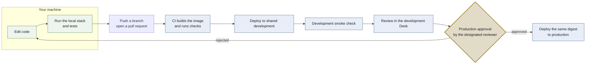

# Development

This guide is for developers who work on the application that runs on this
deployment. It explains how to set up a local stack, how code reaches the shared
environments, and where the boundary is between application work and
infrastructure work.

> **Target state.** This page describes the system as it is meant to be. The
> remaining code work is tracked in [`IMPLEMENTATION.md`](../IMPLEMENTATION.md).
> When this page and the code disagree, this page is authoritative.

The short version: **you develop on your own machine, push code, and use the
shared development host as an integration environment.** You do not get a Linux
account on a shared host.

This page owns the developer workflow and the data rules. Server provisioning,
backups and credential rotation are admin tasks; use [`RUNBOOK.md`](RUNBOOK.md)
and [`SECRETS.md`](SECRETS.md) for those.

## What you get, and what you do not

| You get | You do not get |
|---|---|
| Repository access and code review | A Linux account on development, production, or a control machine |
| A local stack with the app, database and cache | SSH access to a shared host |
| A Frappe Desk login in the development environment | Docker access on a server |
| CI builds and automatic development deploys | The production vault password or any production secret |
| The ability to request a production deploy | The ability to approve your own production deploy |
| System Manager in the development Desk | System Manager in production |

A Frappe Desk user is an application user, not a Linux user. Having a Desk login does not give you a shell, a home directory, or a key on the server.

## The development loop

**Figure 1 — The development loop.** One image is built once, deployed to
development, then promoted by digest after the designated reviewer approves production.



Two things in that diagram are deliberate:

- The image is built once and promoted by digest. Production does not build again from a different checkout.
- The production approval is a human decision by the designated reviewer. A developer can request a deploy; nobody can approve their own.

## One-time setup

### 1. Install the local tools

You need:

- Git.
- Docker Engine or Docker Desktop with the Compose plugin.
- An editor and the language tools used by the application repository.
- Access to the application repository.

Check the container tools:

```bash
docker --version
docker compose version
```

If `docker compose` is not available, install the Compose plugin. The old `docker-compose` command is not the same tool.

### 2. Clone the application repository

The application source lives in its own repository, not in this deployment repository. Clone the repository you have been given access to:

```bash
git clone <application-repository-url>
cd <application-repository>
```

### 3. Read the application repository's local setup

The application repository owns the exact local stack. It should provide:

- a local Compose file;
- an `.env.example` or equivalent;
- a way to create the local database and seed safe data;
- the test command.

This guide uses `compose.dev.yaml` as an example name. If the application repository uses a different name or command, follow that repository. The access rules below do not change.

### 4. Create a local environment file

```bash
cp .env.example .env
```

Use local-only values. A good local environment:

- uses a throwaway database password;
- points at the local database and cache, not at shared development or production;
- disables external email, payment, and webhook integrations;
- uses a fake site name and fake users.

Never put a production credential in a local `.env`. Never commit `.env`. If the repository does not already ignore it, add it to `.gitignore` before you create it.

### 5. Start the local stack

```bash
docker compose -f compose.dev.yaml up -d
```

The stack should start the application, MariaDB and Redis. You do not need Traefik, Cloudflare, or CrowdSec locally. Those are part of the shared environment, not the development loop.

Open the URL printed by the stack. It is often `http://localhost:8000`, but use the address the application repository documents. Create a local administrator account if the setup does not do it for you.

### 6. Seed safe data

Use synthetic data, fixtures, or an anonymised seed. Do not restore a production backup to your laptop. Production data is not a development convenience.

A local database is disposable. If it becomes inconsistent, destroy the local volumes and start again. That is faster and safer than trying to repair it by hand.

### 7. Run the tests once

Run the test command from the application repository before you change anything. A green baseline tells you that a later failure is your change, not a broken setup.

## The daily loop

1. **Pull the latest `main`.** Start from the code the shared environment is actually running.
2. **Create a branch.** Keep one topic per branch and one topic per pull request.
3. **Change the code.** Keep infrastructure out of the change unless the pull request is specifically about infrastructure.
4. **Update the local database if the schema changed.** Use the application repository's migration command. Do not hand-edit the shared database.
5. **Run the tests and the local smoke path.** At minimum, log in, open the page you changed, and exercise the failure path.
6. **Commit and push.** Use a message that says what changed and why.
7. **Open a pull request.** Describe the user-visible change, the tests you ran, and anything that needs review.
8. **Watch CI.** A failed build does not reach shared development.
9. **Check development after the deploy.** Use the development Desk and the smoke result. A green build is not proof that the feature works.
10. **Request production when ready.** The designated reviewer approves. Production runs the same digest that passed development.

## What the shared development environment is for

Shared development is an **integration environment**. Use it to:

- see how your change behaves with the real edge, TLS and proxy configuration;
- test a flow that needs the deployed image rather than your local working tree;
- let another person review the change in a running app;
- run the smoke check that gates production.

Do not use it as your primary editor, debugger, or database. Those belong on your machine.

### If a problem only happens on shared development

You cannot SSH to the host to inspect it. Collect what you can:

- the failing URL and the exact time;
- the user and role you used;
- the browser or API response;
- the CI run and the image digest;
- whether the same steps work locally.

Then ask an admin to collect the host-side logs or run the relevant check. Shared-development log access for developers is not part of this workflow yet; do not assume you can read the host logs yourself.

## Desk roles

Frappe Desk is the application interface. It is separate from Linux access.

| Environment | Your Desk role | What it means |
|---|---|---|
| Local | Administrator | You own the throwaway local site |
| Development | System Manager, where your work needs it | You can configure the development app and its data |
| Production | No System Manager | Production configuration is an admin change or a reviewed deployment |

A Desk action is recorded against your Frappe user. That is your audit identity for application changes. It is not a host login.

If you need a production configuration change, raise it with an admin. Do not ask for production System Manager as a shortcut. The admin can make the change through the controlled path, or explain why it should be part of the application instead.

## Data rules

- **Never copy production data to a laptop.** Use synthetic or anonymised data.
- **Never point a local stack at a shared database.** Use the local database in the Compose stack.
- **Never use production credentials locally.** Local `.env` values are disposable and separate.
- **Do not put customer data in a test fixture or a screenshot.**
- **Treat a backup as production data.** Only admins restore or inspect backups.

If you need a realistic data shape, ask an admin for a sanitised fixture or build one from the application's own seed tools.

## Secrets

Developers do not hold server secrets:

- no production vault password;
- no `deployowner` access;
- no CI private key;
- no Cloudflare, database, or object-storage credential.

Your local `.env` is yours. It contains local-only values. If you accidentally commit a local secret, remove it from the branch immediately and tell an admin. A secret that was pushed should be treated as exposed, even if the commit is later rewritten.

If you need to know which environment variable a feature uses, read the application repository and the variable names in [`ROLES.md`](ROLES.md#where-values-come-from). Do not ask for the production value.

## Deploying

### Deploying to development

A merge to `main` in the application repository builds an image and deploys it to shared development automatically. You do not run an Ansible command.

### Deploying to production

Production waits for the designated reviewer, who must not be the person who triggered the run. The same digest that passed development is deployed. If the development smoke check fails, no production job is created.

You can request a production deploy by following the normal pull-request and CI flow. You cannot approve your own production deploy.

### Rollback

A rollback is a deploy of an older digest. Ask the designated reviewer to approve a dispatch of the previous digest. If the reviewer dispatches it, use the audited control-machine path. Images are pruned after seven days, so a rollback older than that needs a rebuild from the same commit.

## Access changes

### When you join

An admin or repository owner will:

1. give you repository access;
2. create your Frappe Desk user in development;
3. point you at this guide.

No server change is required, because you are not a host user. You do not need an SSH key on a server, and you should not be added to `vault_base_operators` or `vault_ci_deploy_authorized_keys`.

### When you leave

Your repository access and Desk user are removed. There is no Linux account to delete and no shared password to rotate. If you were also an admin, the admin offboarding steps in [`SECRETS.md`](SECRETS.md#removing-someone) apply.

## Troubleshooting

| Symptom | What to check |
|---|---|
| `docker compose` is unknown | Install the Compose plugin. The plugin is `docker compose`, not the old `docker-compose` binary |
| The local app cannot reach the database | Both services must be on the same Compose network; check the service name and port in `.env` |
| The local stack starts but the page is blank | Check the app container logs and the asset build; run the repository's setup command again |
| A migration fails locally | Start from a clean local database and re-run the documented migration order |
| CI fails before a deploy | Open the failing job. A build or test failure never reaches shared development |
| Development works but production is not requested | Production is a separate approval gate. Ask the designated reviewer to review the run |
| A shared-development-only bug needs host logs | Ask an admin. You do not have SSH access by design |
| You need temporary host access to debug | There is no standing exception process. Do not assume it is available. Raise the problem with an admin and use the local or shared-development evidence you have |

## Boundaries to remember

- You are outside Lane 1 and Lane 2. You change code and application data, not hosts.
- A Docker host account is effectively root. That is why you do not have one.
- The admin accounts exist so host changes have a person's name attached. Do not ask for a shared login.
- A Desk role is not a Linux role.
- The pipeline deploys an image digest. It does not run Ansible, read the vault, or change the host.
- If a task seems to need a production secret or a host shell, it is probably an admin task. Ask, rather than working around the boundary.

## Related pages

- [`ARCHITECTURE.md`](ARCHITECTURE.md) for the two lanes and the trust boundaries.
- [`ROLES.md`](ROLES.md) for what each Ansible role does.
- [`RUNBOOK.md`](RUNBOOK.md) for the deployment and restore commands used by admins.
- [`SECRETS.md`](SECRETS.md) for access changes and credential rotation.
- [`DECISIONS.md`](DECISIONS.md) for why developers are local-first and why admins are named.
