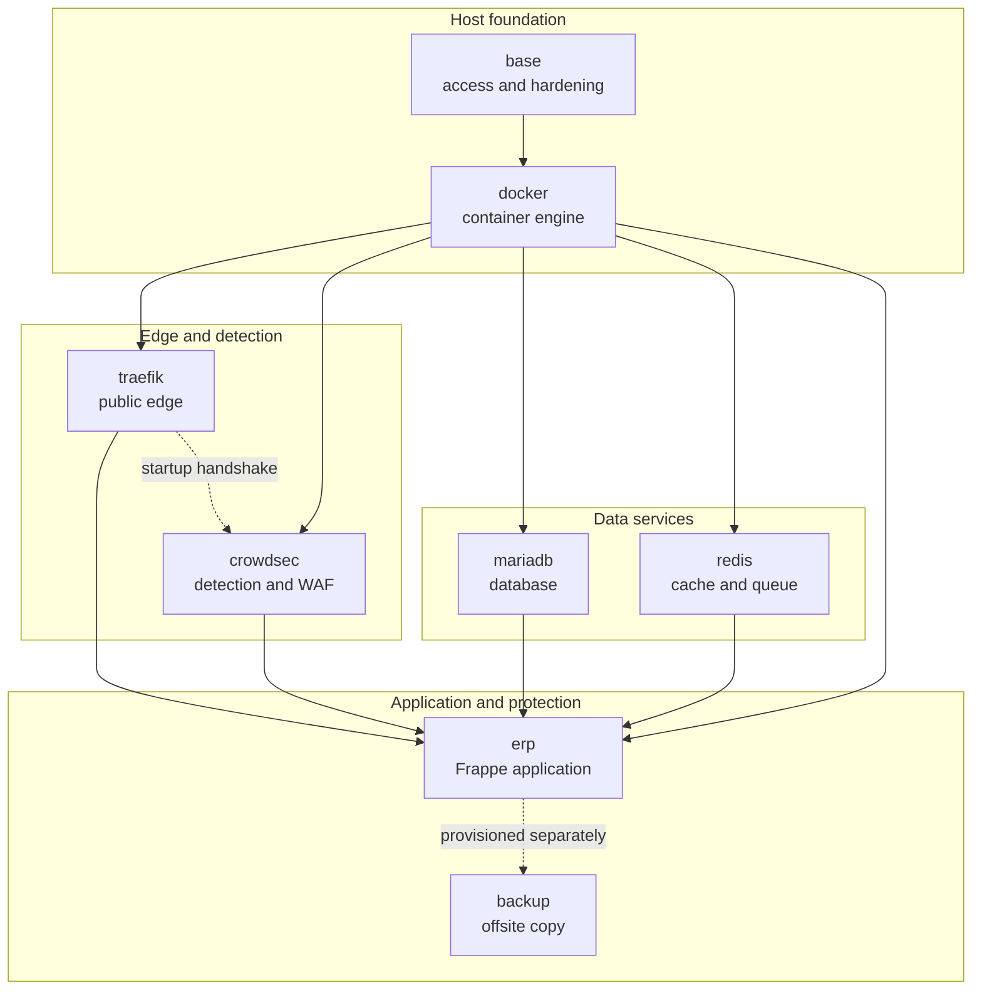
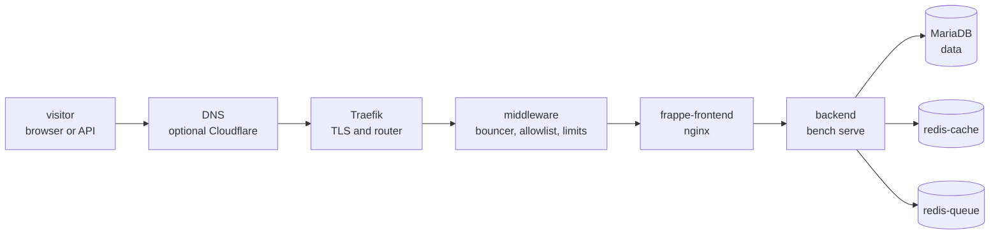

# Roles

This page is the map of the deployment code. It explains what each Ansible role is
responsible for, where it sits in the build order, and the shared container,
network and volume inventory. Each role page owns its file list and role-specific
details.

> **Target state.** This page describes the system as it is meant to be. The
> remaining code work is tracked in [`IMPLEMENTATION.md`](../IMPLEMENTATION.md).
> When this page and the code disagree, this page is authoritative.

## What a role is

Ansible reads a **playbook**, an ordered list of jobs. A playbook calls a **role**,
a folder containing tasks, templates and defaults. One role owns one part of the
system:

- `base` prepares the host and controls access.
- `docker` installs the container engine.
- `traefik` provides the public front door and enforces the WAF.
- `crowdsec` watches traffic, runs the AppSec WAF, supplies block decisions,
  installs the host firewall bouncer and sends Telegram alerts.
- `mariadb` runs the database.
- `redis` runs the cache and job queue.
- `erp` runs the Frappe application.
- `backup` copies the database and files to object storage.

Roles are layers of one server, not independent programs. A later role assumes
that the role before it has created what it needs. The [build order](#build-order)
is part of the design.

## How the roles run

Unless a role page says otherwise, every runtime role uses the same access path:

> **Runs as:** a named admin, becoming `deployowner` through `sudo` with the
> admin's own password.

There are three exceptions:

- `base` starts as `root` on the bootstrap run, then as a named admin.
- The host firewall bouncer service runs as `root`; `crowdsec` installs it through
  the admin's `sudo`.
- `backup` runs its systemd service as `root`, because it reads the container
  environment and the Docker volume.

[`ARCHITECTURE.md`](ARCHITECTURE.md#users-and-identities) owns the full identity
model. No role should introduce a new human login or a shared password.

## The roles at a glance

| Role | Plain-language job | Main playbooks | Main result |
|---|---|---|---|
| [`base`](roles/base.md) | Harden a new Ubuntu host and define who can log in | `server.yml` | Key-only SSH, named admin accounts, a locked `deployowner` service identity, per-admin full sudo, UFW, kernel and service hardening |
| [`docker`](roles/docker.md) | Install Docker and set safe daemon defaults | `server.yml` | Docker Engine, the Compose plugin, log rotation, socket access for the `deployowner` |
| [`traefik`](roles/traefik.md) | Receive public traffic, end TLS and route requests | `traefik.yml`, `site.yml`, `update.yml` | Traefik, a Docker socket proxy, the edge networks and the dashboard |
| [`crowdsec`](roles/crowdsec.md) | Read Traefik and SSH logs, run AppSec, publish decisions, notify Telegram and install the host firewall bouncer | `crowdsec.yml`, `site.yml`, `update.yml` | CrowdSec, the loopback LAPI, AppSec, the Traefik bouncer, the nftables host bouncer and Telegram alerts |
| [`mariadb`](roles/mariadb.md) | Run the application database | `site.yml`, `update.yml` | One MariaDB container with encrypted InnoDB data |
| [`redis`](roles/redis.md) | Run the cache and job queue | `site.yml`, `update.yml` | Two Redis containers on `erp-cache` |
| [`erp`](roles/erp.md) | Run the Frappe application and its workers | `site.yml`, `update.yml` | The web app, background workers, scheduler, frontend, asset build and deploy scripts |
| [`backup`](roles/backup.md) | Copy the database and sites volume off the host | `backup.yml` | A daily backup script, systemd timer and object-storage copy |

The host firewall bouncer is a component of `crowdsec`, not a separate Ansible
role. It has its own page because it runs as a host package and has a different
failure model.

## Build order

**Figure 1 — Build order.** The host foundation comes first; the edge, data and
application layers sit on Docker. The dotted edge is the startup handshake: Traefik
waits for LAPI before it serves. This is not a strict dependency chain between
MariaDB, Redis and CrowdSec.



## Runtime path

**Figure 2 — Runtime path.** The public path reaches the frontend and backend, not
the data services. MariaDB is reachable only from application services on
`erp-db`; Redis is reachable only from application services on
`erp-cache`.



> The dashboard is not on the public path. It is reached through an SSH tunnel and
> a private-only router. The public app router never forwards to MariaDB or Redis.

## Playbook order

Every playbook starts with `guard.yml`. The guard refuses to run unless exactly one
environment is selected with `--limit` and `target_env` matches it. This prevents a
command meant for development from changing production.

| Order | Playbook | Roles | Purpose | Human gate before the next step |
|---|---|---|---|---|
| 1 | `server.yml` | `base`, `docker` | Turn a raw Ubuntu host into a hardened Docker host | Your own admin account can log in with its key, `sudo` and `sudo -u deployowner` work with your own password, and `sshd -T` shows no password login |
| 2a | `traefik.yml` | `traefik` | Create the edge, the networks and the first certificate | The Traefik container is healthy and the dashboard is reachable only through a tunnel. If the Traefik bouncer is already enabled, serving starts after 2b |
| 2b | `crowdsec.yml` | `crowdsec` | Start CrowdSec and AppSec, register the Traefik and host bouncers, install the host nftables bouncer and Telegram profile | The LAPI and AppSec are reachable from Traefik, both bouncer keys are accepted, and `crowdsec-firewall-bouncer` is active |
| 3 | `site.yml` | `traefik`, `crowdsec`, `mariadb`, `redis`, `erp` | Create the shared topology and the full application stack; wait for MariaDB and both Redis services before starting the application | The smoke checks pass, with the expected staging-CA exception in development |
| 4 | `backup.yml` | `backup` | Install the backup script, rclone configuration, systemd service and timer, then run one verification backup | The verification run succeeds and the three objects are listed in the remote prefix |
| — | `update.yml` | All runtime roles except `backup` | Lane 1 rollout of a new image or a full-stack configuration change; the same datastore readiness gate applies | The smoke checks pass under the same development exception |
| — | `smoke.yml` | None; read-only except for a temporary test decision | Verify containers, the edge, TLS, CrowdSec, LAPI and the decision path | Adds one reserved-address decision and removes it; no persistent change |

Both `site.yml` and `update.yml` wait for the MariaDB health check and for both
Redis `PING` checks before they start the application. The application services
then depend on the one-shot configurator completing successfully, not on it
merely starting.

`backup.yml` is deliberately outside both deployment playbooks. A deployment must
not fail because object-storage credentials are missing, and an image rollout must
not silently reinstall or re-verify backups. A freshly provisioned host therefore
has **no backups until an admin runs `backup.yml`**. Treat that as a provisioning
gate: run it immediately after `site.yml` and before declaring the site
production-ready.

Step 2a creates `traefik-logs` and starts the Traefik container. In the target
state the Traefik bouncer is already enabled, so Traefik waits at
`streamStartupBlock` until step 2b starts LAPI. A standalone `traefik.yml` on a host with no CrowdSec
therefore starts a container that does not serve traffic.

The normal application path is Lane 2: GitHub Actions calls the deploy script on
the host. `update.yml` is the Lane 1 path for an emergency or a configuration
change. It is not used by the pipeline.

`site.yml` creates the shared networks and the two Frappe volumes before any role
runs. This is deliberate: Compose files declare some networks and volumes as
`external: true`, so they must already exist. The `traefik` role also creates its
own networks when it runs alone.

## Where values come from

Ansible merges values from several places. Read them in this order; a value lower
in the list wins.

| Layer | What lives there | Examples |
|---|---|---|
| 1. Role defaults | Safe fallback values that belong to one role | `traefik_image`, `mariadb_image`, `redis_image`, `backup_calendar` |
| 2. `group_vars/all/main.yml` | Settings and aliases shared by both environments | Cloudflare address ranges, upstream image names, access-model values, aliases that resolve values from the selected environment vault |
| 3. `group_vars/<env>/main.yml` | Operational values that differ between development and production | `env_name`, `base_dir`, rate limits, ACME server, edge mode |
| 4. `group_vars/<env>/vault.yml` | Encrypted secrets and confidential identifiers | `vault_db_root_password`, `vault_domain`, `vault_mail_login`, `vault_app_image_repository`, `vault_cf_token` |
| 5. Runtime environment | Values supplied by an admin or CI, never committed | `TARGET_SERVER_HOST`, `SSH_LOGIN_USER`, `DEPLOY_OWNER_USER`, `SSH_PORT` |
| 6. Extra vars | A one-off value passed with `-e` | `-e erp_image=sha256:<digest>` |

Only public constants are committed: upstream image names and versions,
Cloudflare address ranges, reserved IP ranges and generic role names.
Confidential identifiers such as the domain, dashboard host, registry
namespace, image repository, mail identity, backup bucket and SSH port are
encrypted in the vault even though they are not cryptographic secrets. They
are referenced through shared aliases in `group_vars/all/main.yml` or
environment-specific variables in `group_vars/<env>/main.yml`; the selected
environment vault supplies their values at run time. For example, `domain` is
the shared alias and `vault_domain` is its environment-specific encrypted
source. Sharing the alias does not share the value or vault password. See
[ADR-026](DECISIONS.md#adr-026--confidential-identifiers-live-in-the-vault-and-the-repository-is-non-identifying).

`erp_image` is the image identity. It is normally a `sha256:` digest for a
deploy. `erp_image_version` is a human-readable label used in records; it is
not the identity of the image.

### Version pins

Documentation does not repeat runtime or package versions. The effective pins live
in code:

- `group_vars/all/main.yml`: `traefik_image`, `socket_proxy_image`,
  `traefik_bouncer_version`, `mariadb_image`, `redis_image`, `base_os_release`.
- `roles/crowdsec/defaults/main.yml`: `crowdsec_image`.

Read the current values with:

```bash
grep -RInE '^(traefik_image|socket_proxy_image|traefik_bouncer_version|mariadb_image|redis_image|base_os_release):' group_vars/all
grep -RInE '^crowdsec_image:' roles/crowdsec/defaults
```

Do not copy a known pin into `docs/`. Change the pin in code, run the matching
upgrade and verification, and leave the docs alone. The deferred documentation
check will fail if a known pin appears in `docs/`; it will ignore `DECISIONS.md`,
because an ADR is a decision record, not a version catalogue.

## Edge mode values

The edge mode changes three values together. Do not set one without the others.

| Mode | `traefik_cert_resolver` | `traefik_trusted_ips` | `traefik_origin_cloudflare_only` |
|---|---|---|---|
| Direct | `http` | `127.0.0.1/32` | `false` |
| Cloudflare DNS, no proxy | `cloudflare` | `127.0.0.1/32` | `false` |
| Cloudflare proxy | `cloudflare` | localhost plus the Cloudflare ranges | `true` after the record is orange |

`traefik_trusted_ips` controls whose forwarded header Traefik believes. It is not
an access gate. The router allowlist is the gate. See
[`ARCHITECTURE.md`](ARCHITECTURE.md#entrypoint-and-router) for the difference.
[`RUNBOOK.md`](RUNBOOK.md#choose-the-edge-mode) owns the operational choice and
the two questions that select a mode.

`traefik_origin_cloudflare_only` defaults to `false` in
`group_vars/all/main.yml`; set it to `true` in the selected environment's
`main.yml` only when enabling Cloudflare proxy mode.

## Shared networks and volumes

The roles share six Docker networks. A container can reach another container only
when both are on a common network. That is the main security boundary inside the
host.

| Network | Type | Members | Purpose |
|---|---|---|---|
| `traefik-public` | Bridge, has a gateway | `traefik`, `frappe-frontend` | The public edge path from Traefik to the frontend |
| `docker-proxynet` | Internal, no gateway | `traefik`, `socket-proxy` | Private Docker API path; no internet route |
| `crowdsec-net` | Private bridge, not published | `traefik`, `crowdsec` | LAPI, AppSec and decision traffic; the LAPI is published only on host loopback `127.0.0.1:8080` for the host bouncer; application containers are not members |
| `erp_default` | Bridge, has a gateway | The Frappe application services | Service-to-service traffic and outbound access for the app |
| `erp-db` | Internal, no gateway | MariaDB, configurator, backend, workers and scheduler | Database traffic with no route to the internet; Redis and the frontend are not members |
| `erp-cache` | Internal, no gateway | Redis, configurator, backend, websocket, workers and scheduler | Cache, queue and Socket.IO traffic with no route to the internet; MariaDB and the frontend are not members |

The application and data networks are deliberately separate. A compromised Redis
container can reach the application services that need it, but not MariaDB. A
compromised frontend can reach the backend and websocket, but neither data
service. The backend, workers and scheduler are dual-homed because they genuinely
need both; the one-shot configurator joins both only while it provisions the site.
The split is recorded in
[ADR-023](DECISIONS.md#adr-023--separate-the-database-and-cache-networks).

The public edge publishes only ports 80 and 443. No application container publishes
a host port. CrowdSec publishes its LAPI only on `127.0.0.1:8080` for the host
bouncer, and AppSec has no host port. MariaDB and Redis have no host port at all.

The Cloudflare-proxy app allowlist accepts RFC1918 private addresses, which
includes the configured `172.30.0.0/16` Docker address pool. That is intentional:
it lets the host and the LAN reach the app. It also means `traefik-public` must
stay limited to `traefik` and `frappe-frontend`; a container on that network is
inside the private-network exception.

| Volume | Owner | Contents | Backup |
|---|---|---|---|
| `traefik-acme` | `traefik` | ACME account, keys and certificates | No; reissued automatically |
| `traefik-logs` | `traefik`, read by `crowdsec` | Traefik access and daemon logs; the access log feeds CrowdSec | No; operational logs |
| `crowdsec-db` | `crowdsec` | Decisions, alerts, AppSec alerts and runtime state | No; detection state |
| `crowdsec-config` | `crowdsec` | CrowdSec configuration, AppSec configs and rules written by the image | No; reproducible |
| `mariadb-data` | `mariadb` | The database files | Yes, through the logical dump |
| `redis-queue-data` | `redis` | RQ jobs and queue metadata; Socket.IO uses the same server | No; not part of the backup pair, and recent jobs can be lost |
| `erp_sites-vol` | `erp` | Site configuration (including database and mail passwords), uploaded files, installed apps | Yes, as a tar archive; the archive is a secret |
| `erp_assets-vol` | `erp` | Built frontend assets | No; rebuilt from the image |

## Container inventory

This is every container in the target stack, including the one-shot services.

| Container | Role | Image | Networks | Host ports | Health check |
|---|---|---|---|---|---|
| `traefik` | `traefik` | `traefik_image` (pinned) | `traefik-public`, `docker-proxynet`, `crowdsec-net` | 80, 443 | `traefik healthcheck --ping` |
| `traefik-log-init` | `traefik` | `traefik_image` (pinned) | none | none | one-shot; must exit successfully |
| `socket-proxy` | `traefik` | `socket_proxy_image` (pinned) | `docker-proxynet` | none | HTTP probe on port 2375 |
| `crowdsec` | `crowdsec` | `crowdsec_image` (pinned) | `crowdsec-net` | `127.0.0.1:8080` (LAPI only; AppSec 7422 stays internal) | `cscli lapi status`; AppSec listener on 7422 |
| `mariadb-database` | `mariadb` | `mariadb_image` (pinned) | `erp-db` | none | `healthcheck.sh --connect --innodb_initialized` |
| `redis-cache` | `redis` | `redis_image` (pinned) | `erp-cache` | none | `redis-cli ping` |
| `redis-queue` | `redis` | `redis_image` (pinned) | `erp-cache` | none | `redis-cli ping` |
| `asset-syncer` | `erp` | application image | `erp_default` | none | completes successfully |
| `configurator` | `erp` | application image | `erp-db`, `erp-cache` | none | completes successfully after the asset build and data readiness |
| `backend` | `erp` | application image | `erp_default`, `erp-db`, `erp-cache` | none | `bench --version` |
| `websocket` | `erp` | application image | `erp_default`, `erp-cache` | none | process stays up |
| `frappe-frontend` | `erp` | application image | `erp_default`, `traefik-public` | none | HTTP through the edge |
| `queue-short` | `erp` | application image | `erp_default`, `erp-db`, `erp-cache` | none | process stays up |
| `queue-long` | `erp` | application image | `erp_default`, `erp-db`, `erp-cache` | none | process stays up |
| `scheduler` | `erp` | application image | `erp_default`, `erp-db`, `erp-cache` | none | process stays up |

## Where files live

All stack files live under `base_dir`, which is `/home/deployowner/app_server` in
production and `/home/deployowner/app_server_dev` in development. The
`deployowner` account is a service identity, not a person. The real path depends
on `DEPLOY_OWNER_USER`.

Each role page lists the files it creates, with their modes and owners. This page
owns the shared network, volume and container inventory; it does not repeat the
per-role file tables.

The application `.env` is written when the server is provisioned and when Lane 1
deliberately rotates a secret. A normal application deploy does not rewrite it. It
contains the Frappe administrator password only; the MariaDB root and mail
passwords are file-backed Compose secrets.
This is what lets the pipeline deploy without a vault or an application secret.

## Where to change what

| Change | Edit | Apply with |
|---|---|---|
| Application image | Dispatch a digest to the deploy workflow, or set `erp_image` for a Lane 1 rollout | The deploy workflow, or `update.yml` |
| Human-readable version label | `erp_image_version` | The next deploy or provisioning run |
| Domain, site name or dashboard host | `vault_domain`, `vault_site_name`, `vault_traefik_dashboard_host` in the environment vault | `site.yml` |
| Edge mode | `traefik_cert_resolver` and `traefik_trusted_ips` in `group_vars/<env>/main.yml`; `traefik_origin_cloudflare_only` defaults in `group_vars/all/main.yml` and is overridden per environment for proxy mode | `traefik.yml` and then `site.yml` |
| Rate limits | `traefik_rate_average`, `traefik_rate_burst`, `frappe_rate_average`, `frappe_rate_burst` | `traefik.yml` |
| Traefik version | `traefik_image` | `traefik.yml` |
| CrowdSec image or collections | `crowdsec_image`, `crowdsec_collections` | `crowdsec.yml` |
| AppSec listener or rule set | `crowdsec_appsec_*`, the AppSec collection list and custom exception overlays | `crowdsec.yml`, then the WAF acceptance suite |
| Traefik bouncer settings | `traefik_bouncer_*` in the Traefik role | `traefik.yml` |
| Dashboard users and passwords | `vault_traefik_dashboard_users` | `traefik.yml` |
| Telegram notifications | `vault_telegram_bot_token`, `vault_telegram_chat_id`, `crowdsec_telegram_enabled` | `crowdsec.yml` |
| Host firewall bouncer | `vault_crowdsec_firewall_key`, bouncer settings in the `crowdsec` role | `crowdsec.yml` |
| MariaDB or Redis image | `mariadb_image`, `redis_image` | `site.yml` |
| Logger, host name or outgoing mail | `frappe_enable_logger`, `frappe_host_name`, `frappe_mail_*` and `vault_mail_password` | `site.yml` |
| Backup schedule | `backup_calendar` | `backup.yml` |
| A secret | The environment vault; then render the affected `.env` or Compose secret with `site.yml` | Lane 1 only |
| Admin accounts and keys | `vault_base_operators` in `group_vars/<env>/vault.yml` (encrypted) | `server.yml` |
| Admin password hashes | `vault_operator_password_hashes` in `group_vars/<env>/vault.yml` | `server.yml` for account creation or rebuild |
| CI key | `vault_ci_deploy_authorized_keys` in the environment vault | `server.yml` |
| Deploy scripts or CI sudo rule | `roles/erp` and `roles/base` | `server.yml` or `site.yml`, depending on where the file is installed |

## Related pages

- [`README.md`](README.md) for the reading paths.
- [`ARCHITECTURE.md`](ARCHITECTURE.md) for the model behind the roles.
- [`RUNBOOK.md`](RUNBOOK.md) for provisioning and the operational commands.
- [`CONVENTIONS.md`](CONVENTIONS.md) for the role-page template.
