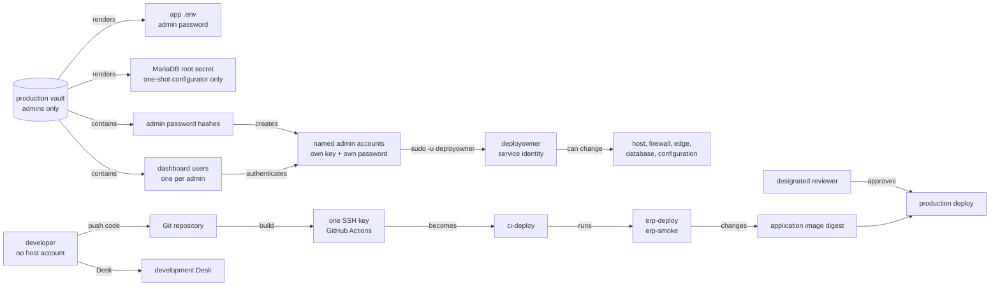

# Secrets and access

This document is the complete inventory of credentials for the stack, where each
one lives, who can use it, and how to replace it. If a credential is not in this
document, it should not exist.

> **Target state.** This page describes the system as it is meant to be. The
> remaining code work is tracked in [`IMPLEMENTATION.md`](../IMPLEMENTATION.md).
> When this page and the code disagree, this page is authoritative.

One rule governs every credential: **a secret belongs to exactly one lane.**
Infrastructure secrets live with Lane 1 admins on their control machines. The
pipeline holds one SSH key and no passwords or application secrets. Developers
hold no server credential at all.

If a term is unfamiliar, [`GLOSSARY.md`](GLOSSARY.md) defines it. For the role
that consumes each secret, see [`ROLES.md`](ROLES.md) and the role pages it links
to.

## If you only need one thing

| I need to... | Go to |
|---|---|
| Set up the vault | [Vault layout](#vault-layout) |
| Set up GitHub | [GitHub configuration](#github-configuration) |
| Rotate a credential | [Rotation](#rotation) |
| Add or remove a person | [Team onboarding and offboarding](#team-onboarding-and-offboarding) |
| Recover from a lost key, password or vault | [Break-glass](#break-glass) |
| Respond to a leak | [If a secret leaks](#if-a-secret-leaks) |

## Edge modes and credentials

The certificate method decides whether you need a Cloudflare token.

| Mode | Cloudflare token | Certificate |
|---|---|---|
| Direct | No | Let's Encrypt HTTP-01 |
| Cloudflare DNS, no proxy | Yes, `Zone:Zone:Read` and `Zone:DNS:Edit` | Let's Encrypt DNS-01 |
| Cloudflare proxy | Yes, `Zone:Zone:Read` and `Zone:DNS:Edit` | Let's Encrypt DNS-01 |

The token is a DNS credential, not a proxy credential. It is used to write the ACME TXT record. It is not needed in direct mode.

Every mode also needs the ACME account email in `vault_cloudflare_email`. Despite its name, this is the Let's Encrypt account contact used by both HTTP-01 and DNS-01. It is not a Cloudflare credential.

---

## Principles

1. **Nothing confidential in the repository is usable without a vault password.** Every environment vault is either encrypted or untracked. Password files are ignored by git.
2. **The pipeline holds one key.** It has no vault password, no sudo password, and no application secret. The key can run two fixed commands.
3. **The admin roster is not public.** Admin account names and public keys live in `vault_base_operators` in the encrypted vault, so the repository does not publish who can log in or which keys are authorised. Private keys are never committed anywhere.
4. **Identifiers are confidential too.** The domain, dashboard hostname, registry namespace, image repository, mail identity, backup bucket, SSH port, repository URL and the personal names in examples are not public values. They live in the vault, like credentials, because together they identify the site, the organisation and the people. See [ADR-026](DECISIONS.md#adr-026--confidential-identifiers-live-in-the-vault-and-the-repository-is-non-identifying).
5. **One credential, one purpose.** The CI key cannot open a root shell. `deployowner` has no login credential of its own; admins reach it only through their own `sudo`. A developer has no host credential.
6. **No shared human login and no shared human sudo password.** Every admin has a named account, their own SSH key and their own password. Revoking one person does not require changing a secret that everyone else knows.
7. **Rotate by replacing, not by editing history.** A leaked secret is rotated, not "removed from the latest commit."

---

## Inventory

### Credentials held by admins (Lane 1)

| Secret | Lives in | Used by | Notes |
|---|---|---|---|
| Production vault password | Each admin's password manager, plus a sealed copy in a safe or emergency-access vault controlled by the team | `ansible-vault` on an admin's control machine | Decrypts every production secret below. Losing it means rebuilding the host or recovering the password from the sealed copy |
| Admin sudo password | Each admin's own password manager | `--become-password-file`; ordinary `sudo` | The admin's own Unix password. It authenticates `sudo`; `deployowner` has no password of its own |
| Admin SSH private key | Each admin's own machine or hardware token | SSH to the hosts | Never committed and never copied to a server |
| Admin accounts and public keys | `vault_base_operators` in the environment vault | `server.yml` when it creates or rebuilds an admin account | Names and public keys are kept out of the public repository. The production vault is committed only in encrypted form; the development vault is not tracked at all |
| Admin password hashes | `vault_operator_password_hashes` in the environment vault | `server.yml` when it creates or rebuilds an admin account | Yescrypt hashes. The plaintext stays with the admin |
| Development vault password | Held by admins; may be stored in the team password manager for continuity | `ansible-vault` for `dev` | Development secrets only. It still gives no production access. Developers do not need it for local work |
| Cloudflare API token | `vault_cf_token` | Traefik ACME DNS-01 | Scope: `Zone:Zone:Read` and `Zone:DNS:Edit` for one zone. Only for Cloudflare DNS modes. Not used in direct mode |
| ACME account email | `vault_cloudflare_email` | Let's Encrypt account contact | Used in every mode. Despite its name, it is not a Cloudflare credential |
| Traefik dashboard users | `vault_traefik_dashboard_users` | Traefik dashboard basic auth | Map of named admin to bcrypt hash. The role renders one `user:hash` file; there is no shared `admin` login |
| CrowdSec Traefik/AppSec key | `vault_crowdsec_key` | Traefik bouncer and AppSec, `cscli` | One key authenticates the Traefik bouncer to LAPI and AppSec. A mismatch returns `401` and blocks all HTTP traffic |
| CrowdSec host firewall key | `vault_crowdsec_firewall_key` | Host firewall bouncer | Separate from the Traefik key. Used only by `firewall-host` on loopback |
| Telegram bot token | `vault_telegram_bot_token` | CrowdSec HTTP notification plugin | Created in BotFather. Part of the Telegram API URL, so it is stored in a file, not a command line |
| Telegram chat ID | `vault_telegram_chat_id` | CrowdSec HTTP notification plugin | Destination chat or channel. Not secret by itself, but kept in the vault for one reviewable inventory |
| MariaDB root password | `vault_db_root_password`, and `<base_dir>/mariadb/secrets/db_root_password` on the host | MariaDB container, one-shot site configurator, backup script | Used for provisioning and recovery, not by the runtime application. Mounted through a Compose `file:` secret. Changing the vault alone does **not** change the database user |
| Frappe site database user | Generated by Frappe at site creation and stored in `sites/<site>/site_config.json` | Backend, workers and scheduler | Not in the vault. The database is also generated; read `.db_name` and `.db_user // .db_name`. Scoped to one database and the `172.30.%.%` host range. Treat `site_config.json` as a secret |
| InnoDB encryption key | `vault_db_encryption_key` | MariaDB container | Base64. Data is unreadable without it |
| InnoDB key password | `vault_db_key_password` | MariaDB container | Protects the key above |
| Frappe administrator password | `vault_admin_password`, and `.env` on the host | Site initialisation and break-glass only | Changing the vault alone does **not** change the existing admin login. Admins use their own Desk users for daily work |
| Frappe mail password | `vault_mail_password`, `<base_dir>/erp/secrets/mail_password` on the host, and `sites/<site>/site_config.json` at runtime | One-shot site configurator writes it; backend, workers and scheduler read it to send mail | Not in `.env` or the Compose environment. Mounted only into the configurator. Treat `site_config.json` as a secret |
| Backup access key ID | `vault_backup_access_key_id` | rclone on the host | Object storage, scoped to one bucket |
| Backup secret access key | `vault_backup_secret_access_key` | rclone on the host | Same |

The `sites.tar.gz` backup contains `site_config.json`, including the site database
password, the mail password and the site encryption key. The backup bucket and the
local staging directory are secret. Keep the bucket private, use encryption at
rest and TLS in transit, and do not copy an archive to a shared drive or an
untrusted workstation.

### Why Redis has no entry

Redis is not in this inventory because it has no password. Both Redis services are reachable only on `erp-cache`, an internal network with no gateway. There is no host port and no TLS between Frappe and Redis.

That makes the network boundary the credential. Do not attach the frontend, Traefik, CrowdSec, MariaDB or an unrelated container to `erp-cache`, and do not publish port `6379`. Queue payloads can contain business data, so Redis is sensitive even without a login prompt. See [`roles/redis.md`](roles/redis.md#why-redis-has-no-password).

### Credentials held by the pipeline (Lane 2)

| Secret | Lives in | Readable by | Scope |
|---|---|---|---|
| `ci-deploy` private key | GitHub Environment secret `CI_DEPLOY_SSH_KEY` in both environments | The development and production deploy jobs | SSH as `ci-deploy`; sudo for two scripts |
| App repository dispatch token | App repository secret | The app repository's build job | `Actions: write` on this repository only |

That is the entire list. There is no vault password, no sudo password, and no application secret in GitHub.

### Confidential identifiers

These values are not cryptographic secrets, but publishing them reveals the
site, the host, the organisation or the people. They live in the environment
vault next to the credentials, and the tracked configuration only references
them.

| Value | Vault key | Why it is confidential |
|---|---|---|
| Application domain and site name | `vault_domain`, `vault_site_name` | Names the live site. DNS and certificate transparency make a domain easy to find once it is known |
| Dashboard hostname | `vault_traefik_dashboard_host` | Names the private admin surface |
| Mail server, login and sender name | `vault_mail_server`, `vault_mail_login`, `vault_mail_sender_name` | Identifies the business in every outbound message |
| SSH port | `vault_ssh_port` | Removes one obstacle for a scanner |
| Registry namespace and image repository | `vault_app_image_repository` | Names the registry account the business owns |
| Backup remote, bucket and endpoint | `vault_backup_remote_name`, `vault_backup_bucket`, `vault_backup_endpoint` | Names the storage account and its provider |
| CI deploy public keys | `vault_ci_deploy_authorized_keys` | Key comments and fingerprints identify the operator |
| Admin names and public keys | `vault_base_operators` | Names the people who can log in |
| Traefik dashboard usernames | `vault_traefik_dashboard_users` | Same |
| ACME account email | `vault_cloudflare_email` | Personal or organisational contact address |

Shared aliases in `group_vars/all/main.yml`, environment-specific settings in
`group_vars/<env>/main.yml`, and role defaults contain indirection such as:

```yaml
domain: "{{ vault_domain | mandatory }}"
erp_image_repository: "{{ vault_app_image_repository | mandatory }}"
```

`mandatory` is deliberate. A missing vault key must stop the run, not silently
fall back to a value that could be real.

### Public values committed to git

These are the only values that are safe to publish, because they come from an
upstream project or a reserved documentation range:

| Value | Where | Why it is safe |
|---|---|---|
| Upstream image names and versions | `group_vars/all/main.yml`, role defaults | Published by the upstream projects; they do not name this deployment |
| Cloudflare IP ranges | `group_vars/all/main.yml` | Published by Cloudflare |
| `127.0.0.1`, `10.0.0.0/8`, `172.16.0.0/12`, `192.168.0.0/16` | `group_vars/all/main.yml` | Reserved or private ranges |
| `example.com`, `example-org`, `example-registry`, `alice` | Documentation and `examples/` | RFC 2606 and RFC 2606-style placeholders. They are never real values |

### What must never be committed

Before every commit, confirm that the change does not add any of these to a
tracked file:

- a real domain, subdomain or dashboard hostname;
- a real host IP, SSH port or SSH login name;
- an organisation, registry, bucket, remote or repository name;
- a personal name, email address or GitHub handle;
- an SSH public key or its comment;
- an API token, password, private key or password hash outside an encrypted
  vault;
- a screenshot, log excerpt or issue link that contains any of the above.

`scripts/check-sensitive.sh` enforces the structural rules. It cannot know the
real values without being told them, so set `SENSITIVE_PATTERNS` (a
newline-separated list) locally or as a repository secret to enforce the value
check as well.

### What is on the server

| Path | Mode / owner | Contains |
|---|---|---|
| `<base_dir>/erp/.env` | `0600 deployowner` | Frappe admin password; no MariaDB root password and no mail password |
| `<base_dir>/erp/secrets/mail_password` | `0600 deployowner` | SMTP password, mounted only into the one-shot configurator |
| `<base_dir>/mariadb/.env` | `0600 deployowner` | InnoDB key material; no root password |
| `<base_dir>/mariadb/secrets/db_root_password` | `0600 deployowner` | MariaDB root password, mounted only into MariaDB and the one-shot configurator |
| `<base_dir>/traefik/secrets/crowdsec-lapi-key` | `0600 deployowner` | Traefik/AppSec bouncer key. Mounted as a Compose secret at `/run/secrets/crowdsec_lapi_key` |
| `<base_dir>/crowdsec/telegram.yaml` | `0600 root` | Telegram bot token, chat ID and message template |
| `/etc/crowdsec/bouncers/crowdsec-firewall-bouncer.yaml` | `0600 root` | Host firewall bouncer key and loopback LAPI URL |
| `/root/.config/rclone/rclone.conf` | `0600 root` | Object storage keys |
| `/etc/erp/deploy.conf` | `0600 root` | Paths and site name used by the deploy scripts. No secrets |
| `/var/log/erp-deploys.log` | `0600 root` | Deploy history, not credentials |

`deployowner` owns the stack, the two `.env` files, the MariaDB root secret and
the mail secret, and admins can read them by becoming `deployowner`. The Traefik
secret file is also `deployowner`-owned; Compose mounts it into the container
without putting the key in the dynamic config or the container environment. The
host firewall bouncer configuration is root-owned because the service runs as
root. The deploy config, deploy log and rclone config are root-owned; an admin can
read them with `sudo`. `ci-deploy` cannot read any of these files, and developers
have no host account at all.

The root secret is mounted only into the MariaDB container and the one-shot
configurator. The mail secret is mounted only into the one-shot configurator.
Neither is in `erp/.env` or in the environment of the backend, workers or
scheduler. The runtime application uses the per-site database user and reads the
mail password from `sites/<site>/site_config.json`.

### Compose secrets, not Swarm secrets

This deployment uses standalone Docker Compose, not Swarm. A service-level
`secrets:` entry with `file:` is a bind mount at `/run/secrets/<name>`. It does not
appear in `docker secret ls`, Docker does not encrypt it, and rotating it means
rewriting the host file and recreating the service. The protection is the host
file mode (`0600`), its owner (`deployowner`) and the service that mounts it, not
Docker's secret store.

The MariaDB root secret and the mail secret use this mechanism. Only the MariaDB
container and the one-shot configurator mount the root secret; only the
configurator mounts the mail secret. The application `.env` holds none of them.

Commands in this document that run on a host assume a root shell (`sudo -i`, using your own password) or a `sudo` prefix. Stack commands can also run as `sudo -u deployowner`.

---

## Vault layout

The system uses one vault per environment, with a matching vault-id:

```text
group_vars/development/vault.yml   vault-id: dev   gitignored, created locally
group_vars/production/vault.yml    vault-id: prod  tracked, encrypted
```

`examples/vault.development.yml` and `examples/vault.production.yml` are the
tracked templates. They contain only placeholders and are also the CI fixtures:
CI copies them over the two vault paths inside the ephemeral runner, which is
how linting resolves every variable without a vault password.

To create the development vault on a control machine:

```bash
cp examples/vault.development.yml group_vars/development/vault.yml
# fill in the real values
ansible-vault encrypt --vault-id dev@prompt group_vars/development/vault.yml
```

The development vault is deliberately not tracked. It is the file an operator
is most likely to fill in on a laptop, so keeping it out of git removes the
chance of a plaintext commit. The production vault is tracked because it is
encrypted and needs to be identical for every admin.

`ansible.cfg` sets `vault_id_match = True`. A production password cannot open the development vault, and the reverse is also true. Passing both `--vault-id` flags removes that guarantee, which is why every command in the runbook passes exactly one.

The development vault uses `dev` and the production vault uses `prod`. Never store the password next to the vault file.

Shared aliases do not mean shared secret storage. For example, the common
`domain` alias in `group_vars/all/main.yml` resolves `vault_domain` from the
selected host's environment vault. Keep development values in the development
vault and production values in the production vault, even when both use the same
key names. Run Ansible with the matching environment limit and exactly one
vault ID; do not add a shared `group_vars/all/vault.yml` just to avoid repeating
keys, because that would weaken the current environment separation.

Every key required by the tracked configuration is listed in the example
vaults. `scripts/check-sensitive.sh` fails if a referenced `vault_*` variable is
missing from them, so a new identifier cannot be added to the code without a
matching template entry.

The vault also holds the confidential identifiers from the table above. They
are mixed with the credentials on purpose: one encrypted file per environment
is easier to review and rotate than a second store for "sensitive but not
secret" values.

The production vault predates ADR-026. Add `vault_domain`,
`vault_site_name`, `vault_traefik_dashboard_host`, `vault_ssh_port`,
`vault_app_image_repository`, `vault_mail_server`, `vault_mail_login`,
`vault_mail_sender_name`, `vault_backup_remote_name`, `vault_backup_bucket`,
`vault_backup_endpoint` and `vault_ci_deploy_authorized_keys` to it with
`ansible-vault edit --vault-id prod@prompt group_vars/production/vault.yml`
before the next production run. Missing keys fail the run through `mandatory`.

The vault also holds `vault_base_operators`: the admin account names and their public keys. They are kept here so the repository does not publish who can log in or which keys are authorised. The shared `base_operators` alias in `group_vars/all/main.yml` resolves the value from the selected environment vault. Each entry has a `name` and a list of `keys`.

The vault also holds `vault_operator_password_hashes`: one yescrypt hash per admin, keyed by account name. The plaintext password is never stored in the vault. Each admin keeps their own password in their password manager and supplies it through `--become-password-file` when they run Ansible.

`vault_traefik_dashboard_users` holds one bcrypt hash per admin for the private Traefik dashboard. It is a separate credential from the Linux password hash and is not a shared login.

`vault_mail_password` is the SMTP password. The role renders it to the mail
secret file; it is not the Frappe administrator password and is not in the
application `.env`.

### Everyday operations

```bash
# read
ansible-vault view --vault-id prod@prompt group_vars/production/vault.yml

# edit in place
ansible-vault edit --vault-id prod@prompt group_vars/production/vault.yml

# change the password without decrypting to a file
ansible-vault rekey --vault-id prod@prompt --new-vault-id prod@prompt \
  group_vars/production/vault.yml
```

Never decrypt to a file inside the repository. If you must decrypt for a tool that cannot read vaults, write to `/tmp` with mode `0600` and shred it afterwards.

---

## GitHub configuration

### Environments

Create two environments under **Settings → Environments**.

**`development`**

| Setting | Value |
|---|---|
| Required reviewers | none |
| Deployment branches | `main` |
| Secrets | `CI_DEPLOY_SSH_KEY` |
| Variables | `TARGET_SERVER_HOST`, `CI_DEPLOY_USER`, `SSH_PORT` |

**`production`**

| Setting | Value |
|---|---|
| Required reviewers | one designated reviewer |
| Prevent self-review | **on** |
| Deployment branches | `main` only |
| Wait timer | A wait timer is optional. Zero is acceptable because a human reviews every deployment. |
| Secrets | `CI_DEPLOY_SSH_KEY` |
| Variables | `TARGET_SERVER_HOST`, `CI_DEPLOY_USER`, `SSH_PORT` |

`CI_DEPLOY_USER` is `ci-deploy`. It is a username, not a secret, so it belongs in Variables. The same key pair serves both environments, and the public half is installed on both hosts.

When the designated reviewer triggers a production run, self-review blocks the approval. That run uses the audited control-machine path instead. A second reviewer is optional; when present, the pipeline can also handle the designated reviewer's own runs without changing this policy.

No environment holds `VAULT_PASSWORD`, `BECOME_PASSWORD`, or any application secret. The pipeline deploys an image; it does not run Ansible.

### Repository settings

| Setting | Value | Why |
|---|---|---|
| Branch protection on `main` | Require PR, require review from an admin, no force-push, no deletion | The pipeline only runs from `main` |
| `CODEOWNERS` on `.github/workflows/**` | An admin | A developer cannot change what a production job executes without review |
| Actions → General | Read-only `GITHUB_TOKEN`, no secrets to fork PRs | This is standard hardening |
| Actions → General | Allow only actions in the allowlist you use | Reduces supply-chain surface |
| Environment secrets | Never duplicated at repository level | Repository secrets are exposed to every workflow |

### Generating the CI key

Generate the key on an admin's control machine, never on a server:

```bash
ssh-keygen -t ed25519 -C "ci-deploy@github" -f /tmp/ci_deploy -N ''
```

- `/tmp/ci_deploy.pub` → add it to `vault_ci_deploy_authorized_keys` in the vault of both environments (`ansible-vault edit --vault-id dev@prompt ...` and `--vault-id prod@prompt ...`), then run `playbooks/server.yml` against each one.
- `/tmp/ci_deploy` (private) → GitHub Environment secret `CI_DEPLOY_SSH_KEY` in both `development` and `production`.
- Delete the local copy with `shred -u /tmp/ci_deploy` after the key is stored and tested.

The public key lives in the vault rather than in `group_vars/<env>/main.yml` because a key comment or fingerprint identifies the operator. It is not a credential, but it is an identifier. The private key never touches the repository, the server, or your shell history.

---

## Rotation

This section owns the rotation procedure for every credential. Role pages link
here instead of repeating the steps. Run the commands from an admin's control
machine. Every `ansible-playbook` command is written out in full; there are no
shell aliases. The examples use production. For development, change
`--limit production` to `--limit development`, `-e target_env=production` to
`-e target_env=development`, and `prod@` to `dev@`. Never pass both vault ids in
one run.

### CI deploy key

```bash
# 1. generate a replacement
ssh-keygen -t ed25519 -C "ci-deploy@github" -f /tmp/ci_deploy_new -N ''

# 2. replace the key in the vault of both environments
#    vault_ci_deploy_authorized_keys (dev and prod)

# 3. install it
export TARGET_SERVER_HOST=... SSH_LOGIN_USER=<your-admin> DEPLOY_OWNER_USER=deployowner
ansible-playbook -i inventory/inventory.yml --limit production -e target_env=production \
  --vault-id prod@/tmp/vault_pass --become-password-file /tmp/become_pass \
  --private-key ~/.ssh/id_ed25519 playbooks/server.yml

# 4. replace the GitHub secret in both environments with the private half
# 5. delete the local copy
shred -u /tmp/ci_deploy_new
```

Run step 3 for development as well, with the development vault-id. The old key stops working on a host as soon as step 3 completes there, because `authorized_keys` is written with `exclusive: true`.

### Admin password

Each admin rotates their own password. There is no shared owner password to coordinate.

```bash
# 1. on a host, as the admin whose password is changing
passwd

# 2. produce a hash of the new password
#    (mkpasswd comes from the whois package on Ubuntu)
mkpasswd -m yescrypt

# 3. put that hash in the environment vault under the admin's name
ansible-vault edit --vault-id prod@prompt group_vars/production/vault.yml
#    vault_operator_password_hashes:
#      alice: <new hash>

# 4. update the password manager entry and, for this session, /tmp/become_pass
```

The hash in the vault is used when the account is first created and when a rebuild recreates it. It is not re-applied to an existing account on every run, so changing your password with `passwd` does not get overwritten. Keep the vault hash in step with the real password; otherwise a rebuilt host will come back with the old one. Repeat the vault update for each environment where you have an admin account.

If the password may be compromised, do not wait for a scheduled rotation. Ask another admin to reset it from the provider console, or run `sudo passwd <admin>` from a root console, then update the vault and check the `sudo` and SSH logs. Nothing in CI depends on this password, so there is no pipeline change.

### Vault password

```bash
ansible-vault rekey --vault-id prod@prompt --new-vault-id prod@prompt \
  group_vars/production/vault.yml
```

Then update the password manager, the sealed copy, and every admin who holds the old password. The secrets inside are unchanged. Only the wrapper is new. Do this immediately if the old password may have been exposed.

### MariaDB root password

The container reads the root secret only when the data directory is initialised and when a client reads the mounted secret file. Updating the vault and re-running Ansible changes the secret file but not the database user. Use this order:

```bash
# 1. change it in the database first, reading the current secret from the file
docker exec -it mariadb-database sh -c \
  'MYSQL_PWD="$(cat /run/secrets/db_root_password)" exec mariadb -uroot'
#    ALTER USER 'root'@'localhost' IDENTIFIED BY '<new>';
#    ALTER USER 'root'@'%' IDENTIFIED BY '<new>';
#    FLUSH PRIVILEGES;

# 2. update the vault
ansible-vault edit --vault-id prod@prompt group_vars/production/vault.yml

# 3. rewrite the secret file and restart
ansible-playbook -i inventory/inventory.yml \
  --limit production -e target_env=production \
  --vault-id prod@/tmp/vault_pass \
  --become-password-file /tmp/become_pass \
  --private-key ~/.ssh/id_ed25519 \
  playbooks/site.yml
```

Until step 3, the container still has the old file mount. That is why the order
matters. The runtime application does not use the root password, so it does not
need a restart for this change.

### Frappe administrator password

The process is the same. The vault value is used at site initialisation, not on every start.

The built-in `Administrator` user is the break-glass application account, not a daily shared login. Each admin should have a personal Frappe Desk user with the role their work needs. Use `Administrator` only when a personal account cannot recover the site, and record why.

```bash
docker compose -f <base_dir>/erp/compose.yaml exec backend \
  bench --site <site> set-admin-password '<new>'
# then update vault_admin_password and re-run site.yml for the record
```

### Frappe site database user

The site database and user names are generated by Frappe and stored in
`<sites-volume>/<site>/site_config.json`. They are not in the vault. Read
`.db_name` and `.db_user // .db_name`; do not assume `frappe`. Rotate only during
a maintenance window, because the backend and workers must pick up the new value
together.

```bash
# 1. take a backup

# 2. read the identity from the site config
DB_NAME=...
DB_USER=...

# 3. change the database user interactively; the new password is not in shell history
docker exec -it mariadb-database sh -c \
  'MYSQL_PWD="$(cat /run/secrets/db_root_password)" exec mariadb -uroot'
#    ALTER USER '<db_user>'@'172.30.%' IDENTIFIED BY '<new>';
#    FLUSH PRIVILEGES;

# 4. write the new password to a 0600 file and run the one-shot rotation path.
#    It reads the file and updates site_config.json. Do not use
#    `bench set-config db_password <value>`: that exposes the password in
#    process arguments.

# 5. recreate the services that use the site
docker compose -f <base_dir>/erp/compose.yaml up -d backend \
  queue-short queue-long scheduler websocket
```

Confirm that `site_config.json` has the new value and that a normal request and a
background job both succeed. The root password is not used in this rotation.

### Frappe mail password

The mail password has two copies: the host Compose secret at
`<base_dir>/erp/secrets/mail_password`, and `mail_password` in
`site_config.json` for the runtime processes. Update both in one maintenance
window.

```bash
# 1. update vault_mail_password and re-render the host secret file
ansible-playbook -i inventory/inventory.yml \
  --limit production -e target_env=production \
  --vault-id prod@/tmp/vault_pass \
  --become-password-file /tmp/become_pass \
  --private-key ~/.ssh/id_ed25519 \
  playbooks/site.yml

# 2. run the one-shot site-config rotation path.
#    It reads /run/secrets/mail_password and updates site_config.json.
#    Do not use `bench set-config mail_password <value>`: that exposes the
#    password in process arguments.

# 3. recreate the services that send or queue mail
docker compose -f <base_dir>/erp/compose.yaml up -d backend \
  queue-short queue-long scheduler websocket
```

Send a test message from Desk and confirm the provider accepted it. If the old
password was exposed, revoke it at the SMTP provider before step 1. The
configurator never prints the mail password.

### Cloudflare token

Create a replacement token with `Zone:Zone:Read` and `Zone:DNS:Edit` scoped to the zone, update `vault_cf_token`, and run `playbooks/traefik.yml`. Traefik re-requests certificates on its own schedule. Restart the container to force a re-request if the old token must be revoked immediately. This section applies only to Cloudflare DNS modes. Direct mode has no token.

### Traefik dashboard users

Each admin has their own dashboard username and bcrypt hash in `vault_traefik_dashboard_users`. The role renders one `user:hash` line per admin into a Compose secret; the dashboard middleware reads it with `basicAuth.usersFile`. There is no shared `admin` credential.

```yaml
vault_traefik_dashboard_users:
  alice: "$2y$..."
  bob: "$2y$..."
```

```bash
# prompts for the password, so it does not enter shell history
htpasswd -B -C 12 -n <admin-name>
# output: <admin-name>:$2y$...
# store only the hash under that name in the vault map
```

Update the map and run `playbooks/traefik.yml`. Remove the admin's line when they leave, then run the playbook again. The playbook restarts the edge briefly, so do it outside a deploy window. A dashboard password is separate from the admin's Linux and sudo password.

### CrowdSec keys

#### Traefik and AppSec key

The Traefik bouncer and AppSec share one key. A mismatch returns `401` from AppSec and blocks every HTTP request, so rotate this key in a maintenance window.

The role registers the Traefik bouncer with the vault key and verifies it
afterwards, so a rotated key is applied rather than silently ignored.

```bash
# 1. update vault_crowdsec_key
# 2. re-register the Traefik bouncer and rewrite its secret file
ansible-playbook -i inventory/inventory.yml \
  --limit production -e target_env=production \
  --vault-id prod@/tmp/vault_pass \
  --become-password-file /tmp/become_pass \
  --private-key ~/.ssh/id_ed25519 \
  playbooks/crowdsec.yml
ansible-playbook -i inventory/inventory.yml \
  --limit production -e target_env=production \
  --vault-id prod@/tmp/vault_pass \
  --become-password-file /tmp/become_pass \
  --private-key ~/.ssh/id_ed25519 \
  playbooks/traefik.yml
# 3. verify LAPI, AppSec and a normal request
ansible-playbook -i inventory/inventory.yml \
  --limit production -e target_env=production \
  --vault-id prod@/tmp/vault_pass \
  --become-password-file /tmp/become_pass \
  --private-key ~/.ssh/id_ed25519 \
  playbooks/smoke.yml
```

If `smoke.yml` reports that the bouncer key was rejected, or if normal requests return `403`, the old bouncer or the old secret is still in use. Remove it with `cscli bouncers delete traefik`, re-run `crowdsec.yml` and `traefik.yml`, then verify AppSec is not returning `401`.

#### Host firewall key

The host firewall key is separate. Rotating it does not affect HTTP traffic.

```bash
# update vault_crowdsec_firewall_key, then
ansible-playbook -i inventory/inventory.yml \
  --limit production -e target_env=production \
  --vault-id prod@/tmp/vault_pass \
  --become-password-file /tmp/become_pass \
  --private-key ~/.ssh/id_ed25519 \
  playbooks/crowdsec.yml
sudo systemctl restart crowdsec-firewall-bouncer
docker exec crowdsec cscli bouncers list
```

`firewall-host` must show a recent `Last API pull`. If it does not, the config still has the old key or the service is not reading it.

### Telegram bot token and chat ID

Create or revoke the bot in BotFather. If the destination changes, update the chat ID too.

```bash
# update vault_telegram_bot_token and, if needed, vault_telegram_chat_id
ansible-playbook -i inventory/inventory.yml \
  --limit production -e target_env=production \
  --vault-id prod@/tmp/vault_pass \
  --become-password-file /tmp/become_pass \
  --private-key ~/.ssh/id_ed25519 \
  playbooks/crowdsec.yml
docker exec crowdsec cscli notifications test telegram
```

The playbook restarts CrowdSec to load the new notification file. Because AppSec is fail-closed, use a maintenance window. Confirm the test message arrives and the old token no longer works. The bot token is part of the Telegram API URL; it must not be pasted into a shell command that is recorded in history.

### Backup keys

Create a new access key in the object storage console, update both `vault_backup_*` values, run `playbooks/backup.yml`, then:

```bash
systemctl start erp-backup
journalctl -u erp-backup -n 50
```

Revoke the old key only after a successful upload.

### App repository dispatch token

Revoke the fine-grained PAT, create a new one scoped to this repository with `Actions: write`, and update the app repository secret. A repository dispatch that fails with `401` is almost always this token.

---

## Team onboarding and offboarding

### Giving someone development access

No server change is required. A developer is not a host user.

1. Give them repository write access.
2. Create a Frappe Desk user for them in the development environment, with the role their work needs. System Manager is appropriate in development.
3. Point them at [`DEVELOPMENT.md`](DEVELOPMENT.md) so they can run the stack locally.

They can push code, let CI deploy the development image, and use the development Desk. They cannot SSH to a shared host, read the vault, or use Docker on a server.

Do **not** add them to `vault_base_operators` or `vault_ci_deploy_authorized_keys`. Those lists are for admins and the pipeline, not for developers.

### Giving someone admin access

Admin access is a host change, and it is granted per environment.

1. Add the person's name and public key to `vault_base_operators` in that environment's vault.
2. Generate a yescrypt hash of an initial password and add it to `vault_operator_password_hashes` in the same vault.
3. Run `playbooks/server.yml` against that environment. The commands are in [`RUNBOOK.md`](RUNBOOK.md#8-first-provision--run-as-root) and [`RUNBOOK.md`](RUNBOOK.md#181-add-an-admin).
4. Give the initial password to the person out of band. Ask them to run `passwd` at their first login. They can then update the vault hash themselves, or send the new hash to an existing admin if they do not have vault access yet.
5. Add their dashboard username and a bcrypt hash to `vault_traefik_dashboard_users`, then run `playbooks/traefik.yml`. Give them the dashboard password out of band; it does not have to match their Linux password.
6. Create a personal Frappe Desk user for them with the role their work needs. In production this may include System Manager for admins. Do not give them the shared `Administrator` password.
7. If they will be an additional production reviewer, add them to the GitHub `production` environment.
8. Give them the environment vault password through the agreed password-manager or sealed-copy process.

There is no shared login to add them to and no shared owner password to disclose.

### Giving someone production *request* access

No server change is required. Repository write access plus the ability to dispatch the workflow is enough. Their request waits for the designated reviewer.

Do **not** add their key to `vault_ci_deploy_authorized_keys`. That list is for the pipeline only.

### Removing someone

If the person is an **admin**:

1. Remove their entry from `vault_base_operators` and `vault_operator_password_hashes` in every environment they could access.
2. Run `playbooks/server.yml` against each of those environments. The role removes the account, its home directory and its keys from the host.
3. Remove their entry from `vault_traefik_dashboard_users` and run `playbooks/traefik.yml` so the old dashboard credential stops working.
4. Remove repository access, GitHub reviewer status, and Desk access.
5. If they ever held an environment vault password, rekey that vault.
6. Check `journalctl -u ssh`, `last`, and the sudo log for unfamiliar activity.

If the person is a **developer**:

1. Remove repository access.
2. Disable their Frappe Desk user in development.
3. No server change is needed, because they never had a host account.

Removing a name or key from YAML without running `server.yml` changes nothing on the server.

---

## Break-glass

### The reviewer or an admin is unavailable

The designated reviewer approves a deployment that is waiting for review. If that reviewer is unavailable and a production deploy cannot wait, an admin may use the audited control-machine path. If no admin can reach a host during a production incident, the only option is the provider console as root. That requires credentials held by an admin, so provisioning waits until an admin is available.

There is no shared human account or shared owner password to fall back to. That is deliberate: a shared fallback would remove the attribution the admin accounts provide.

### An admin's control machine is lost

1. Clone this repository on another machine.
2. Install `ansible-core` and the collections.
3. Restore the vault password from the password manager or sealed copy.
4. Recreate your own SSH key, `~/.ssh/id_ed25519`, from your key backup or hardware token.
5. Continue from `docs/RUNBOOK.md`.

Losing the laptop does not affect a running production stack.

### The vault password is lost

There is no recovery from the encrypted file alone. The options are:

- restore the password from the sealed copy held by the admins, or
- rebuild the host with new secrets and restore data from backup.

This is why the sealed copy exists. Store it offline, in a safe or a password manager's emergency-access feature controlled by the team. Do not store it in the repository or on the server.

### CrowdSec or AppSec is unavailable

An AppSec outage is an HTTP outage by design. Do not disable the WAF as the permanent recovery. Use the provider console if SSH is also blocked, restart CrowdSec, and verify LAPI, AppSec and the bouncer keys. If the cause is a bad rule or update, roll back to the previous known-good state and restore the WAF before closing the incident.

### GitHub is unavailable

Deploy from an admin's control machine using the same digest:

```bash
ansible-playbook -i inventory/inventory.yml --limit production -e target_env=production \
  -e erp_image=sha256:<digest> \
  --vault-id prod@/tmp/vault_pass --become-password-file /tmp/become_pass \
  --private-key ~/.ssh/id_ed25519 playbooks/update.yml
```

`erp_image` is the image identity and must be a `sha256:` digest. The digest
is recorded in `/var/log/erp-deploys.log` and in the last successful run
summary. `erp_image_version` is only a human-readable label; it is not a
deploy target. See ADR-004 in [`DECISIONS.md`](DECISIONS.md#adr-004--pin-by-digest-not-tag).

That path needs the vault, which is exactly why it is not the pipeline's path.

---

## If a secret leaks

| Leaked | First action | Then |
|---|---|---|
| `ci-deploy` private key | Remove the public key from `vault_ci_deploy_authorized_keys` in both environments, run `server.yml` against both | Generate a new pair, update the GitHub secret in both environments, review the deploy log and Actions runs |
| SSH private key of an admin | Replace the public key in that admin's `vault_base_operators` entry, run `server.yml` against the affected environments | If the password may also be exposed, reset it; check `journalctl -u ssh` and `last` for unfamiliar logins |
| Admin sudo password | Reset it with `passwd` from another admin session or a root console | Update `vault_operator_password_hashes`, check the sudo log, and review host changes |
| Production vault password | Rekey the vault immediately | Rotate every secret inside it, starting with the database and admin passwords |
| Cloudflare token | Revoke in the Cloudflare dashboard | Issue a new token, update the vault, run `traefik.yml` |
| Traefik dashboard credential | Remove that admin's entry and re-run `traefik.yml` | Generate a new hash, update `vault_traefik_dashboard_users`, re-run `traefik.yml`, verify the old password fails |
| CrowdSec Traefik/AppSec key | Treat it as a total HTTP outage risk | Rotate in a maintenance window: update `vault_crowdsec_key`, re-register `traefik`, rewrite the Compose secret, verify AppSec and a normal request |
| CrowdSec host firewall key | Stop the host bouncer if it cannot be trusted, or rotate immediately | Update `vault_crowdsec_firewall_key`, re-register `firewall-host`, restart the service |
| Telegram bot token | Revoke it in BotFather | Create a new bot or token, update the vault, run `crowdsec.yml`, run `cscli notifications test telegram` |
| MariaDB root password | Change it in MariaDB first | Update the vault, run `site.yml`, verify a backup and the one-shot configurator |
| Frappe site database password | Change it in MariaDB and `site_config.json` first | Recreate the services that use the site; verify a request and a background job |
| Frappe mail password | Revoke it at the SMTP provider | Update the vault, rotate the host secret and site config through the one-shot path, recreate the mail-using services, send a test |
| `site_config.json` | Treat the site database and mail credentials as exposed | Rotate the site database user and mail password; if integrity is in doubt, restore the sites volume and database from a trusted backup |
| Frappe administrator password | Change it in the running service first | Update the vault, run `site.yml`, verify with `smoke.yml` |
| Object storage keys | Revoke at the provider | New keys in the vault, run `backup.yml`, take a manual backup |
| Backup archive (`sites.tar.gz`) | Treat the site database and mail credentials as exposed | Rotate the site user and mail password; delete or recall the archive; restore only from a trusted copy |
| Dispatch token | Revoke the PAT | Issue a new one, update the app repository secret |
| Root on the server | Assume the host is compromised | Rebuild from provisioning. Do not rotate in place. Restore data from a backup taken before the compromise |

After any leak, check the host-side deploy log:

```bash
sudo cat /var/log/erp-deploys.log
```

It records timestamp, digest, actor and workflow run for every pipeline deploy, which is the fastest way to see whether the key was used.

---

## Summary: who can do what

**Figure 1 — Who can do what.** The production vault feeds the admin accounts,
the MariaDB root secret and the application `.env`; the pipeline has one key and
changes only the image digest.



| Capability | Admin | Developer | Pipeline |
|---|---|---|---|
| Approve a production deploy | yes, if the designated reviewer | no | no |
| Trigger a development deploy | yes | yes, by pushing | yes |
| Trigger a production deploy | yes | request only | yes, after approval |
| Read production app secrets | yes | no | no |
| Change host, firewall, proxy, database config | yes | no | no |
| Rotate production secrets | yes | no | no |
| SSH to a shared host | yes, with their own account | no | as `ci-deploy` only |
| Recover from a lost vault password | sealed copy held by admins | no | no |
