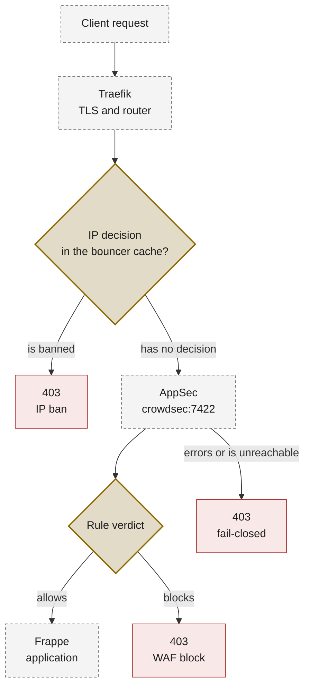

# WAF and AppSec policy

This page is for anyone who operates, tests or troubleshoots the ERP WAF,
including people who have never used CrowdSec. After reading it you can explain
what AppSec does, predict what it will and will not block, and handle a `403`
without turning the WAF off.

> **Target state.** This page describes the system as it is meant to be. The
> remaining code work is tracked in [`IMPLEMENTATION.md`](../IMPLEMENTATION.md).
> When this page and the code disagree, this page is authoritative.

## Start here

| If you need to... | Read |
|---|---|
| Understand what the WAF is and why it exists | [The WAF in plain language](#the-waf-in-plain-language) |
| Deal with a `403` right now | [The three kinds of `403`](#the-three-kinds-of-403) |
| Check whether the WAF is actually on | [Is the WAF on right now?](#is-the-waf-on-right-now) |
| Prove the WAF does not break Frappe | [Frappe workflow acceptance suite](#frappe-workflow-acceptance-suite) |
| Fix a false positive | [Handling a false positive](#handling-a-false-positive) |
| Respond to an outage or a `403` spike | [Monitoring and incident response](#monitoring-and-incident-response) |
| Change a rule or the rule set | [Rule sets and rollout](#rule-sets-and-rollout) and [Change control](#change-control) |
| Understand why production starts with the bouncer off | [Why production starts with the bouncer off](#why-production-starts-with-the-bouncer-off) |

## The WAF in plain language

### What CrowdSec AppSec is

CrowdSec is a detection engine. It reads logs and produces **decisions**, such as
"ban this address for four hours" (the general policy) or a longer SSH
brute-force ban. **Bouncers** enforce those decisions. This stack has two: the
**Traefik bouncer** for HTTP and the **host firewall bouncer** for nftables.

**AppSec** is the part of the CrowdSec engine that acts as a web application
firewall. It does not sit in front of Traefik as another proxy. For each HTTP
request, the Traefik bouncer sends the request shape to AppSec at
`crowdsec:7422` and waits for a verdict:

- **allow** — Traefik forwards the request to Frappe.
- **block** — the user gets a `403`.
- **error or unreachable** — the request is also blocked, because this stack is
  **fail-closed**.

A simple way to picture the layers:

| Real world | In this stack |
|---|---|
| Security office with a list of banned people and an incident log | CrowdSec engine and LAPI |
| Door staff checking the banned list | Traefik bouncer |
| Bag check at the door | AppSec |
| Which rooms you may enter once inside | Frappe roles and permissions |
| If the bag check is broken, the door stays locked | Fail-closed |
| Security outside the building | Host firewall bouncer |

Two distinctions confuse most newcomers:

- **A decision is not a rule match.** A decision is a temporary ban on an
  address. An AppSec rule match is a judgement about one request. Both can
  produce a `403`, but they are cleared in different ways.
- **In-band is not out-of-band.** In-band rules can block the current request.
  Out-of-band rules only produce an event or alert; they do not block that
  request. A scenario can later turn repeated events into an address decision.

> **Note.** Upstream CrowdSec documentation often tells you to create
> `appsec.yaml`, install collections by hand, and edit the Traefik plugin. In
> this repository you do not do that. `roles/crowdsec` and `roles/traefik`
> render those files. Hand edits inside a container are lost on the next run and
> cannot be reviewed. Change the role and re-run the playbook instead.

### The five things to remember

1. **AppSec inspects requests, not people.** It sees the method, path, headers
   and part of the body. It does not know your business rules.
2. **A `403` can come from three different layers.** Confirm the layer before
   changing anything.
3. **The WAF is fail-closed.** If AppSec is down, the ERP returns `403` instead
   of serving uninspected traffic. That is deliberate.
4. **It is not a substitute for Frappe permissions, patching, antivirus or
   backups.** It is one layer, not the whole security model.
5. **False positives are fixed narrowly.** Never turn the WAF off or exclude a
   whole application area to fix one workflow.

### Who does what

| Component | What it is | What it does here |
|---|---|---|
| CrowdSec engine | Detection engine and Local API (LAPI) | Reads logs, runs AppSec, stores alerts and decisions |
| AppSec | WAF inside the CrowdSec engine | Inspects a request and returns allow or block |
| Traefik bouncer | Plugin inside Traefik | Checks cached IP decisions and forwards every other request to AppSec |
| Host firewall bouncer | nftables (Linux firewall) service on the host | Drops banned addresses before they reach SSH or a container |
| Frappe | The application | Applies roles, permissions, CSRF protection and business rules |
| Cloudflare, when used | Optional public proxy in proxy mode | Terminates public traffic and forwards it to Traefik |

The canonical definition of each term is in [`GLOSSARY.md`](GLOSSARY.md). The
component details are in [`roles/crowdsec`](roles/crowdsec.md) and
[`roles/traefik`](roles/traefik.md#crowdsec-integration).

### Why this matters for Frappe

Frappe is not a small static site. It exposes the Desk at `/app`, login pages, a
broad REST API at `/api`, file upload and download at `/files` and
`/private/files`, static assets, Socket.IO for realtime updates, and print and
PDF views. AppSec helps at the HTTP boundary, before Python, MariaDB or Redis do
any work.

| Frappe surface | Typical risk | What AppSec contributes | What it still does not replace |
|---|---|---|---|
| `/login` | Credential stuffing, injection attempts, scanner traffic | Blocks obvious injection shapes; address decisions from abusive HTTP behaviour | Frappe authentication controls, account lockout or 2FA if configured, strong passwords |
| `/api/*` | Malicious query or JSON payloads, scanners, known exploit probes | Rejects known bad request shapes and raises alerts | Frappe role permissions, API key scopes, input validation |
| `/files`, `/private/files` | Path traversal, probing for exposed files, malicious uploads | Blocks traversal patterns and obvious exploit requests; can match patterns in the request bytes | File validation, antivirus or malware scanning, safe storage, Frappe file permissions |
| `/app` (Desk) | Cross-site scripting (XSS) or request forgery (CSRF) attempts, abusive automation | Some rule coverage and alerting | Frappe CSRF protection, sanitisation, content security policy, roles |
| `/socket.io` | Realtime abuse | Inspects the HTTP handshake only | Frappe authentication, rate limits, business logic |
| Print and PDF | HTML or query-string injection | Inspects the request that triggers the print | Frappe print permissions and sanitisation |
| Background jobs | Job abuse, malicious queued data | Nothing — workers are not in the HTTP path | Application logic, queue monitoring, permissions |
| Whole site | Exploitation of a known Frappe or dependency vulnerability | **Virtual patching**: blocks the exploit pattern until you patch | Patching Frappe and dependencies, backups, incident response |

The biggest practical wins are:

1. **Virtual patching.** Known exploitation patterns are blocked before they
   reach Frappe, which buys time to patch.
2. **Scanner reduction.** Automated probes for `/.env`, PHPUnit, traversal paths
   and similar noise are stopped at the edge.
3. **API boundary protection.** Obvious SQL injection, cross-site scripting and
   local file inclusion shapes are rejected before they reach the ORM, as
   defence in depth.
4. **Visibility.** Blocked requests become alerts in `cscli`, Telegram and the
   Console, so you can see attacks on the ERP.
5. **One policy for the edge.** One AppSec instance protects the Traefik edge
   instead of duplicating rules in every container.

> **Important.** A clean WAF verdict does not make an upload safe, and it does
> not make an authorised user trustworthy. The WAF does not inspect response
> bodies, so it cannot stop an authorised user exporting data. Those are
> application, audit and data-governance problems.

## The decision flow

AppSec does not run as a separate reverse proxy. The Traefik bouncer sends it the
request metadata and body and waits for the verdict before forwarding the
request to Frappe.

**Figure 1 — The `403` decision flow.** Traefik checks the cached IP decisions
first, then asks AppSec for a verdict. An AppSec error or an unreachable
listener is a block, not a pass.



In plain English: the request reaches Traefik, the bouncer checks the banned
list, and only then is the request inspected by AppSec. If AppSec cannot answer,
the request does not reach Frappe.

### A request's journey

1. The client connects to Traefik over TLS.
2. Traefik matches the router and runs the middleware chain. The bouncer runs
   first.
3. The bouncer checks its cached IP decisions. A banned address gets a `403`
   immediately.
4. If there is no ban, the bouncer forwards the request metadata and readable
   body to AppSec on `crowdsec:7422`.
5. AppSec evaluates the in-band rules and returns allow or block.
6. On allow, Traefik forwards the request to the Frappe frontend.
7. On block, the user gets a `403` and the request never reaches Frappe.
8. In the background, out-of-band rules produce events. Those events can become
   alerts and, through a scenario, an address decision that blocks future
   requests.

### The three kinds of `403`

There are three different `403` outcomes and they are not interchangeable.

| `403` source | What it means | How to recognise it | How to clear it |
|---|---|---|---|
| IP decision | The client address is banned | The address appears in `cscli decisions list` | Remove or expire the decision |
| AppSec rule | One request matched a WAF rule | No IP decision, but AppSec metrics and alerts show a match | Fix or narrow the rule; do not delete an IP decision |
| Frappe permission | The application rejected the request | The app returns its normal permission or CSRF error and AppSec shows no block | Fix the Frappe role, permission or request |

Use this decision tree when you do not know where to start:

```text
A request returned 403
├─ Is the client address in `cscli decisions list`?
│  └─ yes → IP decision (ban)
├─ Is `Blocked` rising in `cscli metrics show appsec`, or is there a WAF alert?
│  └─ yes → AppSec rule match
└─ Neither?
   └─ the Frappe application returned 403 (role, permission, CSRF or app error)
```

The first step in any `403` investigation is to identify which of these three
happened. Clearing the wrong layer wastes time and can hide the real problem.

### The first 60 seconds

Run these from the host, as an admin or as `deployowner` with Docker access:

```bash
# Is the address banned?
docker exec crowdsec cscli decisions list

# Did a WAF rule match recently?
docker exec crowdsec cscli alerts list --limit 20

# Is AppSec processing and blocking requests?
docker exec crowdsec cscli metrics show appsec

# What did Traefik see?
docker logs --tail 100 traefik
```

- If the address is in `decisions list`, the block is an IP decision. Remove the
  decision only if it is wrong.
- If there is no decision but AppSec metrics show a block or an alert, an AppSec
  rule matched. Continue with the rule process.
- If neither is true, the application returned the `403`.

## Fail-closed behavior

The target is fail-closed:

| Setting | What it means for you |
|---|---|
| `crowdsecAppsecFailureBlock: true` | An AppSec error blocks the request |
| `crowdsecAppsecUnreachableBlock: true` | An unreachable AppSec blocks the request |
| `streamStartupBlock: true` | Traefik waits for the initial decision stream before serving |
| `updateMaxFailure: 0` | A failed decision stream refresh is a failure, not permission to serve without decisions |

This means CrowdSec is a critical dependency. If the CrowdSec container is down,
every HTTP request returns `403`. That is the intended trade-off: an outage is
visible and recoverable, while an uninspected request is not.

The full bouncer setting list is owned by
[`roles/traefik`](roles/traefik.md#crowdsec-integration). The host firewall
bouncer has a different failure model because a layer-3 firewall cannot
default-deny the whole host without an outage. It is fail-open for new decisions,
while UFW (the host's basic firewall) keeps the static port policy. See
[`roles/crowdsec-firewall-bouncer`](roles/crowdsec-firewall-bouncer.md).

> **Rollout vs steady state.** During rollout, the bouncer is enabled in
> development first. Production is enabled only after the same checks pass
> there. A CrowdSec or plugin change needs a maintenance window because a
> restart is an HTTP outage while AppSec is unavailable.

## What AppSec can and cannot inspect

| It can inspect | It cannot inspect |
|---|---|
| Method, scheme, host, path and query string | Traffic that never reaches Traefik |
| Selected headers, including user agent and content type | Encrypted payloads inside an application-level protocol |
| The first 10 MB of a request body in this stack | The whole body of a larger upload |
| Uploaded files as request bytes, not as files on disk | Malware inside an uploaded file |
| JSON, form and multipart bodies within the limit | Background jobs, database traffic and Redis traffic |
| Readable request streams up to the body limit | Some HTTP/2 or HTTP/3 streams without a `Content-Length`, depending on the bouncer setting |

AppSec is a request-shape WAF and a virtual-patching engine. It is not an
antivirus, a file scanner, a database firewall or a replacement for Frappe
permissions. It is also not DDoS mitigation; volume protection belongs to
Cloudflare and the Traefik rate limits. A clean WAF verdict does not make an
uploaded file safe.

The bytes of an upload are part of the request body, so a rule can match a
pattern in them. AppSec still does not treat the upload as a file on disk, unpack
an archive, or scan it for malware.

Some streaming bodies cannot be buffered for inspection. In the target state,
`crowdsecAppsecUnreadableBodyBlock: true` means a body that cannot be read is
blocked rather than forwarded uninspected. This is safer but can reject a legitimate
upload. Forwarding it with headers only keeps the upload working but leaves the
body uninspected. The acceptance suite includes an HTTP/2 large-upload case so
this is discovered before production. Any change to the unreadable-body setting
is a recorded exception, not a reason to exclude `/files` or `/api`.

### Frappe features that need special testing

| Frappe feature | What AppSec sees | Practical consequence |
|---|---|---|
| Rich text | HTML and punctuation inside a form or JSON body | An XSS or generic rule may flag legitimate content; test with `<`, `>`, `&`, quotes, apostrophes, `%`, `..` and `--` |
| File uploads | A multipart body, up to the body limit | Only the inspected part is checked; a large file is not fully inspected |
| REST API | JSON bodies and query strings | A business value that looks like SQL or a path may match a rule; test token reads and writes |
| Realtime | The HTTP upgrade handshake | Frames after the WebSocket upgrade are not HTTP requests and are outside AppSec inspection |
| Print and PDF | The request that triggers the print | Test print formats and PDF generation after every rule change |
| Static assets | A normal `GET` | Do not exclude `/assets` to "fix" a problem; test asset loading instead |
| Background jobs | Nothing | Workers are not in the HTTP path; the WAF cannot break or protect a queued job |

> **Important.** If Cloudflare proxy mode is in use, Traefik must restore the
> real client address from the trusted forwarded headers. Otherwise CrowdSec may
> ban Cloudflare's address instead of the attacker's, or fail to ban the attacker
> at all. The trusted list is owned by
> [`roles/traefik`](roles/traefik.md#crowdsec-integration).

## Rule sets and rollout

### Collections, configs and rules

The three words are easier to remember as a music library:

- A **collection** is an album. It brings rules, a config, and sometimes a
  parser or scenarios.
- A **config** is a playlist. It decides which rules run together.
- A **rule** is one check inside the playlist.

`crowdsecurity/appsec-virtual-patching` brings the virtual-patching rules and the
`crowdsecurity/appsec-default` config. The listener loads `appsec-default`. Do not
install a bare config without its rules; the engine fails to start with a
missing-rule error.

### The rollout stages

The target rule sets are introduced in stages. This is not because the WAF is
optional; it is because a WAF rule that breaks ordinary work is a production
outage with a security label.

| Stage | Rule set | Mode | What it adds | Frappe risk |
|---|---|---|---|---|
| 1 | `crowdsecurity/appsec-virtual-patching` | In-band | Blocks known exploitation patterns | Low; start here |
| 2 | `crowdsecurity/appsec-generic-rules` | In-band | Broader injection and attack-vector coverage | Medium; more likely to flag rich text or API payloads |
| 3 | `crowdsecurity/crs` | Out-of-band first | Broad OWASP Core Rule Set coverage; no block for the matched request | Low immediate blocking risk; alerts and scenario-driven decisions need review |
| 4 | Selected CRS rules | In-band | Chosen rules that have been observed against real traffic | Higher; needs a separate review, test and rollback plan |

The base collection set is the small, non-overlapping one in
[`roles/crowdsec`](roles/crowdsec.md#collections); stages 2 and later are
additions with their own gate. The collection defaults in the repository are the
source of truth for what is installed; do not assume a stage is active because
it appears in this table.

- **Stage 1** is the first in-band set. The virtual-patching rules are the least
  likely to reject ordinary Frappe content.
- **Stage 2** adds generic vectors. Run the full acceptance suite before and
  after enabling it, because rich text, file names and JSON values are more
  likely to look suspicious.
- **Stage 3** installs `crowdsecurity/crs` together with the
  `crowdsecurity/appsec-crs` scenario collection. Without the scenarios, matches
  become neither alerts nor decisions.
- **Stage 4** moves selected CRS rules in-band only after they have been observed
  against real traffic and the suite still passes.

Do **not** load `crowdsecurity/crs-inband` at the same time as the first rollout.
Out-of-band CRS gives visibility without blocking the request that matched, but
repeated matches can still become alerts and decisions through the scenarios.
Review those before moving any rule in-band.

### Why production starts with the bouncer off

`traefik_crowdsec_enabled` controls one thing: whether the Traefik HTTP bouncer is
attached. It does not control whether CrowdSec is installed. In production the
CrowdSec engine, the AppSec listener and the host firewall bouncer are all
deployed. Only the HTTP enforcement is staged.

Production starts with the value `false` because the bouncer is fail-closed (see
[Fail-closed behavior](#fail-closed-behavior)). The first production run has the
least evidence and the most new moving parts: the production vault, the networks,
DNS and the certificate. If the bouncer key is wrong, if AppSec did not start, if
Traefik cannot reach the LAPI, or if a rule rejects an ordinary Frappe workflow,
every request returns `403`. With the bouncer off you can find and fix those
problems while the site still serves. The host firewall bouncer keeps enforcing
address decisions at layer 3 and layer 4 during that gap.

`false` is a **bootstrap value**, not the target state. The target state is
`true`. The gate is:

1. CrowdSec, the LAPI and AppSec are healthy in production.
2. Both bouncers are registered and the Traefik key is the vault key.
3. A test decision is served from the LAPI to the Traefik container. The smoke
   check does this with a reserved documentation address.
4. `playbooks/smoke.yml` passes with the bouncer still off.
5. The acceptance suite has passed in development and the result is recorded.

Then the flag is set to `true`, committed and deployed, and smoke and the
acceptance suite are repeated in production. The exact procedure is in
[`RUNBOOK.md` §15.3](RUNBOOK.md#153-enable-the-traefik-bouncer-in-production) and
the reasoning is recorded in
[ADR-025](DECISIONS.md#adr-025--the-production-traefik-bouncer-is-enabled-only-after-the-chain-is-proven).

> **Note.** A smoke run warns when production still has the bouncer off. That
> warning exists so the bootstrap state cannot be forgotten. It is not a permanent
> production setting.

## Is the WAF on right now?

Run these from the host, as an admin or as `deployowner` with Docker access:

```bash
# Which AppSec config is loaded?
docker exec crowdsec cscli appsec-configs list

# Which AppSec rules are installed?
docker exec crowdsec cscli appsec-rules list

# Is AppSec processing requests?
docker exec crowdsec cscli metrics show appsec

# Is the Traefik bouncer registered and pulling decisions?
docker exec crowdsec cscli bouncers list
```

What good looks like:

- The `crowdsecurity/appsec-default` config is present and enabled.
- The virtual-patching rules are present.
- `Processed` increases when you refresh a page through Traefik.
- The `traefik` bouncer is listed with a recent last API pull.

Then check the rollout flag. The exact values live in
`group_vars/<env>/main.yml` on the control machine; this page does not copy
them. Run this part from the control machine, in the repository root:

```bash
grep -n "traefik_crowdsec_enabled" \
  group_vars/development/main.yml \
  group_vars/production/main.yml
```

- `true` means the bouncer middleware is loaded and the WAF is enforcing at the
  edge.
- `false` means CrowdSec may be running, but the bouncer is not attached, so the
  WAF is not enforcing. In the target state it is `true`. Production is flipped
  only after the smoke gate and the acceptance suite pass.

> **Note.** A `403` from AppSec and a `403` from Frappe look the same in the
> browser. Always use the three-layer check above before you change a rule.

## Frappe workflow acceptance suite

This suite is the contract between the WAF and the application. It must pass in
development before production, and again after any AppSec rule, CrowdSec image,
Traefik plugin or Frappe version change.

> **Note.** Today this is a manual checklist. Automated coverage is tracked in
> [`IMPLEMENTATION.md`](../IMPLEMENTATION.md). Do not assume a test script exists
> because the tables look like a test plan.

### Before you start

- Use a dedicated test account and non-destructive test records.
- Run the requests through Traefik, not directly against the application
  container. The path matters.
- Use the same Cloudflare mode as production.
- Run in development first.
- Record the pinned application image digest, the CrowdSec and bouncer
  references, the rule set and the date with the result.
- A run is not green if any legitimate request returns a WAF `403`, even if the
  rest of the suite passes.

### What green and red mean

| Result | Meaning |
|---|---|
| Green | Every legitimate workflow returns its normal response, and every negative probe is blocked |
| Red | A legitimate workflow returns `403`, a negative probe returns `200`, or you cannot tell which layer produced the response |

If a run is red, stop and use [The three kinds of `403`](#the-three-kinds-of-403).
Do not mark a legitimate `403` as "expected" without an approved exception.

### Core pages and authentication

| Workflow | What to do | Expected result |
|---|---|---|
| Health | `GET /api/method/ping` | Normal ping response, not `403` |
| Login page | `GET /login` | Login page renders with assets |
| Desk login | Sign in through the Desk form with a test user | Session established; Desk loads |
| Logout | Use the Desk logout action | Session ends cleanly |
| Password reset | Request a reset for the test user | Normal Frappe flow; no WAF block |
| Static assets | Load Desk CSS, JavaScript and images | `200` responses; no missing assets |
| 404 and app error pages | Request a missing route and a deliberate app error | The application's own response, not a WAF page |

### Desk and document work

| Workflow | What to do | Expected result |
|---|---|---|
| Desk navigation | Open the workspace, a list view and a form | All views load |
| Create | Create a test document with normal text | Document saved |
| Edit | Change fields and save again | Document updated |
| Rich text | Save text containing `<`, `>`, `&`, quotes, apostrophes, `%`, `..` and `--` as ordinary content | Saved without a WAF block |
| Attachments | Upload a small text file and a small image | Upload succeeds; file is downloadable |
| Large upload | Upload a file larger than 10 MB through the normal Desk uploader | Upload succeeds; note that only the first 10 MB is inspected |
| HTTP/2 upload | Repeat the upload over HTTP/2, including a stream without a `Content-Length` if the client supports it | Upload succeeds, or the unreadable-body setting is changed through a recorded exception |
| Filename edge cases | Upload a file with spaces, Unicode and a long name | Upload succeeds |
| Delete | Delete the test document | Deleted or moved to trash as Frappe normally does |
| Search and filters | Use list filters, search, sort and pagination | Results return normally |
| Bulk actions | Select several rows and run a normal bulk action | Action completes |
| Print view | Open a print format and generate a PDF | Print view and PDF render |

### APIs, reports and realtime

| Workflow | What to do | Expected result |
|---|---|---|
| Token API read | Call a read-only `/api/resource/...` endpoint with an API token | JSON response, not `403` |
| Token API write | Create, update and delete a test record with the API | Normal Frappe response |
| Method call | Call a whitelisted server method with JSON arguments | Normal result |
| Report | Run a report with filters and export CSV or Excel | Report and export succeed |
| File API | Upload and download a file through the API | Both directions succeed |
| Realtime | Open a Desk page that uses Socket.IO and wait for a notification | Socket connects and receives events |
| Background job | Queue a normal background job | Job completes; WAF is not in the worker path |
| Email | Send a test email through the app | Queued and sent by the normal worker path |

### Negative security probes

These must be blocked, and they prove the WAF is doing its job. Use reserved
test addresses and isolated paths; do not target a real user's data.

| Probe | Expected result |
|---|---|
| A known virtual-patch path such as the PHPUnit eval probe | `403` from AppSec |
| Path traversal in a URL that is not a legitimate file path | `403` or the application's own rejection |
| A request with an obviously malicious scanner user agent | `403` or an alert, depending on the rule set |
| A direct request to `crowdsec:7422` from outside `crowdsec-net` | Cannot connect |

If a negative probe returns `200`, do not assume the WAF is healthy. Check the
AppSec metrics, the active config and the rule list.

### Copy-paste smoke tests

Run these from the host or the control machine. Replace `<host>` with the real
hostname. In development, add `--insecure` or the staging CA certificate because
the certificate is not publicly trusted.

```bash
# Health: expect 200 and a JSON ping response.
curl -sS -o /dev/null -w '%{http_code}\n' https://<host>/api/method/ping

# Login page: expect 200.
curl -sS -o /dev/null -w '%{http_code}\n' https://<host>/login

# Authenticated API read: expect 200 and JSON.
curl -sS -H "Authorization: token <api-key>:<api-secret>" \
  "https://<host>/api/resource/ToDo?limit=1"

# Negative probe: expect 403 from AppSec.
curl -sS -o /dev/null -w '%{http_code}\n' https://<host>/.env
```

If DNS does not point at the host yet, use `--resolve <host>:443:<address>` with
the same URL. Do not paste real API keys into a ticket or a chat message.

### How to record a run

| Field | What to record |
|---|---|
| Date and environment | The day, and `development` or `production` |
| Application image | The pinned digest that was deployed |
| CrowdSec and bouncer references | The pinned references from the deploy record |
| Rule set | The AppSec config and rule collections that were active |
| Cloudflare mode | Direct, DNS-only or proxy |
| Result | Green or red |
| Failures | The exact workflow, request, rule name and timestamp |
| Exceptions | A link to each approved exception record |

### Acceptance rules

- A legitimate workflow that returns `403` is a **failed** run. Do not mark it as
  "expected" without an approved exception.
- A negative probe that returns `200` is a **failed** run. The WAF is not
  enforcing the rule you think it is.
- Run the suite through Traefik, not directly against the application container.
  The path matters.
- Run it with Cloudflare in the same mode as production when Cloudflare proxy
  mode is used.
- Run it after a Traefik plugin update and after a CrowdSec hub update.
- Record the suite result in the change ticket or deploy record.

## Handling a false positive

The goal is to keep the protection while removing the specific rejection. The
goal is **not** to turn AppSec off, and it is never to exclude a whole
application area.

A realistic example: a user uploads `Q3 report (final)..pdf` and gets a `403`.
The filename contains `..`, which looks like path traversal to a rule. The fix is
not to exclude `/api/method/upload_file`. The fix is to confirm the layer,
capture the rule name, and make the rule accept that legitimate filename shape
while still blocking traversal in a URL path.

### 1. Confirm the layer

```bash
docker exec crowdsec cscli decisions list
docker exec crowdsec cscli alerts list --limit 20
docker exec crowdsec cscli metrics show appsec
docker logs --tail 100 traefik
```

- If the address is in `decisions list`, the block is an IP decision. Remove the
  decision only if it is wrong.
- If there is no decision but AppSec metrics show a block, an AppSec rule
  matched. Continue with the rule process.
- If neither is true, the application returned the `403`.

### 2. Capture the request

Record the timestamp, user, method, host, path, query string, content type, user
agent and the rule name. Do not paste secrets, session cookies or personal data
into a ticket. A screenshot of the user-visible error is not enough; the rule
name is the important part.

### 3. Choose the narrowest response

In order of preference:

1. **Fix the client or the application** if it is sending malformed data. This is
   the best outcome.
2. **Narrow the rule** so it still protects the dangerous case but accepts the
   legitimate shape.
3. **Disable one rule** through a custom AppSec config overlay, with the rule
   named in the repository.
4. **Set one rule to log** in a custom overlay while evidence is collected. This
   is a temporary shadow state, not a permanent exception.
5. **A path-specific exception** for one exact path and one exact rule. It must
   be owned, reviewed and given an expiry date.

| Narrow response | Broad response to avoid |
|---|---|
| Allow `..` in a multipart filename for `POST /api/method/upload_file` | Exclude `/api` |
| Narrow a rule to accept one exact content type on one exact path after a measured review | Disable AppSec for all uploads |
| Log one rule in a custom overlay for a limited period | Disable the whole virtual-patching collection |
| Exempt one exact path from one exact rule, with an expiry date | Exclude `/files` or the whole domain |

Never:

- exclude all of `/app`, `/api`, `/assets`, `/files` or the whole domain;
- disable AppSec globally to fix one workflow;
- add a broad `clientTrustedIPs` range that bypasses the bouncer;
- add the Docker or Cloudflare ranges to `clientTrustedIPs`;
- remove an IP decision that belongs to an active attacker just because the user
  is also blocked.

### 4. Record the exception

Every exception needs:

| Field | Meaning |
|---|---|
| Owner | The named admin or developer who owns the exception |
| Reason | The legitimate workflow and the exact false-positive behaviour |
| Rule | The AppSec rule or config being changed |
| Scope | The narrow path, method or content type affected |
| Evidence | Alert IDs, timestamps, request shape and test result |
| Expiry | A date to review or remove it |
| Rollback | The previous config or commit to restore |
| Test | The acceptance-suite case that proves the fix |

A filled example makes the level of detail clearer:

| Field | Example |
|---|---|
| Owner | The Frappe admin who owns the upload workflow |
| Reason | `POST /api/method/upload_file` with a filename containing `..` is rejected although the upload is legitimate |
| Rule | The exact rule name shown in the alert, not "the WAF" |
| Scope | `POST /api/method/upload_file`, `multipart/form-data` only |
| Evidence | Alert ID, timestamp, request shape and a passing upload test |
| Expiry | A review date, not "permanent" |
| Rollback | The previous config or commit |
| Test | The filename edge-case row in the acceptance suite |

An exception is a code change in the repository, reviewed like any other change.
A chat message or a manual edit inside the container is not an exception; it
disappears on the next run and cannot be audited.

### 5. Verify and review

Apply the change in development first. Run the acceptance suite. Then apply it to
production in a low-traffic window, watch the AppSec metrics and the application
error rate, and keep the rollback ready. Review the exception at its expiry date.
If the application or the rule has changed, remove the exception rather than
letting it become permanent.

## Monitoring and incident response

### What the numbers mean

| Signal | Where to look | What it means | First action |
|---|---|---|---|
| `Processed` | `cscli metrics show appsec` | Requests AppSec inspected; it should rise with traffic | If it stays flat, the WAF is not receiving traffic |
| `Blocked` | `cscli metrics show appsec` | Requests AppSec rejected; a sudden rise is an attack or a false positive | Compare the rise with alerts and the affected path |
| WAF alerts | `cscli alerts list` | Rule matches, with the rule name | Read the rule name before changing anything |
| Decisions | `cscli decisions list` | Address bans | Check the source and the scenario |
| Bouncer last pull | `cscli bouncers list` | Freshness of the decision stream | If stale, check the LAPI and the network |
| `403` rate | Traefik logs or metrics | User-visible blocks | Split by path and user agent |
| Telegram delivery | `cscli notifications list` | Whether alerts reach the team | Send a test notification |

There is no universal "normal" blocked percentage. Record a baseline during a
quiet period, then treat a sudden change from that baseline as an incident until
you have proved otherwise.

### Routine checks

- **Weekly:** review `cscli metrics show appsec`, `cscli alerts list` and
  `cscli decisions list`. Look for a new rule dominating the alerts.
- **Weekly:** confirm the `traefik` bouncer has a recent last API pull and the
  host firewall bouncer is active.
- **Monthly:** review every exception and its expiry date. Remove the ones the
  application or the rule has made unnecessary.
- **After every change:** run the acceptance suite and record the result.

### Incident: everyone gets `403`

This is usually a CrowdSec or bouncer problem, not a Frappe problem.

1. Confirm the response is a WAF block, not a Frappe error.
2. Check that the CrowdSec container is running.
3. Check that AppSec is listening on `crowdsec-net:7422`.
4. Check that the `traefik` bouncer is registered and its key is accepted.
5. Check the Traefik log for a plugin error or a stale decision stream.
6. If a recent rule, plugin or image change caused it, roll back that change.
7. Restore the WAF and re-run the smoke checks. Do not leave it disabled.

```bash
docker ps --filter name=crowdsec
docker exec crowdsec cscli metrics show appsec
docker exec crowdsec cscli bouncers list
docker logs --tail 100 traefik
docker run --rm --network container:traefik alpine \
  wget -qO- http://crowdsec:8080/health
docker run --rm --network container:traefik alpine \
  wget -S --spider http://crowdsec:7422/ 2>&1 | grep "HTTP/"
```

Any HTTP status line from the AppSec probe proves the listener is reachable; the
status itself is not the test. If AppSec is unreachable, check the container, the
`crowdsec-net` network and
whether the AppSec acquisition loaded. If the bouncer key is rejected, AppSec
returns `401` and the request is blocked regardless of the failure flags. If the
decision stream is stale, `updateMaxFailure: 0` makes the bouncer fail closed.

### Incident: one user gets `403`

1. Use [The three kinds of `403`](#the-three-kinds-of-403) to identify the layer.
2. If it is an IP decision, verify whether the address belongs to an attacker
   before removing it.
3. If it is an AppSec rule, capture the request and follow
   [Handling a false positive](#handling-a-false-positive).
4. If it is Frappe, check the role, permission or CSRF token. The WAF is not
   involved.

### Incident: the site is down but not a `403`

The WAF may not be involved at all. Check the Frappe containers, MariaDB, Redis
and the Traefik router first. The operational checks are in
[`RUNBOOK.md`](RUNBOOK.md#19-troubleshooting).

### Rollback

If the site is down and the cause is a bad AppSec change, the incident commander
may authorize a temporary rollback to the previous known-good rule set. Restoring
the WAF is part of closing the incident. Do not leave the WAF disabled as the
permanent fix.

## Change control

- WAF rule changes are Lane 1 changes. They go through the repository, review and
  a test run.
- The AppSec rule set is not edited by hand inside the container. Hand edits are
  lost and cannot be reviewed.
- A rule change needs the acceptance suite and a rollback path.
- A Traefik plugin or CrowdSec image change needs a maintenance window because
  AppSec is fail-closed.
- A hub update needs a reload and an AppSec availability check. A full restart is
  a maintenance-window operation.
- A permanent exception is a decision record, not a comment in a ticket.

## FAQ

**Does the WAF replace Frappe permissions?**

No. AppSec decides whether a request shape looks dangerous. Frappe decides which
records and fields a user may read or change. Both are required.

**Will it scan uploaded files for malware?**

No. It can match patterns in the bytes of the request, but it does not treat the
upload as a file on disk, unpack archives, or run an antivirus scan.

**Does it stop scrapers and headless browsers?**

Not by itself. AppSec blocks request shapes that match its rules. A scraper that
sends ordinary requests and looks like a normal browser can pass unless a rule, a
rate limit or an IP decision catches it. CrowdSec has a separate bot-detection
and browser-challenge capability; this stack's documented outcome is the `403`
block, not a challenge.

**Why did one API call get `403`?**

It could be an IP decision, an AppSec rule match or a Frappe permission error.
Use [The three kinds of `403`](#the-three-kinds-of-403).

**Why does everyone get `403` when CrowdSec restarts?**

Because the stack is fail-closed. A request that cannot be inspected is blocked.
Use the maintenance-window procedure and restore the WAF as part of the change.

**Can I exclude `/api` or `/files` to fix a false positive?**

No. That removes protection from the most valuable application surfaces. Use the
narrow exception process instead.

**Does it inspect WebSocket frames?**

No. It sees the HTTP upgrade handshake. Frames after the upgrade are not HTTP
requests and are outside AppSec inspection.

**Are background jobs affected?**

No. Workers and the scheduler are not in the HTTP path. The WAF neither protects
nor breaks a queued job.

**Does it work with Cloudflare proxy mode?**

Yes, but Traefik must restore the real client address from the trusted forwarded
headers. Otherwise bans may hit Cloudflare instead of the attacker, or not take
effect at all.

**How are the rules updated?**

A hub update is a change, not an automatic background action in this stack.
Follow the hub update procedure in [`RUNBOOK.md`](RUNBOOK.md), then check that
AppSec still listens and run the acceptance suite.

**Why is the WAF off in production?**

Production is enabled only after the same smoke checks and acceptance suite pass
there. Check `traefik_crowdsec_enabled` before assuming the WAF is enforcing.

**What is the difference between a decision and an alert?**

A decision is a ban that a bouncer enforces. An alert is a record of something
that happened. An in-band rule match creates an alert; out-of-band events can
become alerts, and a scenario can turn repeated events into a decision.

**What is the difference between in-band and out-of-band?**

In-band rules can block the current request. Out-of-band rules only produce
events and alerts; they do not block that request.

## Command cheat sheet

Run these from the host, as an admin or as `deployowner` with Docker access. A
command that uses `sudo` asks for your own password.

| What you want | Command | Where it runs |
|---|---|---|
| List IP decisions | `docker exec crowdsec cscli decisions list` | Host |
| List recent alerts | `docker exec crowdsec cscli alerts list --limit 20` | Host |
| Show AppSec metrics | `docker exec crowdsec cscli metrics show appsec` | Host |
| List AppSec configs | `docker exec crowdsec cscli appsec-configs list` | Host |
| List AppSec rules | `docker exec crowdsec cscli appsec-rules list` | Host |
| List bouncers | `docker exec crowdsec cscli bouncers list` | Host |
| List installed hub content | `docker exec crowdsec cscli hub list` | Host |
| Read the Traefik log | `docker logs --tail 100 traefik` | Host |
| Check the host bouncer | `systemctl is-active crowdsec-firewall-bouncer` | Host |
| Check nftables tables | `sudo nft list tables \| grep crowdsec` | Host root shell |
| Test Telegram | `docker exec crowdsec cscli notifications test telegram` | Host |
| Add a test decision | `docker exec crowdsec cscli decisions add --ip 198.51.100.42 -d 2m` | Host |
| Remove the test decision | `docker exec crowdsec cscli decisions remove --ip 198.51.100.42` | Host |

> **Security.** Do not use an address you are connected from for the test
> decision. Use a reserved documentation address such as `198.51.100.42`, and
> remove the decision afterwards.

## Related pages

- [`roles/crowdsec`](roles/crowdsec.md) for the engine, log sources, AppSec listener and Telegram notifications.
- [`roles/traefik`](roles/traefik.md#crowdsec-integration) for the fail-closed bouncer settings.
- [`roles/crowdsec-firewall-bouncer`](roles/crowdsec-firewall-bouncer.md) for layer-3 and layer-4 enforcement.
- [`RUNBOOK.md`](RUNBOOK.md#19-troubleshooting) for the operational checks.
- [`DECISIONS.md`](DECISIONS.md) for the reasoning behind fail-closed behavior and the exception policy.
- [`SECRETS.md`](SECRETS.md#crowdsec-keys) for LAPI key rotation.
- [`GLOSSARY.md`](GLOSSARY.md) for the vocabulary used on this page.
- [`IMPLEMENTATION.md`](../IMPLEMENTATION.md) for the remaining WAF automation work.
