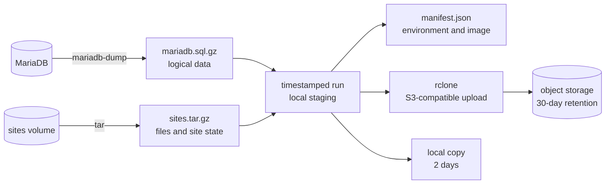

# `backup` — offsite copy of the Frappe stack

> **Target state.** This page describes the system as it is meant to be. The
> remaining code work is tracked in [`IMPLEMENTATION.md`](../../IMPLEMENTATION.md).
> When this page and the code disagree, this page is authoritative.

## What this role is for

`backup` copies the application to object storage every day. It is **independent of the application deployment**: `playbooks/backup.yml` owns the install, the schedule, the verification run and every later change. Neither `site.yml` nor `update.yml` installs or touches backups.

> **Provisioning gate.** A freshly provisioned host has **no backups** until an admin runs `playbooks/backup.yml`. This is deliberate. A deployment must not be able to fail, or silently install a broken backup, because object-storage credentials were absent. Run `backup.yml` immediately after `site.yml` and before the site is considered production-ready.

It produces two artefacts from the same run:

1. A logical MariaDB dump.
2. A tar archive of the sites volume.

Both are needed. A dump without the sites volume restores a database that points at files which are not there. A sites archive without the dump restores files with an empty database. The role puts them in one timestamped directory so a restore always has a matching pair.

## At a glance

| Item | Value |
|---|---|
| Role path | `roles/backup` |
| Called by | `playbooks/backup.yml` only |
| Runs as | A named admin, becoming `deployowner` through `sudo` with the admin's own password; the backup service itself runs as `root` |
| Depends on | MariaDB and the `erp_sites-vol` volume exist; `sites/<site>/site_config.json` is readable; object-storage credentials are in the vault |
| Used by | Restore operations and offsite retention |
| Main tags | `backup` |

## Backup flow

**Figure 1 — Backup flow.** The dump and the sites archive are produced in the same
run, recorded together in `manifest.json`, and uploaded to one timestamped prefix.



> **Restore rule:** always take the dump and the sites archive from the same timestamp. The manifest is the check. A mixed pair is worse than no backup because it looks valid until a file is missing.

### What is not in the pair

Redis is deliberately not backed up. `redis-cache` is disposable. `redis-queue` uses the `redis-queue-data` volume, but those jobs are not part of this backup pair and are not restored by the database/sites procedure.

A queue crash can lose jobs accepted since the last RDB snapshot. If queued work needs stronger durability, that is a Redis design change, not a backup change. See [`redis`](redis.md#persistence-and-data-loss).

## Inputs

### Schedule and retention

| Variable | Default or source | Required | What it controls |
|---|---|---|---|
| `backup_enabled` | `true` | no | Install the script, configuration and timer; `false` removes the units and timer |
| `backup_calendar` | `*-*-* 03:17:00` | no | systemd `OnCalendar` schedule |
| `backup_persistent` | `true` | no | Run a missed backup after the host was off |
| `backup_local_dir` | `/var/backups/erp` | no | Local staging directory |
| `backup_local_keep_days` | `2` | no | Days to keep local copies |
| `backup_retention_days` | `30` | no | Days to keep remote copies |

### Destination

| Variable | Default or source | Required | What it controls |
|---|---|---|---|
| `backup_remote_name` | `vault_backup_remote_name` | yes | rclone remote name |
| `backup_bucket` | `vault_backup_bucket` | yes | Destination bucket |
| `backup_storage_class` | `STANDARD` | no | Object-storage class |
| `backup_endpoint` | `vault_backup_endpoint` (empty for AWS) | yes | S3-compatible endpoint |
| `backup_region` | `auto` | no | Object-storage region |
| `backup_access_key_id` | `vault_backup_access_key_id` | yes when enabled | Access key ID |
| `backup_secret_access_key` | `vault_backup_secret_access_key` | yes when enabled | Secret access key |

### Dump

| Variable | Default or source | Required | What it controls |
|---|---|---|---|
| `backup_mysqldump_extra_args` | `--single-transaction --quick --routines --triggers --events --hex-blob --default-character-set=utf8mb4` | no | `mariadb-dump` flags; the script adds `--databases` and the resolved database name itself |

`--single-transaction` gives a consistent InnoDB snapshot without locking the tables. `--quick` avoids buffering the whole result in memory. `--routines`, `--triggers` and `--events` preserve application logic, not just tables. `--hex-blob` keeps binary values safe. The script appends `--databases <db_name>` so the dump always contains the `CREATE DATABASE` and `USE` statements a restore needs.

## What the role creates and changes

| Path | Mode | Purpose |
|---|---|---|
| `/usr/bin/rclone` | `0755` | The object-storage copy binary |
| `/root/.config/rclone` | `0700` | Directory for the rclone configuration |
| `/root/.config/rclone/rclone.conf` | `0600` | Object-storage credentials |
| `/usr/local/sbin/erp-backup` | `0755` | The backup script |
| `/var/backups/erp` | `0700` | Local staging area |
| `/etc/systemd/system/erp-backup.service` | `0644` | One-shot backup unit |
| `/etc/systemd/system/erp-backup.timer` | `0644` | Daily timer |

The role also installs rclone from the official Debian package. It uses rclone rather than an AWS SDK because rclone speaks every S3-compatible provider with one binary and does not add a Python dependency to the host.

## The script

The script is deliberately linear. If any step fails, it removes the partial local run and exits non-zero so systemd records a failed backup.

1. Create a UTC timestamp such as `20261022T031700Z`.
2. Create `/var/backups/erp/<timestamp>` with mode `0700`.
3. Read `db_name` from `sites/<site>/site_config.json` and fail closed if the file or the key is missing. Run `mariadb-dump` inside the MariaDB container for that database and gzip the output to `mariadb.sql.gz`. Do not fall back to `frappe`.
4. Check that the first part of the dump contains `CREATE TABLE`. A gzip of an error message is still a valid gzip, so the script does not trust the exit code alone.
5. Resolve the sites volume mountpoint with `docker volume inspect --format '{{ .Mountpoint }}' erp_sites-vol`, then tar that directory into `sites.tar.gz`. The Docker data root is not assumed to be `/var/lib/docker`.
6. Write `manifest.json` with the environment, timestamp, domain, site name, database name, application image **digest**, application version label and MariaDB image.
7. Upload the directory to `<rclone-remote>:<bucket>/<environment>/<timestamp>/`.
8. List the remote and require at least three objects. A partial upload can return success in some failure modes.
9. Delete remote backups older than `backup_retention_days`.
10. Delete local directories older than `backup_local_keep_days`.

The MariaDB root password is read from the Compose secret inside the MariaDB
container at `/run/secrets/db_root_password`. It never appears in the host process
table, in the backup script or in the backup service environment.

## The systemd units

### Service

| Setting | Value | Purpose |
|---|---|---|
| `Type` | `oneshot` | The script runs to completion |
| `ExecStart` | `/usr/local/sbin/erp-backup` | The backup script |
| `TimeoutStartSec` | `3600` | A hung dump or upload must not hold the slot forever |
| `User` / `Group` | `root` | Read the MariaDB container and the sites volume |
| `NoNewPrivileges` | `true` | No privilege escalation |
| `PrivateTmp` | `true` | Private temporary directory |
| `ProtectSystem` | `full` | Most of the system is read-only |
| `ReadWritePaths` | `backup_local_dir` | The staging directory remains writable |

### Timer

| Setting | Value | Purpose |
|---|---|---|
| `OnCalendar` | `backup_calendar` | Daily at 03:17 by default |
| `Persistent` | `true` | Catch up after downtime |
| `RandomizedDelaySec` | `15m` | Spread load across hosts |
| `Unit` | `erp-backup.service` | The unit to start |

## Remote layout

```text
<rclone-remote>:<bucket>/<environment>/<timestamp>/
  mariadb.sql.gz
  sites.tar.gz
  manifest.json
```

The timestamp is the restore key. The manifest records which environment, database, site, image digest and application version the pair belongs to.

## Security invariants

- The rclone configuration is `0600` and root-owned.
- The local staging area is `0700`; it contains production data.
- The service runs as root only because it must read the container environment and the Docker volume.
- The database password stays inside the MariaDB container; the sites archive still contains `site_config.json`, including the site database and mail passwords and the site encryption key.
- The backup bucket is private. Use provider-side encryption at rest and TLS in transit; if the provider does not encrypt at rest, add client-side encryption before upload.
- Treat `sites.tar.gz` as a secret. It is enough to reconstruct the site, including its service credentials.
- The backup script does not write credentials to the manifest or the log.
- The backup role does not expose a network port.
- Remote retention is applied by the script. Bucket versioning is still recommended as a second line of defence.
- A failed verification run fails `playbooks/backup.yml` and prints the journal command. It does not stop, restart or roll back the running site, because the backup playbook is a separate operation.
- The role does not install backups during a deployment. `site.yml` and `update.yml` neither install nor verify them.

## Idempotency and change behaviour

- The rclone configuration, script and units are rewritten when their content changes.
- Re-running the role with `backup_enabled: true` keeps the timer enabled.
- Re-running the role with `backup_enabled: false` stops and disables the timer, removes the timer and service units, and leaves the script, configuration and existing data in place. This is a deliberate stop, not a purge.
- Every `playbooks/backup.yml` run with `backup_enabled: true` performs one verification backup, whether or not any file changed.
- Changing the script, units or rclone configuration does not by itself run a second backup; the single verification run covers it.
- Changing `vault_backup_remote_name` or `vault_backup_bucket` changes where future backups go. It does not move existing objects.

## Verification

The verification run happens inside `playbooks/backup.yml`, before the timer is
started, every time that playbook runs with backups enabled. A failed
verification fails the playbook and leaves the timer disabled, so a broken
backup does not run unattended. To check the installed schedule afterwards:

```bash
systemctl list-timers erp-backup.timer
systemctl status erp-backup.timer
journalctl -u erp-backup -n 50
rclone lsf '<rclone-remote>:<bucket>/<environment>/'
```

Run one backup now:

```bash
sudo systemctl start erp-backup
journalctl -u erp-backup -f
```

Check the local run:

```bash
ls -l /var/backups/erp/
cat /var/backups/erp/<timestamp>/manifest.json
```

Check the remote objects:

```bash
rclone lsf '<rclone-remote>:<bucket>/<environment>/<timestamp>/'
```

A complete run has all three objects:

- `mariadb.sql.gz`
- `sites.tar.gz`
- `manifest.json`

## Restore

The restore procedure is in [`RESTORE.md`](../RESTORE.md). The important rules are:

1. Choose one timestamp.
2. Download all three objects from that timestamp.
3. Read the manifest and confirm the environment and site.
4. Stop the application services.
5. Restore the database.
6. Restore the sites volume.
7. Start the application and run smoke checks.
8. Delete the local restore copy; it contains production data.

Run quarterly drills against an isolated disposable target, never over the live
development or production site. A backup that has never been restored is a
hope, not a backup.

ERPNext also documents a [Google Drive integration](https://docs.frappe.io/erpnext/google_drive)
for uploading system backups and public/private files. It is not currently the
destination configured by this role. Evaluate and test it as a separate backup
source before changing the recovery policy.

## Failure modes

| Symptom | Likely cause | First check |
|---|---|---|
| Timer is not listed | `backup_enabled` is false, or `playbooks/backup.yml` has not run | `systemctl list-timers`; inspect the Ansible output |
| Service exits non-zero | Dump, tar or upload failed | `journalctl -u erp-backup -n 100` |
| `rclone` cannot read its config | The config path is missing or not readable by the service | `sudo ls -l /root/.config/rclone/rclone.conf`; `sudo -u root rclone lsd erp-backup:` |
| Dump does not look like a dump | `site_config.json` is missing, `db_name` is wrong, the password is wrong or the dump command is broken | Run the dump manually and inspect the first lines; check `db_name` before the dump |
| Sites volume not found | Docker's data root moved, the volume name changed, or the volume is missing | `docker volume inspect erp_sites-vol` |
| Upload succeeds but remote count is low | Partial upload or wrong remote path | `rclone lsf` the exact timestamp directory |
| Old backups are not deleted | Retention path or age filter is wrong | Inspect the `rclone delete` line and the remote prefix |
| Local disk fills | Local retention is too long, or upload keeps failing | `du -sh /var/backups/erp`; check the service log |

## Changing the schedule

1. Edit `backup_calendar` in `group_vars/<env>/main.yml`.
2. Run `playbooks/backup.yml`.
3. Confirm the new schedule with `systemctl list-timers erp-backup.timer`.

## Changing the destination

1. Create the bucket and credentials at the provider.
2. Update `vault_backup_access_key_id` and `vault_backup_secret_access_key`.
3. Update `vault_backup_endpoint`, `backup_region`, `vault_backup_remote_name` and `vault_backup_bucket` in the environment vault as needed.
4. Run `playbooks/backup.yml`.
5. Run one backup manually and verify the remote objects.
6. Keep the old bucket until the new destination has passed a restore test.

## Implementation checklist

- [ ] One run produces `mariadb.sql.gz`, `sites.tar.gz` and `manifest.json` under
      one timestamp.
- [ ] The database password stays inside the MariaDB container and never appears
      in the manifest or the log.
- [ ] The sites archive is treated as a secret because it contains
      `site_config.json`, including the site database and mail passwords.
- [ ] The dump database name is read from `site_config.json`; there is no
      hardcoded `frappe` fallback.
- [ ] The rclone config is `0600 root`; the local staging area is `0700 root`.
- [ ] The timer runs daily at 03:17 and keeps 30 remote days.
- [ ] A failed verification run fails `playbooks/backup.yml`; it never fails a
      deployment.
- [ ] A fresh host has no backup timer until `playbooks/backup.yml` runs.
- [ ] The restore procedure uses one timestamp for both artefacts.
- [ ] A restore is tested into an isolated disposable target once a quarter.
- [ ] Redis is explicitly outside the backup pair.

## Related pages

- [`ROLES.md`](../ROLES.md) for the shared volume inventory.
- [`mariadb`](mariadb.md) for the database dump and password order.
- [`erp`](erp.md) for the sites volume and application version.
- [`RUNBOOK.md`](../RUNBOOK.md#16-backups-and-restore) for the backup commands.
- [`RESTORE.md`](../RESTORE.md) for the restore procedure and recovery limitations.
- [`SECRETS.md`](../SECRETS.md) for object-storage credentials.
