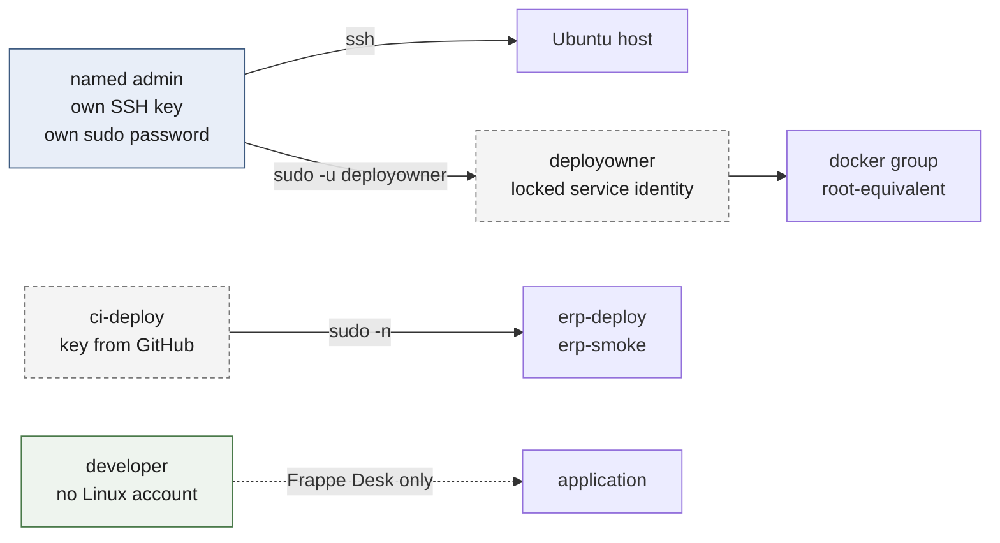

# `base` — host hardening and access

> **Target state.** This page describes the system as it is meant to be. The
> remaining code work is tracked in [`IMPLEMENTATION.md`](../../IMPLEMENTATION.md).
> When this page and the code disagree, this page is authoritative.

## What this role is for

`base` turns a fresh Ubuntu server into a host that is safe to put on the internet. It creates the human and machine accounts, decides how each one authenticates, closes every port except SSH and the web edge, and applies the kernel and service settings that the rest of the stack depends on.

This is the first role in the build. Nothing else can work until it has run, because every later role connects through the access model it creates.

## At a glance

| Item | Value |
|---|---|
| Role path | `roles/base` |
| Called by | `playbooks/server.yml` |
| Runs as | `root` on the first bootstrap run; afterwards as a named admin, becoming `deployowner` through `sudo` with the admin's own password |
| Depends on | A reachable host on the supported Ubuntu LTS baseline (`base_os_release` in `group_vars/all/main.yml`), one public key per admin, and one password hash per admin |
| Used by | Every later role, through SSH, `sudo`, the firewall and the Docker group |
| Main tags | `base`, `system`, `users`, `ssh`, `firewall`, `docker` |

## The access model

The host has three kinds of identity, and they are deliberately separate:

1. **Human admins.** Each admin has a named Linux account, their own SSH key and their own Unix password. They log in with the key. They become `deployowner` with `sudo -u deployowner`, which asks for their own password. They also have full `sudo` for system checks and repairs; admins are root-equivalent by design.
2. **A service identity, `deployowner`.** This account owns the stack directories and `.env` files, and it is the only human-adjacent account in the `docker` group. It has no SSH login and no usable password. Admins reach it only through `sudo`.
3. **A pipeline identity, `ci-deploy`.** This account logs in with a key from GitHub and can run only two root-owned commands through `sudo`: `erp-deploy` and `erp-smoke`. It has no other groups and no broader `sudo` rule.

There is **no shared human login** and **no shared human sudo password**. That is the central change from the older design. A shared login tells you that *someone* changed the host. A named account tells you *who*.

**Figure 1 — Access model.** Admins reach the host directly and the stack through
`sudo -u deployowner`; `ci-deploy` reaches two scripts; developers reach only the
application.



### Why admins are not in the `docker` group

Membership in the `docker` group is effectively root. A member can start a container that mounts the host filesystem and writes anywhere. If every admin were in that group, they could reach root without a sudo password, and the sudo log would not record the stack action.

The stack therefore puts only `deployowner` in `docker`. Admins normally become `deployowner` with `sudo -u deployowner` for stack work, and a one-off Docker command still goes through `sudo`. Either way, Docker access needs a password and the sudo log records the person's name. An admin is not in the group because ambient membership would skip both.

This does **not** make an admin less powerful. Admins have full `sudo` and can become `deployowner`. The model provides attribution, revocation and separation between people; it does not pretend that an admin is unprivileged.

### Why developers have no host account

A developer works on a laptop, pushes code, and uses the shared development host as an integration environment. Giving a developer an SSH account would create another root-equivalent credential without improving that loop, because Docker is one command away.

Developers therefore get:

- repository access;
- a Frappe Desk login in development;
- the local stack and the CI workflow described in [`DEVELOPMENT.md`](../DEVELOPMENT.md).

They do not get a Linux account, a vault password, or a key to a shared host. In production they have no System Manager role either.

## Inputs

| Variable | Default or source | Required | What it controls |
|---|---|---|---|
| `base_operators` | `vault_base_operators` in the environment vault | yes | The admin accounts. Each item has a `name` and a list of public `keys`; names and keys are stored in the encrypted vault, not in `main.yml` |
| `vault_operator_password_hashes` | environment vault | yes | A map of admin name to yescrypt password hash, used when the account is created or rebuilt |
| `base_operator_group` | `base_operators` | derived | The Unix group that holds the admins and carries the sudo rule |
| `base_deploy_owner_user` | `lookup('env', 'DEPLOY_OWNER_USER')` or `deployowner` | yes | The locked service identity and `sudo` target |
| `ci_deploy_authorized_keys` | `vault_ci_deploy_authorized_keys` in the environment vault | for CI | Public keys allowed to log in as `ci-deploy` |
| `ci_deploy_user` | `ci-deploy` | derived | The pipeline account name |
| `base_apt_packages` | package list | no | Base packages, including UFW, chrony and unattended upgrades |
| `base_ssh_directives` | list of `sshd` settings | no | The SSH policy applied to `/etc/ssh/sshd_config` |
| `base_ssh_ciphers` | modern cipher list | no | Accepted SSH ciphers |
| `base_ssh_macs` | modern MAC list | no | Accepted SSH message authentication codes |
| `base_ssh_kex_algorithms` | modern key-exchange list | no | Accepted SSH key-exchange algorithms |
| `base_firewall_allowed_tcp_ports` | SSH port, 80, 443 | no | The complete inbound TCP allowlist |
| `base_firewall_ssh_rate_limit` | `true` | no | Use UFW `limit` instead of `allow` for SSH |
| `base_firewall_enable_ipv6` | `true` | no | Make UFW filter IPv6 as well as IPv4 |
| `base_firewall_logging` | `low` | no | UFW log level |
| `base_firewall_docker_user_rules` | `true` | no | Install the `DOCKER-USER` rules that stop Docker from bypassing UFW |
| `base_sysctl_settings` | map of kernel settings | no | Network and kernel hardening |
| `base_journald_settings` | map of journal settings | no | Journal size, retention and forwarding |
| `base_chrony_packages` | `[chrony]` | no | Time-synchronisation package |
| `base_unattended_upgrades_enabled` | `true` | no | Enable automatic security updates |
| `base_unattended_upgrades_origins` | security and update origins | no | Which package origins may be applied automatically |
| `base_unattended_upgrades_automatic_reboot` | `false` | no | Never reboot the host automatically |
| `base_swap_enabled` | `true` | no | Create a swap file |
| `base_swap_file` | `/swapfile` | no | Swap file path |
| `base_swap_size_mb` | `2048` | no | Swap file size |
| `base_default_umask` | `0027` | no | Default permissions for new files |
| `ansible_port` | `SSH_PORT`, default `vault_ssh_port` | yes | The SSH port the firewall opens |
| `ansible_user` | `SSH_LOGIN_USER` | yes | The admin account Ansible connects as |
| `ansible_become_user` | `root` | yes | The account Ansible becomes through `sudo`; system tasks need root. `deployowner` is the stack owner and is reached with `sudo -u deployowner` for stack work, not by Ansible |

`base_ssh_ciphers_accepted`, `base_ssh_macs_accepted` and `base_ssh_kex_algorithms_accepted` are compatibility flags. Leave them `true`; they do not change the running configuration.

`base` does **not** change the `sshd` port. `ansible_port` is both the port Ansible
connects to and the SSH port UFW opens. `sshd` must already listen there before
hardening. The recommended target is a non-standard port recorded as
`vault_ssh_port` in the environment vault, configured with a drop-in before the
first run; see [`RUNBOOK.md`](../RUNBOOK.md#82-set-the-ssh-port-on-the-host).
Exporting `SSH_PORT` overrides the vault value for one run. If the host stays on
`22`, set `SSH_PORT=22`; the role will keep that port open.

### The shape of `base_operators`

`base_operators` is a reference to the encrypted vault. Account names and public
keys are not published in the repository:

```yaml
# group_vars/<env>/vault.yml
vault_base_operators:
  - name: alice
    keys:
      - "ssh-ed25519 AAAAC3... alice@laptop"
  - name: bob
    keys:
      - "ssh-ed25519 AAAAC3... bob@laptop"

vault_operator_password_hashes:
  alice: "$y$j9T$..."
  bob: "$y$j9T$..."
```

`group_vars/all/main.yml` contains the shared alias:

```yaml
base_operators: "{{ vault_base_operators | mandatory }}"
```

By default, the role creates a Unix group named `base_operators`; the variable is the list of its human members. Each name in `vault_base_operators` must have a matching key in `vault_operator_password_hashes`. The plaintext password is never stored in the repository or the vault. Each admin keeps their own password in their password manager and supplies it through `--become-password-file` when they run Ansible.

## SSH policy

The role writes `/etc/ssh/sshd_config` through validated changes. Every write is checked with `sshd -t` before it is activated, so a typo fails the Ansible run instead of locking you out.

| Setting | Value | Why |
|---|---|---|
| `PermitRootLogin` | `no` | Root cannot log in over SSH after bootstrap |
| `PasswordAuthentication` | `no` | Keys only |
| `KbdInteractiveAuthentication` | `no` | No keyboard-interactive fallback |
| `ChallengeResponseAuthentication` | `no` | No challenge-response fallback |
| `PubkeyAuthentication` | `yes` | Public-key login is the only method |
| `PermitEmptyPasswords` | `no` | Reject blank passwords |
| `PermitUserEnvironment` | `no` | Users cannot inject environment files |
| `UsePAM` | `yes` | Standard Ubuntu account and session handling |
| `X11Forwarding` | `no` | No graphical forwarding |
| `AllowAgentForwarding` | `no` | The SSH agent cannot be forwarded to the host |
| `AllowTcpForwarding` | `local` | Allows the dashboard tunnel (`ssh -L`) but not remote forwarding |
| `PermitTunnel` | `no` | No VPN-style tunnel devices |
| `GatewayPorts` | `no` | A forwarded port binds to loopback, not the public interface |
| `ClientAliveInterval` | `300` | Detect a dead session after five minutes |
| `ClientAliveCountMax` | `2` | Close after two missed keepalives |
| `LoginGraceTime` | `30` | Short window to finish authentication |
| `MaxAuthTries` | `3` | Limit password and key attempts |
| `MaxSessions` | `5` | Limit sessions per connection |
| `MaxStartups` | `3:30:10` | Limit unauthenticated connection pressure |
| `LogLevel` | `VERBOSE` | Enough detail for an audit without logging secrets |
| `DebianBanner` | `no` | Do not advertise the distribution |
| `Banner` | `/etc/ssh/banner` | Show the access warning |

`AllowUsers` lists every admin account. It also lists `ci-deploy` once the
pipeline account is registered; a first bootstrap run creates admins only.
`deployowner` is deliberately absent.

The `AllowTcpForwarding local` setting exists for one reason: the Traefik
dashboard is private and is reached through `ssh -L 8443:127.0.0.1:443`.
`GatewayPorts no` keeps any remote forward (`-R`) bound to loopback instead of a
public interface; the local `-L` tunnel binds on your own machine.

### SSH keys

The role writes each admin's `authorized_keys` with `exclusive: true`. This replaces the file rather than appending to it, so removing a key from `vault_base_operators` actually revokes it.

- Admin names and keys go in `vault_base_operators` in the environment vault.
- The pipeline key goes in `vault_ci_deploy_authorized_keys` in the environment vault. A key comment or fingerprint identifies the operator, so it is treated as an identifier.
- The admin roster is not published: admin keys are committed only inside the encrypted vault. Private keys are never committed and never stored on the server.

## What the role creates and changes

### Accounts and access

| Path or object | Mode | Purpose |
|---|---|---|
| One Linux account per admin | password from the vault hash, key-only SSH | A named human identity with attribution |
| `/home/<admin>/.ssh` | `0700` | SSH directory |
| `/home/<admin>/.ssh/authorized_keys` | `0600` | That admin's public keys |
| `base_operators` group | system group | Holds the admin accounts and carries the sudo rule |
| `deployowner` user | locked password | Service identity, stack owner and `sudo` target |
| `ci-deploy` user | no password, no supplementary groups | Pipeline account |
| `/home/ci-deploy/.ssh/authorized_keys` | `0600` | CI public keys |
| `/etc/sudoers.d/base-operators` | `0440` | `%base_operators` has full sudo; `sudo -u deployowner` is the normal target for stack work, and sudo asks for the admin's own password |
| `/etc/sudoers.d/ci-deploy` | `0440` | `ci-deploy` may run only the two deploy scripts |
| `/etc/ssh/banner` | `0644` | Login warning |
| `/etc/ssh/sshd_config` | `0600` | Hardened SSH configuration |
| `/etc/ssh/sshd_config.d` | `0755` | Drop-in directory |

The sudo rule does not use `targetpw` or `rootpw`. A default sudo rule authenticates the person who invoked it, which is exactly the behaviour we want: `sudo -u deployowner` and ordinary `sudo` both ask for the admin's password, not a password for `deployowner`.

Admins have full sudo because they are root-equivalent by design. The account model is about attribution and revocation, not about pretending an admin is unprivileged. The normal target for stack work is still `deployowner`, so files and containers keep one owner.

### System settings

| Path | Mode | Purpose |
|---|---|---|
| `/etc/apt/apt.conf.d/20auto-upgrades` | `0644` | Enable periodic package-list updates and unattended upgrades |
| `/etc/apt/apt.conf.d/51unattended-upgrades-hardened` | `0644` | Restrict automatic upgrades to the chosen origins |
| `/etc/chrony/chrony.conf` | `0644` | Use Ubuntu NTP pools and log clock adjustments |
| `/etc/sysctl.d/60-deployment-hardening.conf` | `0644` | Kernel and network hardening |
| `/etc/systemd/journald.conf.d/10-deployment-hardening.conf` | `0644` | Persist and cap the journal |
| `/etc/profile.d/00-deployment-umask.sh` | `0644` | Set the default umask |
| `/etc/shadow` | `0640` | Restrict the shadow database |
| `/etc/gshadow` | `0640` | Restrict the group shadow database |
| `/swapfile` | `0600` | Swap safety net, initialised with `mkswap` before first use |
| `/etc/fstab` | `0644` | Persist swap across reboots |

### Firewall

| Object | Purpose |
|---|---|
| `/etc/default/ufw` | Enable IPv6 filtering |
| UFW rules | Allow SSH with rate limiting, allow 80 and 443, deny other inbound traffic |
| `/usr/local/sbin/apply-docker-user-rules` | Rebuild the `DOCKER-USER` chain from the same allowlist |
| `/etc/systemd/system/docker.service.d/10-firewall.conf` | Reapply the Docker rules whenever Docker starts or reloads |

The firewall is rebuilt from a known state on each run. A rule added by hand does not survive, which is intentional: a hidden hole should not outlive a deployment.

Docker inserts its own rules before UFW's normal input chain. Without the `DOCKER-USER` rules, a published container port would be reachable even though UFW says "deny". The script closes that gap by allowing only the SSH port and ports 80 and 443, then dropping the rest.

`base` owns the **static** policy. The [`crowdsec`](crowdsec.md) role later installs the **dynamic** layer: `crowdsec-firewall-bouncer-nftables`. That service reads CrowdSec decisions from the loopback LAPI and drops banned source addresses in its own nftables tables. It does not edit UFW, and UFW does not edit its tables. Both layers are required: UFW decides which ports exist; the host firewall bouncer decides which sources may reach them.

The host bouncer can block an admin's egress address if a decision is wrong. There is no permanent admin bypass. Recovery is the provider console, followed by removing only the false decision. See [`crowdsec-firewall-bouncer`](crowdsec-firewall-bouncer.md).

## Security invariants

These statements must remain true. A change that breaks one of them is not a normal configuration change.

- There is no shared human Linux account and no shared human sudo password.
- Every admin has a named account, at least one key, and their own password.
- Every admin is in `base_operators` and is not in `docker`.
- `deployowner` has no SSH login, no usable password, and cannot `sudo` to another account.
- `deployowner` is the only account in `docker`.
- `ci-deploy` has no supplementary groups and only two allowed `sudo` commands.
- Root cannot log in over SSH after bootstrap.
- Password authentication is disabled only after every admin has a usable key.
- `AllowUsers` contains the admin accounts and, after registration, `ci-deploy`,
  and nothing else.
- `AllowTcpForwarding` is `local`, not `yes` and not `no`.
- UFW filters IPv4 and IPv6.
- The `DOCKER-USER` chain is reapplied when Docker restarts.
- The host firewall bouncer uses separate nftables tables and never edits UFW or Docker's tables.
- The CrowdSec LAPI is reachable on host loopback `127.0.0.1:8080` only.
- There is no broad permanent admin allowlist in the host bouncer.
- The host never reboots itself during an unattended upgrade.
- The journal is capped so a log flood cannot fill the root filesystem.
- Time synchronisation is running; certificates, CrowdSec ban windows and Frappe timestamps all depend on it.

## Idempotency and change behaviour

The role is safe to run again. The important behaviours are:

- SSH changes are validated before they are applied. The handler re-checks the effective policy and fails if it is not what was intended.
- Each admin's `authorized_keys` is replaced, not appended, so a removed key is revoked.
- An admin removed from `base_operators` is removed from the host. Their home directory and keys go with the account. This is how offboarding becomes real.
- The password hash is applied when an account is created. It is not forced over an existing password on every run, so an admin can change their own password with `passwd` without Ansible changing it back. Keep the vault hash in step with the real password so a rebuild recreates the account correctly.
- UFW is reset and rebuilt. Manual rules are discarded.
- The swap file is created once with `dd conv=fsync`, initialised with `mkswap`, then enabled. Existing active swap is left in place.
- Swap size is **not** resized automatically. If `base_swap_size_mb` differs from the existing file, the role fails before touching it. To resize deliberately: `swapoff /swapfile`, remove the file, set the new size, and re-run.
- A partial file from an interrupted `dd` also fails the size check. Remove it and re-run; the role never calls `mkswap` on a file it did not create at the declared size.
- The `DOCKER-USER` script is rewritten on each run and re-applied by its handler.
- The role flushes its handlers before it finishes, so a later failure in the same playbook cannot leave SSH or the firewall half-applied.

## Verification

Run these checks after `server.yml`:

```bash
# SSH policy as sshd will actually use it
sudo sshd -T | grep -E 'permitrootlogin|passwordauthentication|pubkeyauthentication|allowusers|allowtcpforwarding|gatewayports'

# Firewall state
sudo ufw status verbose

# The admin group and one admin account
getent group base_operators
id -nG <your-admin>

# The service identity must be locked and must have no SSH access
sudo passwd -S deployowner
getent passwd deployowner

# An admin has sudo and the deploy-owner target
sudo -l -U <your-admin>

# The CI user may only run the two scripts
sudo -l -U ci-deploy

# Time and swap
timedatectl status
swapon --show

# After the crowdsec role has run: the dynamic host layer
systemctl is-active crowdsec-firewall-bouncer
sudo nft list tables | grep crowdsec
```

A correct result shows key-only SSH, `AllowUsers` containing every admin name
(and `ci-deploy` after the pipeline is registered), `AllowTcpForwarding local`, no
`docker` group for your admin, `deployowner` locked and absent from `AllowUsers`,
and a UFW default-deny policy with only the chosen SSH port, 80 and 443 open.

The `sudo -l -U ci-deploy` check only works after the pipeline is registered. On a
first bootstrap, skip it and return after section 8.7 of
[`RUNBOOK.md`](../RUNBOOK.md#87-re-run-the-playbook-through-the-normal-path).

The host bouncer tables appear only after the `crowdsec` role has run. `base` does not install that service.

The `docker` group check for `deployowner` belongs to the [`docker`](docker.md) role. `base` creates the account; `docker` puts it in the group.

## Failure modes

| Symptom | Likely cause | First check |
|---|---|---|
| `Permission denied (publickey)` for an admin | The key is not in that admin's `vault_base_operators` entry, or `AllowUsers` is wrong | `sudo sshd -T \| grep allowusers`; inspect the admin's `authorized_keys` |
| `Permission denied (publickey)` for CI | `vault_ci_deploy_authorized_keys` is empty or `ci-deploy` is not in `AllowUsers` | `id ci-deploy`; `sudo sshd -T \| grep allowusers` |
| SSH tunnel opens but the dashboard does not answer | `AllowTcpForwarding` is `no`, or the tunnel targets the wrong port | `sudo sshd -T \| grep allowtcpforwarding`; confirm `-L 8443:127.0.0.1:443` |
| A container port is reachable from the internet | The `DOCKER-USER` rules are missing or Docker was not restarted | `sudo iptables -L DOCKER-USER -n -v` |
| SSH is blocked even though sshd is healthy | A CrowdSec host firewall decision matched your address | Use the provider console; `docker exec crowdsec cscli decisions list`; remove only the false decision. Do not add a broad allowlist |
| `sudo` asks for a password you do not have | You are typing a `deployowner` password; there is none | Use your own admin password. If forgotten, reset it from another admin session or the console |
| `sudo: sorry, you are not allowed to execute ...` | The admin is not in `base_operators`, or the sudoers file is missing | `id -nG <admin>`; `sudo visudo -c`; `sudo cat /etc/sudoers.d/base-operators` |
| An admin account disappeared | The name is missing from `vault_base_operators` for that environment | Review the environment vault and re-run `server.yml` |
| Certificate issuance or logs show clock errors | `chrony` is not running | `systemctl status chrony`; `timedatectl status` |
| `swapon: read swap header failed` | The swap file was never initialised with `mkswap` | Re-run `server.yml`; confirm the role ran `mkswap` before `swapon` |
| The role fails with a swap-size mismatch | `base_swap_size_mb` changed, or a previous `dd` was interrupted | Follow the deliberate resize steps; remove a partial file and re-run |
| The host runs out of disk from logs | journald limits were not applied | `journalctl --disk-usage`; inspect the drop-in |

## Changing access

### Add an admin

1. Add the person's name and public key to `vault_base_operators` in that environment's vault.
2. Add a yescrypt hash for their initial password to `vault_operator_password_hashes` in the same vault.
3. Run `playbooks/server.yml` for that environment.
4. Give them the initial password out of band. Ask them to run `passwd` at their first login. They can then update the vault hash themselves, or send the new hash to an existing admin if they do not have vault access yet.
5. Add their dashboard username and bcrypt hash to `vault_traefik_dashboard_users`, then run `playbooks/traefik.yml`.
6. If they will be an additional production reviewer, add them to the GitHub `production` environment.

Admin access is granted per environment. Adding someone to development does not add them to production.

### Remove an admin

1. Remove their entry from `vault_base_operators` and `vault_operator_password_hashes` in every environment they could access.
2. Run `playbooks/server.yml` for each of those environments. Their account, home directory and keys are removed. Take anything you need from the home directory before this run.
3. Remove their dashboard entry and run `playbooks/traefik.yml`.
4. Remove their repository, GitHub reviewer, and Desk access.
5. If they held an environment vault password, rekey that vault.
6. Check `journalctl -u ssh`, `last`, and the sudo log for unfamiliar activity.

There is no shared password to rotate after someone leaves. That is one of the practical benefits of named accounts.

### Rotate an admin's SSH key

1. Replace the public key in that admin's `vault_base_operators` entry.
2. Run `playbooks/server.yml` for the affected environments.
3. Confirm the old key no longer works.

### Rotate an admin's password

1. As the admin, run `passwd` on a host.
2. Generate a new yescrypt hash and update `vault_operator_password_hashes.<name>`.
3. Update the password manager entry and the local `--become-password-file`.

The vault hash is for account creation and rebuilds. It does not overwrite an existing password on every run.

### Add or remove a developer

No `base` change is required. A developer has no Linux account on the host.

- To grant access, give them repository access and a Frappe Desk user in development. See [`DEVELOPMENT.md`](../DEVELOPMENT.md).
- To remove access, remove the repository and Desk access. No `server.yml` run is needed.

### Rotate the CI key

1. Generate a new key pair on an admin's control machine.
2. Replace the public key in `vault_ci_deploy_authorized_keys` for both environments.
3. Run `playbooks/server.yml` for both environments.
4. Replace the private key in the GitHub environment secret.
5. Delete the local private key.

### Break-glass

The only fallback is the provider console as `root`. There is no shared human account and no shared owner password to recover. After a console repair, run `server.yml` again so the declared access model is restored.

## Implementation checklist

- [ ] `vault_base_operators` creates one named account per admin, with no shared login.
- [ ] Each admin authenticates with their own key and escalates to `root` with
      their own password; stack work uses `sudo -u deployowner`.
- [ ] `deployowner` is locked, has no SSH login and is absent from `AllowUsers`.
- [ ] `ci-deploy` is created only with the pipeline key, has no supplementary
      groups, and is limited to the two root-owned scripts.
- [ ] `AllowUsers` names the admins and, after registration, `ci-deploy`.
- [ ] Password authentication is disabled only after every admin has a key.
- [ ] The SSH port is already configured in `sshd`; the role opens the same port
      in UFW and never changes `sshd` itself.
- [ ] Every SSH change is validated with `sshd -t` and re-checked after reload.

## Related pages

- [`ROLES.md`](../ROLES.md) for the role map and shared topology.
- [`ARCHITECTURE.md`](../ARCHITECTURE.md#users-and-identities) for the access model.
- [`SECRETS.md`](../SECRETS.md) for key and password rotation.
- [`RUNBOOK.md`](../RUNBOOK.md#8-first-provision--run-as-root) for the first provisioning run.
- [`RUNBOOK.md`](../RUNBOOK.md#13-register-the-pipeline) for the pipeline account.
- [`DEVELOPMENT.md`](../DEVELOPMENT.md) for the developer workflow.
- [`docker`](docker.md) for the Docker group and daemon boundary.
