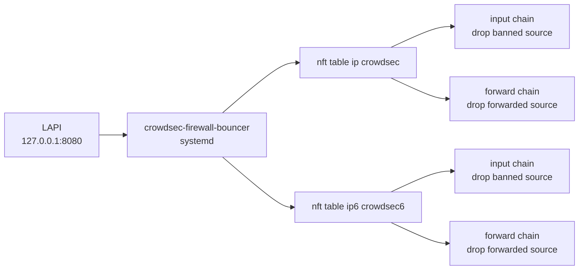

# `crowdsec-firewall-bouncer` — host-level enforcement

> **Target state.** This page describes the system as it is meant to be. The
> remaining code work is tracked in [`IMPLEMENTATION.md`](../../IMPLEMENTATION.md).
> When this page and the code disagree, this page is authoritative.

## What this component is for

The host firewall bouncer is a small systemd service that reads CrowdSec decisions from the LAPI and drops banned addresses in nftables. It protects the host before a packet reaches SSH, Docker's forwarded traffic or a container.

It is not an Ansible role of its own. It is part of the [`crowdsec`](crowdsec.md) role: the same role that starts the containerized engine also installs and configures the host package.

The host bouncer is **mandatory**. Traefik's HTTP bouncer protects the web application; the host bouncer protects everything else. Neither one replaces the other.

## At a glance

| Item | Value |
|---|---|
| Role path | none; this is a host component installed by `roles/crowdsec` |
| Called by | `playbooks/crowdsec.yml`, `playbooks/site.yml`, `playbooks/update.yml` through `roles/crowdsec` |
| Depends on | A working LAPI on `127.0.0.1:8080`, nftables, and root |
| Used by | SSH and forwarded container traffic protection |
| Main tags | none; the host bouncer is part of the `crowdsec` role |
| Managed by | `roles/crowdsec` |
| Package | `crowdsec-firewall-bouncer-nftables` |
| Service | `crowdsec-firewall-bouncer` |
| Backend | nftables |
| LAPI URL | `http://127.0.0.1:8080/` |
| Bouncer name | `firewall-host` |
| Key | `vault_crowdsec_firewall_key` |
| Configuration | `/etc/crowdsec/bouncers/crowdsec-firewall-bouncer.yaml`, mode `0600 root` |
| Update interval | `10s` |
| Deny action | `DROP` |
| IPv6 | enabled |
| Runs as | `root` through the admin's `sudo` |

## Why it is separate from Traefik

The host bouncer is the only layer that can block a non-HTTP connection from a
banned address. It also protects SSH during a brute-force campaign, even when the
attacker never reaches Traefik.

The full enforcement stack and failure behaviour are in
[`ARCHITECTURE.md`](../ARCHITECTURE.md#detection-and-enforcement). This page
covers only the host component.

## How it works

**Figure 1 — Host enforcement.** The bouncer reads decisions from the loopback LAPI
and writes them into its own nftables tables; it does not edit UFW or Docker's
tables.



The bouncer builds its own tables. It does not edit UFW's tables or Docker's tables. The chains run before the normal filter table and have `policy accept`: only addresses in the decision sets are dropped, and everything else follows the existing firewall policy.

The bouncer splits decisions by origin and address family. A manual `cscli decisions add` lands in the `cscli` set; the CrowdSec community blocklist lands in the `CAPI` set; a console push lands in the `crowdsec` set; a subscribed list lands in the `lists` set. This is why a test decision may not appear in the first set you inspect.

## Decision scope

The host bouncer subscribes to **all decision origins**. There is no local-only filter:

- local scenarios from the Traefik log;
- local scenarios from the SSH log;
- manual `cscli decisions add` entries;
- the CrowdSec community blocklist from CAPI;
- decisions pushed from the CrowdSec Console;
- subscribed blocklists.

This is deliberate. A ban should be a ban everywhere it can be enforced. If a specific decision is wrong, remove that decision or fix the scenario; do not narrow the bouncer to one origin.

### Cloudflare limitation

In Cloudflare proxy mode the host sees the Cloudflare edge as the source address, not the visitor. The host bouncer cannot drop the real visitor at layer 3 or layer 4, because the visitor's packets never arrive at the host directly. Traefik and AppSec remain the primary HTTP enforcement point.

The host bouncer still protects:

- SSH;
- direct-to-origin traffic, if it reaches the host;
- forwarded container traffic;
- any decision that names an address the host can actually see.

Do not treat the host bouncer as a substitute for the Traefik bouncer in Cloudflare proxy mode.

A CAPI decision that names a Cloudflare edge address is a special case: the host bouncer may drop that edge and affect every visitor using it. Inspect the decision before removing it, and do not add a broad permanent Cloudflare allowlist without a reviewed decision record. The real client is still enforced by Traefik and AppSec; the host layer simply cannot see that address.

## LAPI exposure

The LAPI is published only on the host loopback:

```text
127.0.0.1:8080:8080
```

It is not published on `0.0.0.0`. UFW does not need to allow 8080, because loopback traffic is not subject to the public interface policy. The host bouncer reaches the LAPI at `http://127.0.0.1:8080/`.

AppSec is different: it listens on `0.0.0.0:7422` **inside the CrowdSec container only**, and it is reachable only from `crowdsec-net`. It has no host port.

The host bouncer key is separate from the Traefik key. If one key leaks, the other bouncer does not need to be re-registered with the same exposed credential.

## Configuration

The target configuration is:

| Setting | Value | Why |
|---|---|---|
| `api_url` | `http://127.0.0.1:8080/` | Loopback-only LAPI |
| `api_key` | `vault_crowdsec_firewall_key` | Separate bouncer identity |
| `mode` | `nftables` | Native nftables backend |
| `update_frequency` | `10s` | New decisions appear quickly without polling too hard |
| `deny_action` | `DROP` | No response to a banned source |
| `disable_ipv6` | `false` | IPv6 is filtered too |
| `log_level` | `info` | Enough for diagnosis, not a flood |

The configuration file is root-owned and mode `0600`. It contains the bouncer key. The Ansible task that writes it uses `no_log: true`, so a failed task does not print the key.

## Installation and registration

The role does not rely on the package's post-install auto-registration. That auto-registration creates a random bouncer name and a key that is not in the vault, which makes the state hard to reproduce.

The target sequence is:

1. Add the CrowdSec packagecloud repository and signing key.
2. Install `crowdsec-firewall-bouncer-nftables` with `DEBIAN_FRONTEND=noninteractive`.
3. Stop the service while the configuration is written.
4. Register `firewall-host` with `vault_crowdsec_firewall_key`.
5. Remove any auto-registered bouncer left by the package, so exactly one host bouncer remains.
6. Write `/etc/crowdsec/bouncers/crowdsec-firewall-bouncer.yaml` with that key and the loopback LAPI URL.
7. Enable and start `crowdsec-firewall-bouncer`.
8. Verify that the service is active and its `Last API pull` is recent.

`crowdsec-firewall-bouncer-nftables` is not in the Ubuntu archive. The role adds
`deb [signed-by=/etc/apt/keyrings/crowdsec_crowdsec-archive-keyring.gpg] https://packagecloud.io/crowdsec/crowdsec/any/ any main`
and fetches the key from `https://packagecloud.io/crowdsec/crowdsec/gpgkey`.

This ordering matters. A bouncer that starts with a placeholder key logs `access forbidden` and may exit with `bouncer stream halted`, leaving the host with no dynamic protection.

## Coexistence with UFW and Docker

The host bouncer is not a replacement for UFW. The responsibilities are separate:

- **UFW** decides which ports are open at all. It is reset from the repository on each `server.yml` run.
- **`DOCKER-USER`** stops Docker from bypassing UFW for published container ports.
- **The host bouncer** adds dynamic source-address drops in its own nftables tables.
- **Traefik and AppSec** enforce HTTP decisions and request-shape rules.

The bouncer's chains run before the normal filter table, so an `ACCEPT` later in the path cannot undo a drop. The bouncer never default-denies; if it is stopped, the static UFW policy still applies. That is the intended layering.

## Failure behavior

The host bouncer is fail-open for new decisions:

- If LAPI is unavailable, the bouncer cannot learn new bans.
- Existing decisions have a timeout and eventually expire.
- The service retries; when LAPI returns, it resumes.
- UFW continues to enforce the static port policy throughout.

This is different from AppSec, which is fail-closed. A layer-3 bouncer cannot default-deny without blocking every packet, so "fail-closed" would mean "the host is offline". The correct static protection remains UFW plus the `DOCKER-USER` rules.

If the bouncer service is stopped, monitor it. The host still has UFW, but it has lost dynamic source blocking.

## Verification

### Service and tables

```bash
systemctl status crowdsec-firewall-bouncer
journalctl -u crowdsec-firewall-bouncer -n 50
sudo nft list tables | grep crowdsec
sudo nft list sets | grep crowdsec
```

The service must be active. The tables `ip crowdsec` and `ip6 crowdsec6` must exist. The sets should exist for each decision origin the bouncer uses.

### Bouncer registration

```bash
docker exec crowdsec cscli bouncers list
```

`firewall-host` must appear with a recent `Last API pull`. A bouncer with no recent pull is not enforcing anything new.

### A real test decision

Use a reserved address that is not your own and not a production client:

```bash
docker exec crowdsec cscli decisions add --ip 198.51.100.42 \
  --duration 4m --reason host-bouncer-test
sleep 12
docker exec crowdsec cscli decisions list | grep 198.51.100.42
sudo nft list set ip crowdsec crowdsec-blacklists-cscli | grep 198.51.100.42
docker exec crowdsec cscli decisions remove --ip 198.51.100.42
```

The address should appear in the `cscli` set. If it does not, list the sets first and inspect the correct origin and address family. Do not guess the set name.

To prove an actual packet drop, ban a host you can make a test connection from. Do not ban your own admin address. If you must test from the server itself, use a network namespace or a second test host; a loopback test does not exercise the input chain the same way.

### Coexistence

```bash
sudo ufw status verbose
sudo iptables -S DOCKER-USER
sudo nft list chain ip crowdsec crowdsec-chain-input
sudo nft list chain ip crowdsec crowdsec-chain-forward
```

UFW must still show only the SSH port, 80 and 443. The `DOCKER-USER` rules must still be present. The bouncer chains must contain drop rules for the decision sets.

## Failure modes

| Symptom | Likely cause | First check |
|---|---|---|
| Service is inactive | Package missing, config invalid, or key rejected | `systemctl status`; `journalctl -u crowdsec-firewall-bouncer` |
| `access forbidden` or `bouncer stream halted` | The key in the config is not registered, or a stale key survived a reinstall | `cscli bouncers list`; re-register and rewrite the config |
| Decisions appear in `cscli` but not in nftables | Wrong set, wrong address family, or the update interval has not elapsed | `nft list sets`; wait 10 seconds; inspect the correct set |
| A banned address still reaches SSH | Bouncer stopped, IPv6 disabled, or the packet is arriving through a path not covered | `systemctl status`; `nft list table ip6 crowdsec6`; test from the banned host |
| A legitimate admin is locked out of SSH | A decision matched the admin's egress address | Use the provider console; list and remove the false decision; do not add a broad allowlist |
| UFW rules disappeared | Something rebuilt UFW outside Ansible | Run `server.yml` again; UFW is the static policy |
| Docker-published port is reachable | `DOCKER-USER` rules are missing | `sudo iptables -S DOCKER-USER`; re-run `server.yml` |
| The host bouncer sees Cloudflare edge addresses | Cloudflare proxy mode | This is expected; Traefik and AppSec enforce the real client |

## Lockout recovery

A dynamic ban can match the address you use to reach SSH. The host bouncer has no "admin bypass", because an allowlist large enough to cover every admin network would also be a broad firewall bypass.

Recovery is the provider console:

1. Open the provider console as `root`.
2. Check the decision and its reason:
   ```bash
   docker exec crowdsec cscli decisions list
   ```
3. Remove only the false decision:
   ```bash
   docker exec crowdsec cscli decisions remove --ip <address>
   ```
4. Confirm the nftables set no longer contains it after the update interval.
5. Fix the scenario or rule that produced the false decision.
6. Do not leave a permanent broad allowlist behind.

## Key rotation

1. Generate a new key.
2. Update `vault_crowdsec_firewall_key`.
3. Run `playbooks/crowdsec.yml`.
4. Restart `crowdsec-firewall-bouncer`.
5. Confirm `firewall-host` has a recent `Last API pull` and a test decision reaches the nftables set.

The Traefik key is separate. Rotating the host bouncer key does not affect HTTP traffic.

## Package and engine updates

- Update the host bouncer package independently with `apt`. Restart the service and verify the tables and last pull.
- Update the CrowdSec engine in a maintenance window. The host bouncer reconnects to the loopback LAPI when it returns.
- Do not update the engine, the Traefik plugin and the bouncer package at the same time. If something breaks, you need to know which layer changed.

## Implementation checklist

- [ ] `crowdsec-firewall-bouncer-nftables` is installed and the service is
      enabled.
- [ ] The bouncer reads decisions from `http://127.0.0.1:8080/`, not a public
      LAPI.
- [ ] The bouncer key is `vault_crowdsec_firewall_key`, separate from the
      Traefik key.
- [ ] The configuration is `0600 root`.
- [ ] `firewall-host` appears in `cscli bouncers list` with a recent pull.
- [ ] The bouncer writes its own nftables tables and never edits UFW or Docker's
      tables.
- [ ] IPv4 and IPv6 decisions are both enforced.
- [ ] A test decision appears in the set and disappears after removal.

## Related pages

- [`crowdsec`](crowdsec.md) for the engine, LAPI, AppSec and notifications.
- [`traefik`](traefik.md) for HTTP enforcement and the fail-closed bouncer.
- [`WAF.md`](../WAF.md) for the WAF policy and acceptance suite.
- [`base`](base.md#firewall) for UFW and the `DOCKER-USER` rules.
- [`ARCHITECTURE.md`](../ARCHITECTURE.md#detection-and-enforcement) for the layered model.
- [`SECRETS.md`](../SECRETS.md#crowdsec-keys) for key rotation.
- [`RUNBOOK.md`](../RUNBOOK.md#19-troubleshooting) for lockout recovery.
