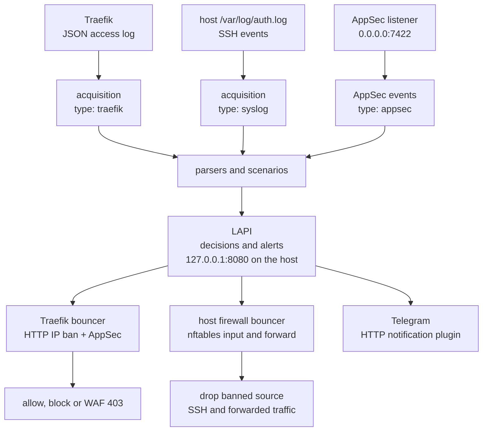

# `crowdsec` — detection, WAF and block decisions

> **Target state.** This page describes the system as it is meant to be. The
> remaining code work is tracked in [`IMPLEMENTATION.md`](../../IMPLEMENTATION.md).
> When this page and the code disagree, this page is authoritative.

## What this role is for

`crowdsec` runs the detection engine, the Local API (LAPI), the AppSec web application firewall (WAF) and the notification path. It reads security-relevant logs, turns suspicious behaviour into **decisions**, and makes those decisions available to the parts of the stack that enforce them.

There are two enforcement points:

1. **Traefik**, through the CrowdSec bouncer plugin. It blocks a banned client address and sends every other request through AppSec for request-shape inspection.
2. **The host firewall**, through the nftables firewall bouncer. It drops banned addresses at layer 3 and layer 4, before a packet reaches SSH or a forwarded container.

CrowdSec itself does not open or close ports. It produces decisions. The bouncers enforce them.

> **Rollout vs steady state.** AppSec is required, in-band and **fail-closed** in
> the target state. The Traefik bouncer starts only after its initial decision
> stream is ready. A CrowdSec outage therefore blocks HTTP traffic instead of
> letting it through uninspected. That trade-off is deliberate and is recorded in
> [`DECISIONS.md`](../DECISIONS.md). The WAF operating policy and the Frappe
> acceptance suite live in [`WAF.md`](../WAF.md).

## At a glance

| Item | Value |
|---|---|
| Role path | `roles/crowdsec` |
| Called by | `playbooks/crowdsec.yml`, `playbooks/site.yml`, `playbooks/update.yml` |
| Runs as | A named admin. The container stack runs as `deployowner` through `sudo -u deployowner` with the admin's own password. The host firewall bouncer package and service are installed as `root` through the admin's `sudo` |
| Depends on | `base` for `rsyslog`, `/var/log/auth.log`, UFW and nftables; `traefik` for `traefik-logs` and `crowdsec-net` |
| Used by | The Traefik bouncer, the host firewall bouncer, Telegram and `playbooks/smoke.yml` |
| Main tags | `crowdsec`, `appsec`, `notifications`, `firewall-bouncer` |

## The whole chain

Every part below is necessary. If a log is not read, the parser has no events. If
there are no events, there are no decisions. If there are no decisions, the
bouncers block nobody. If AppSec is unreachable, the fail-closed Traefik bouncer
blocks the request.

**Figure 1 — Detection chain.** Three acquisitions feed parsers and scenarios; the
LAPI feeds both bouncers and the notification path.



> **Two different failure policies.** AppSec is fail-closed: if it is unreachable or errors, Traefik returns `403`. The host firewall bouncer is naturally fail-open at layer 3: if LAPI is unavailable, it cannot learn new bans and existing decisions expire, but UFW still enforces the static port policy. Neither bouncer replaces the other.

## Inputs

| Variable | Default or source | Required | What it controls |
|---|---|---|---|
| `crowdsec_image` | Pinned in `roles/crowdsec/defaults/main.yml` | no | CrowdSec image; never `latest` |
| `crowdsec_network` | `crowdsec-net` | no | The private network shared with Traefik |
| `crowdsec_collections` | `crowdsecurity/traefik`, `crowdsecurity/linux`, `crowdsecurity/appsec-virtual-patching` | no | Parsers, scenarios, AppSec rules and configs installed on boot |
| `crowdsec_appsec_enabled` | `true` | yes | Start the AppSec listener and install the AppSec acquisition |
| `crowdsec_appsec_listen` | `0.0.0.0:7422` | yes | AppSec listener address inside the container |
| `crowdsec_appsec_config` | `crowdsecurity/appsec-default` | yes | AppSec config loaded by the listener. The 10 MB body limit belongs to the Traefik bouncer settings |
| `vault_crowdsec_key` → `crowdsec_key` | Vault | yes | LAPI key used by the Traefik bouncer and AppSec |
| `vault_crowdsec_firewall_key` → `crowdsec_firewall_key` | Vault | yes | Separate LAPI key used by the host firewall bouncer |
| `vault_telegram_bot_token` → `crowdsec_telegram_bot_token` | Vault | yes | Telegram bot token |
| `vault_telegram_chat_id` → `crowdsec_telegram_chat_id` | Vault | yes | Telegram chat or channel that receives alerts |
| `crowdsec_telegram_enabled` | `true` | yes | Install the Telegram notification profile |
| `env_name` | Environment group variable | yes | Used in the bouncer description and reports |
| `base_dir` | Environment group variable | yes | Parent directory for the Compose project |

The LAPI keys are stored in files: the Traefik key in a Compose secret and the host bouncer key in its root-owned config. The Telegram token is in a mode `0600 root` notification file. None of them is in the CrowdSec container environment or visible in `docker inspect` output.

### Collections

The target collection set is deliberately small and non-overlapping:

| Collection | Why it is present | What it brings |
|---|---|---|
| `crowdsecurity/traefik` | Parse the Traefik access log and detect HTTP abuse | Traefik parser, HTTP scenarios, and its own dependencies |
| `crowdsecurity/linux` | Detect SSH brute force and other host behaviour | `sshd` parser and scenarios, plus `whitelist-good-actors` |
| `crowdsecurity/appsec-virtual-patching` | In-band WAF virtual patching | AppSec rules, the `appsec-default` config and its parser/scenarios |

Do **not** also list `crowdsecurity/base-http-scenarios` or `crowdsecurity/http-cve`. `crowdsecurity/traefik` already pulls them, and duplicate collection entries make the installed set harder to reason about.

Two optional additions have their own gate:

- `crowdsecurity/http-dos` — add only after the rate limits and the Frappe acceptance suite show that normal traffic is not mistaken for a flood.
- `crowdsecurity/appsec-generic-rules` — add after the Frappe acceptance suite passes with virtual patching, because generic vectors are more likely to reject legitimate rich text, file names and API payloads.

CRS is different. Load `crowdsecurity/crs` out-of-band first, together with the `crowdsecurity/appsec-crs` scenario collection; without the scenarios, matches do not become alerts or decisions. Do **not** load `crowdsecurity/crs-inband` until a separate tuning and acceptance pass has shown that it does not break Frappe. The WAF policy is in [`WAF.md`](../WAF.md).

## What the role creates and changes

### Directories and files

| Path | Mode | Purpose |
|---|---|---|
| `<base_dir>/crowdsec` | `0750` | Compose project and private notification files |
| `<base_dir>/crowdsec/acquis.d` | `0750` | One acquisition file per source |
| `<base_dir>/crowdsec/acquis.d/traefik.yaml` | `0644` | Read `/var/log/traefik/access.log` with the Traefik parser |
| `<base_dir>/crowdsec/acquis.d/sshd.yaml` | `0644` | Read `/logs/auth.log` with the `sshd` parser |
| `<base_dir>/crowdsec/acquis.d/appsec.yaml` | `0644` | Start the AppSec listener on `0.0.0.0:7422` |
| `<base_dir>/crowdsec/acquis.yaml` | `0644` | Empty file that replaces the image's nginx and syslog sources |
| `<base_dir>/crowdsec/profiles.yaml` | `0644` | The default policy and the Telegram notification wiring |
| `<base_dir>/crowdsec/telegram.yaml` | `0600 root` | Telegram bot token, chat ID and message template |
| `<base_dir>/crowdsec/.env` | `0600` | `COLLECTIONS` and image settings |
| `<base_dir>/crowdsec/compose.yaml` | `0644` | Compose project |
| `/etc/crowdsec/bouncers/crowdsec-firewall-bouncer.yaml` | `0600 root` | Host firewall bouncer configuration and key |
| `/var/log/auth.log` | host file, mounted read-only | SSH authentication events |

CrowdSec reads one acquisition file per log source. The empty `acquis.yaml` is not a mistake: it replaces the sources the image ships with, so CrowdSec does not log a "datasource unavailable" error for nginx and syslog files that do not exist here.

Mount the `acquis.d` **directory** writable, or leave it unmanaged inside the
`/etc/crowdsec` volume. Do not bind-mount the directory, or a subdirectory, read-only:
the image prepares and `chown`s that tree on boot, and a read-only mount aborts
startup with `rsync ... Read-only file system (30)`.

The SSH acquisition uses a **container path**, not the host path. The host file is mounted at `/logs/auth.log`; the acquisition must name `/logs/auth.log`.

### Networks and volumes

| Object | Type | Purpose |
|---|---|---|
| `crowdsec-net` | External private bridge | Traefik and CrowdSec only |
| `crowdsec-db` | Named volume | Decisions, alerts and runtime state |
| `crowdsec-config` | Named volume | Configuration prepared by the image |
| `traefik-logs` | External named volume, read-only | Traefik access log |
| host `/var/log/auth.log` | Read-only bind mount | SSH authentication log |

### Container

| Property | Value |
|---|---|
| Name | `crowdsec` |
| Image | `crowdsec_image` (pinned) |
| Network | `crowdsec-net` |
| Ports | `127.0.0.1:8080:8080` for LAPI only; no AppSec host port |
| Restart | `unless-stopped` |
| Health check | `cscli lapi status` |
| Command | Image default; no custom command |
| User | `root`, the image default. The entrypoint prepares `/etc/crowdsec`, `/var/lib/crowdsec/data`, machine registration and online credentials as root |

The LAPI is published **only on the host loopback**. That is how the host firewall bouncer reaches it without exposing the LAPI to the internet. The AppSec listener stays on `crowdsec-net` at `crowdsec:7422`; it is never published on a host port.

The container receives `COLLECTIONS` as a space-separated environment variable. The image installs those collections on every start. Adding an item works; **removing** an item from the list does not uninstall it. Use the matching `DISABLE_COLLECTIONS` variable or `cscli collections remove` when a collection must go away.

The container runs as `root`, matching the upstream image. Do not force `user: 1000:1000`: UID 1000 cannot write the root-owned named volumes, cannot register the machine, and cannot read `/var/log/auth.log` (`0640 root:adm`).

## What CrowdSec can and cannot see

| Can see | Cannot see |
|---|---|
| Traefik's JSON access log | MariaDB or Redis traffic |
| Request method, path, status, user agent and selected headers | Full request bodies after the AppSec body limit |
| Host SSH authentication events in `/var/log/auth.log` | Application logs |
| AppSec request metadata and rule matches | The Docker socket |
| Its own decisions, alerts and AppSec metrics | Traffic that never reaches Traefik or the host firewall |

AppSec inspects at most the first 10 MB of a request body by default. It is not an antivirus and does not scan uploaded files for malware. A file that is larger than the limit is only partially inspected. The target also blocks a body it cannot buffer, so an HTTP/2 stream without a length is not forwarded uninspected. The WAF acceptance suite includes large-upload and HTTP/2 cases for this reason.

## AppSec in this role

This role starts the AppSec listener on `0.0.0.0:7422`, installs its config and
collection, and supplies the key the Traefik bouncer uses to reach it.

The request decision flow, fail-closed behaviour, rule-set rollout and acceptance
suite are owned by [`WAF.md`](../WAF.md). The settings that take effect in Traefik
are in [`traefik`](traefik.md#crowdsec-integration).

The Traefik LAPI key authenticates that bouncer to both LAPI and AppSec. The host
firewall bouncer uses a separate key. A mismatch on the Traefik key is therefore a
total HTTP outage, not a warning. Key rotation is a maintenance-window operation.

## Telegram notifications

CrowdSec sends alerts to Telegram through its **HTTP notification plugin**. There is no dedicated Telegram plugin.

The role writes:

- `<base_dir>/crowdsec/telegram.yaml` with the bot token, chat ID, URL and message template.
- `<base_dir>/crowdsec/profiles.yaml` with ordered remediation and notification-only profiles.

The notification file is mode `0600` and root-owned; the container runs as root. The bot token is part of the Telegram API URL, so it must not appear in a shell history, a commit or a log. The Ansible tasks that render the file and register the bouncer keys use `no_log: true`, so a failed task does not print the secret.

The CrowdSec HTTP notification plugin uses `format` for its Go template. The
template creates a JSON request with `toJson`; do not interpolate attacker-
controlled event metadata directly into JSON. Messages contain the alert scope,
source, scenario and event count, plus bounded country/ASN and selected HTTP
method, path (without its query string) and rule name when those fields are
available. Arbitrary event metadata and user-agent strings are intentionally
omitted. The message includes at most five alert summaries, reports any
additional alerts as omitted, and caps the combined text at 1,800 characters.

The target shape is:

```yaml
type: http
name: telegram
url: "https://api.telegram.org/bot<token>/sendMessage"
method: POST
headers:
  Content-Type: application/json
format: |
  {{.|toJson}}
group_wait: 30s
group_threshold: 5
max_retry: 3
```

The example `format` above is only the HTTP plugin's default JSON output; the
role template wraps the alert summary in Telegram's `chat_id` and `text` fields.
Keep the message plain text; Telegram Markdown is easy to break with
attacker-controlled fields. `group_threshold: 5` triggers a notification after
five queued alerts; the template separately caps the number of summaries and
message length, since the threshold is not itself a hard batch-size limit.

Test it with:

```bash
docker exec crowdsec cscli notifications list
docker exec crowdsec cscli notifications test telegram
```

A `400` from Telegram usually means the rendered JSON is invalid. CrowdSec logs
the status code, not the body. The `notifications test` command validates the
plugin; confirm the test message arrives in the configured chat.

### Alert context

The role does not install Hub contexts automatically. Contexts are Hub content
and are kept as an explicit operator-managed change, like collection updates.
Without the relevant contexts, the notification still includes the alert
summary, but HTTP/AppSec details may be absent.

Check and install the HTTP and AppSec contexts when needed:

```bash
docker exec crowdsec cscli contexts list
docker exec crowdsec cscli contexts install crowdsecurity/http_base crowdsecurity/appsec_base
docker restart crowdsec
docker exec crowdsec cscli alerts inspect <alert-id> -d
```

The contexts enrich alert-level metadata used by notification rendering.
Install them in development first, inspect representative HTTP and AppSec
alerts, then repeat the change in production. Review Hub updates deliberately;
do not add `cscli contexts upgrade` to routine deployments.

### Ban profiles

Profile order is deliberate. Remediation SSH alerts from
`crowdsecurity/ssh-bf`, `crowdsecurity/ssh-slow-bf` and their user-enumeration
variants receive a 24-hour IP ban. Other remediation alerts retain the
four-hour policy and the existing supported scopes. Alerts with
`Alert.Remediation == false` go through a notification-only profile, so a
single AppSec match does not create a ban. Notifications are wired into each
matching profile when Telegram is enabled.

Do not enable repeat-offender escalation until the longer SSH policy has been
observed and its decision-count behavior is confirmed against real alerts.
After deploying a profile change, inspect `docker logs crowdsec`, list recent
alerts and decisions, run `cscli notifications test telegram`, and verify the
expected duration on a development alert before applying it to production.

## The host firewall bouncer

The host firewall bouncer is mandatory. It is a host package, not a container, and it uses nftables tables separate from UFW:

- repository: CrowdSec packagecloud, `https://packagecloud.io/crowdsec/crowdsec/any/ any main`, keyed by `/etc/apt/keyrings/crowdsec_crowdsec-archive-keyring.gpg`
- package: `crowdsec-firewall-bouncer-nftables`
- service: `crowdsec-firewall-bouncer`
- LAPI URL: `http://127.0.0.1:8080/`
- bouncer name: `firewall-host`
- key: `vault_crowdsec_firewall_key`

It subscribes to **all decision origins** and drops matching addresses in the nftables `input` and `forward` chains. UFW remains the static port policy. The bouncer never edits UFW, and UFW never edits the bouncer's tables.

The details, including the Cloudflare limitation and the lockout recovery path, are in [`crowdsec-firewall-bouncer`](crowdsec-firewall-bouncer.md).

## Security invariants

- The LAPI is reachable on the host only at `127.0.0.1:8080`. It has no public listener.
- AppSec listens on `0.0.0.0:7422` **inside the container only**. It has no host port and no public route.
- The Traefik bouncer key and the host firewall bouncer key are different.
- Both keys live in files with restricted permissions, not in the container environment.
- AppSec is fail-closed. The Traefik bouncer does not start serving until its initial decision stream is ready.
- Application containers are not on `crowdsec-net`. A compromised app cannot query or change LAPI decisions.
- The host firewall bouncer enforces all decision origins. There is no local-only filter and no broad client allowlist.
- UFW remains the static port policy. The host bouncer only adds dynamic drops in its own nftables tables.
- Telegram is the only human notification channel.
- Hub content is updated deliberately, not on every boot or every three hours.
- WAF exceptions are narrow, owned and reviewed. There is no exclusion for all of `/app`, `/api`, `/assets` or `/files`.

## Idempotency and change behaviour

- Acquisition files, `profiles.yaml`, `telegram.yaml`, `.env` and the Compose file are rewritten when their content changes.
- The Traefik bouncer and the host firewall bouncer are registered only when missing, and re-registered when their vault keys no longer work.
- The role fails if a key is still rejected after re-registration. It does not silently leave Traefik with a key the LAPI or AppSec refuses.
- A change to the Compose file, an acquisition file, `profiles.yaml` or `telegram.yaml` restarts the container through the Compose project so the change is loaded. Because AppSec is fail-closed, plan that restart as an HTTP outage and use a maintenance window.
- Adding a collection is applied on the next container start. Removing one requires an explicit `DISABLE_COLLECTIONS` entry or `cscli collections remove`.
- A hub update is an explicit admin operation. The role does not update hub content on every run.
- Changing the AppSec config or rule set requires a CrowdSec reload. Verify that the AppSec listener is still up before trusting the result.
- Removing `vault_telegram_bot_token` or `vault_telegram_chat_id` does not silently disable notifications. The target state requires both; a missing value fails the run.

## Verification

### Container and LAPI

```bash
docker ps --filter name=crowdsec
docker inspect --format '{{.State.Health.Status}}' crowdsec
docker exec crowdsec cscli lapi status
docker exec crowdsec cscli bouncers list
docker exec crowdsec cscli decisions list
docker exec crowdsec cscli alerts list --limit 10
```

### LAPI from Traefik's network

```bash
docker run --rm --network container:traefik alpine \
  wget -qO- http://crowdsec:8080/health
```

This must succeed. A check from the CrowdSec container alone proves nothing about the path the bouncer uses.

### Log and acquisition

```bash
docker exec crowdsec ls -l /var/log/traefik/access.log
docker exec crowdsec ls -l /etc/crowdsec/acquis.d/traefik.yaml
docker exec crowdsec ls -l /logs/auth.log
docker exec crowdsec ls -l /etc/crowdsec/acquis.d/sshd.yaml
docker exec crowdsec cscli metrics show acquisition
```

The acquisition metrics should show both the Traefik source and the SSH source. A source that does not appear is not being read.

### AppSec listener and rule set

```bash
docker exec crowdsec cscli appsec-configs list
docker exec crowdsec cscli appsec-rules list
docker exec crowdsec cscli metrics show appsec
```

The AppSec config should be enabled, the virtual-patching rules should be present, and `Processed` should increase when requests pass through Traefik.

### A test decision

```bash
docker exec crowdsec cscli decisions add --ip 198.51.100.42 -d 2m
docker exec traefik sh -c \
  'wget -qO- --header="X-Api-Key: $(cat /run/secrets/crowdsec_lapi_key)" \
  http://crowdsec:8080/v1/decisions'
docker exec crowdsec cscli decisions remove --ip 198.51.100.42
```

The reserved test address should appear in the response. Remove it afterwards. Do not use an address you are connected from.

### Full HTTP chain

```bash
# In development, add --insecure for the staging CA.
curl --silent --show-error --fail \
  --resolve erp.example.com:443:127.0.0.1 \
  https://erp.example.com/api/method/ping
```

This must return the normal ping response, not a `403`. The WAF acceptance suite in [`WAF.md`](../WAF.md#frappe-workflow-acceptance-suite) covers the rest of the application.

### Host firewall bouncer

```bash
systemctl is-active crowdsec-firewall-bouncer
sudo nft list tables | grep crowdsec
docker exec crowdsec cscli bouncers list
```

The bouncer must be active, its `Last API pull` must be recent, and the nftables tables `ip crowdsec` and `ip6 crowdsec6` must exist. The full test is in [`crowdsec-firewall-bouncer`](crowdsec-firewall-bouncer.md#verification).

### Telegram

```bash
docker exec crowdsec cscli notifications list
docker exec crowdsec cscli notifications test telegram
```

The test message must arrive in the configured chat. If it does not, check the token, the chat ID, the template and the batching settings.

## Failure modes

| Symptom | Likely cause | First check |
|---|---|---|
| No decisions are produced | An acquisition file is missing or the log is not readable | `cscli metrics show acquisition`; check both `traefik.yaml` and `sshd.yaml` |
| Every request returns `403` | AppSec is down, AppSec returned an error, or the bouncer key is rejected | `docker exec crowdsec cscli metrics show appsec`; `docker logs traefik`; `cscli bouncers list` |
| Traefik will not serve after a restart | The initial decision stream cannot reach LAPI, or the plugin cannot load | `docker logs traefik`; `docker run --rm --network container:traefik alpine wget -qO- http://crowdsec:8080/health`; check the plugin version |
| A specific Frappe workflow returns `403` but there is no IP decision | An AppSec rule matched the request shape | `cscli alerts list`; `cscli metrics show appsec`; follow the WAF false-positive process |
| A banned address is still reaching SSH | The host bouncer is stopped, its key is rejected, or its update interval has not elapsed | `systemctl status crowdsec-firewall-bouncer`; `cscli bouncers list`; `nft list tables` |
| A legitimate admin cannot reach SSH | A decision matched the admin's egress address | Use the provider console; list decisions; delete the false one; do not add a broad allowlist |
| Telegram messages do not arrive | Bad token or chat ID, invalid template, or batching delay | `cscli notifications test telegram`; `docker logs crowdsec`; check `group_wait` |
| New collections do not appear | The container was not recreated, or the collection name is wrong | `cscli collections list`; `docker logs crowdsec` |
| The site is slow on every request | AppSec latency or an oversized body limit | `cscli metrics show appsec`; check CPU and memory; tune the rule set, not the fail-closed setting |
| Hub updates did not apply | Items are tainted, or the engine was not reloaded | `cscli hub list`; `cscli hub upgrade`; reload and verify AppSec |

## Changing CrowdSec

### Rotate the Traefik LAPI key

The Traefik bouncer and AppSec use the same key. A mismatch returns `401` and blocks every HTTP request. Do this in a maintenance window.

1. Generate a new key.
2. Update `vault_crowdsec_key`.
3. Run `playbooks/crowdsec.yml` so the bouncer is re-registered.
4. Run `playbooks/traefik.yml` so the Compose secret and Traefik configuration are updated.
5. Verify `/api/method/ping` and one known WAF block.
6. If AppSec returns `401`, roll back the vault value and re-run both playbooks.

### Rotate the host firewall bouncer key

1. Generate a new key.
2. Update `vault_crowdsec_firewall_key`.
3. Run `playbooks/crowdsec.yml`.
4. Restart `crowdsec-firewall-bouncer`.
5. Confirm the bouncer's `Last API pull` is recent and a test decision appears in the nftables set.

### Rotate the Telegram bot

1. Create or revoke the bot in BotFather.
2. Update `vault_telegram_bot_token` and, if the destination changed, `vault_telegram_chat_id`.
3. Run `playbooks/crowdsec.yml`. It restarts CrowdSec to load the new notification file; because AppSec is fail-closed, use a maintenance window.
4. Run `cscli notifications test telegram`.
5. Confirm the old token no longer works.

### Change collections

1. Edit `crowdsec_collections`.
2. Run `playbooks/crowdsec.yml`.
3. Check `docker logs crowdsec` for parser or AppSec installation errors.
4. Run the WAF acceptance suite from [`WAF.md`](../WAF.md).
5. Run `playbooks/smoke.yml`.

### Update hub content

Hub content — parsers, scenarios, collections and AppSec rules — is separate from the engine image. Update it daily or weekly, not every few hours.

```bash
docker exec crowdsec cscli hub update
docker exec crowdsec cscli hub upgrade
docker exec crowdsec cscli hub list | grep -i tainted
```

Then use the supported reload for the container and verify that AppSec is still listening. If the reload does not preserve AppSec, use a maintenance window and restart the container. The full procedure is in [`RUNBOOK.md`](../RUNBOOK.md#update-crowdsec).

A full container restart briefly makes CrowdSec unavailable. Because AppSec is fail-closed, that means all HTTP traffic is blocked during the restart. Do not restart CrowdSec casually during business hours.

### Update the engine image

Treat an image update as a maintenance-window change:

1. Read the release notes.
2. Note the current image tag and keep it for rollback.
3. Take a deliberate backup of the CrowdSec volumes if the update is a major version.
4. Pull the new image and recreate the container with the same volumes.
5. Verify LAPI, AppSec, the host bouncer and the Frappe acceptance suite.
6. If any check fails, roll back to the previous tag.

Do not update the CrowdSec engine and the Traefik bouncer plugin at the same time.

## Implementation checklist

- [ ] Three acquisitions load: Traefik access log, host SSH authentication and
      AppSec.
- [ ] The target collections install and `cscli hub list` shows no tainted item.
- [ ] The LAPI is published only on `127.0.0.1:8080`; AppSec has no host port.
- [ ] The Traefik and host bouncers use two different vault-backed keys.
- [ ] The host bouncer package is installed and `crowdsec-firewall-bouncer` is
      active.
- [ ] AppSec is enabled, fail-closed, and the Traefik bouncer waits for a healthy
      startup stream.
- [ ] Telegram notification is configured and the test message succeeds.
- [ ] A test decision is visible to both bouncers and can be removed cleanly.

## Related pages

- [`crowdsec-firewall-bouncer`](crowdsec-firewall-bouncer.md) for the host-level nftables enforcement.
- [`traefik`](traefik.md) for the bouncer middleware, AppSec settings and fail-closed behavior.
- [`WAF.md`](../WAF.md) for the WAF policy, Frappe acceptance suite and exception process.
- [`ROLES.md`](../ROLES.md) for shared networks and volumes.
- [`ARCHITECTURE.md`](../ARCHITECTURE.md#detection-and-enforcement) for the layered enforcement model.
- [`RUNBOOK.md`](../RUNBOOK.md#10-start-crowdsec) for the provisioning sequence.
- [`SECRETS.md`](../SECRETS.md#crowdsec-keys) for the CrowdSec and Telegram credentials.
- [`DECISIONS.md`](../DECISIONS.md) for the fail-closed, startup, bouncer and notification decisions.
