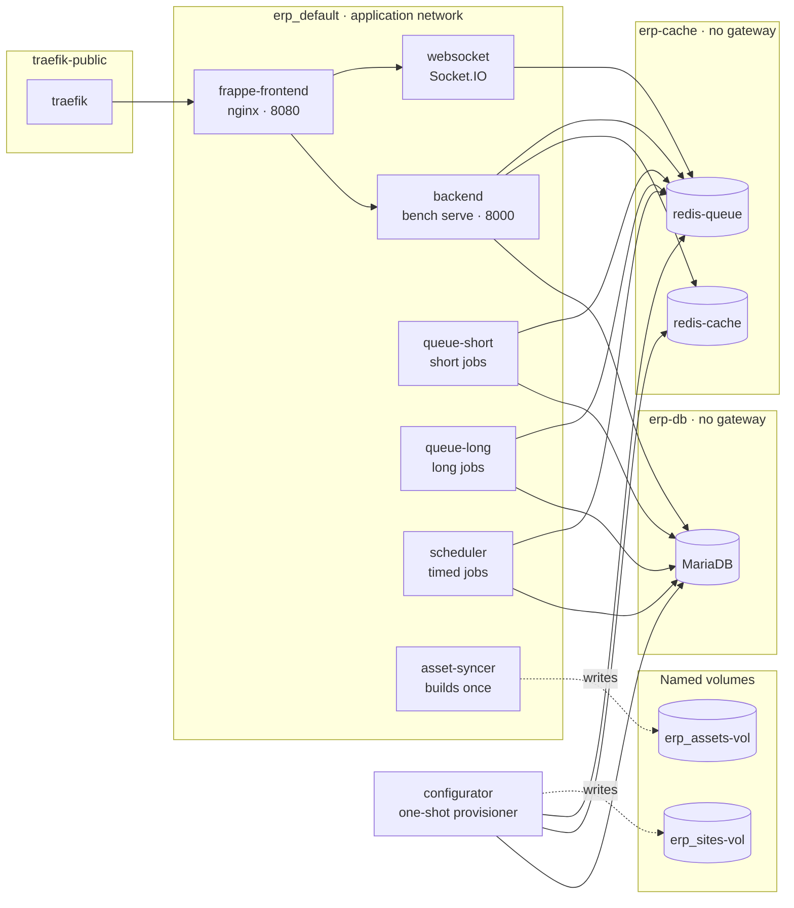

# `erp` — Frappe application

> **Target state.** This page describes the system as it is meant to be. The
> remaining code work is tracked in [`IMPLEMENTATION.md`](../../IMPLEMENTATION.md).
> When this page and the code disagree, this page is authoritative.

## What this role is for

`erp` runs the Frappe application. It creates the Compose project, renders the application environment file, starts the web and background services, builds and publishes the frontend assets, initialises the site, and attaches the public router to Traefik.

It also owns the two deploy scripts that the CI pipeline is allowed to run. That makes it the meeting point between Lane 1, which owns the host and secrets, and Lane 2, which owns the application image.

## Relationship to frappe_docker

This role is derived from the upstream `frappe_docker` layout, but it does not run the upstream compose command at deploy time.

| Upstream concept | What this role does |
|---|---|
| `compose.yaml` services | Renders one deterministic `<base_dir>/erp/compose.yaml` |
| `overrides/compose.redis.yaml` | Points the application at the two Redis services documented in [`redis`](redis.md) |
| `overrides/compose.multi-bench.yaml` | Replaced by the `erp_default` application network and the separate `erp-db` and `erp-cache` data networks |
| `overrides/compose.multi-bench-ssl.yaml` | Replaced by the Traefik router and the edge mode |
| `configurator` connection setup | Writes the MariaDB and Redis settings, then runs the role-owned site initialisation wrapper for first boot |
| `create-site` or manual `bench new-site` | Folded into the one-shot configurator. The wrapper follows Frappe's documented `bench new-site` flow, applies the initial site configuration, and lets Frappe choose the database name. The root secret is scoped to that service; runtime services use the per-site database user from `site_config.json` |
| `frontend` | Named `frappe-frontend` and attached to `traefik-public` |
| `websocket`, workers and scheduler | Kept as separate services with their own network membership |

The upstream repository is useful as a reference for service behavior and environment variable names. It is not the source of truth for this deployment's access model, secrets, WAF or image promotion.

## At a glance

| Item | Value |
|---|---|
| Role path | `roles/erp` |
| Called by | `playbooks/site.yml`, `playbooks/update.yml` |
| Runs as | A named admin, becoming `deployowner` through `sudo` with the admin's own password |
| Depends on | MariaDB is healthy; both Redis services are ready; `erp_default`, `erp-db`, `erp-cache` and `traefik-public` exist; the sites and assets volumes exist; the root secret and, when email is enabled, the mail secret exist |
| Used by | The public application, the Traefik router, the workers and the scheduler |
| Main tags | none specific; the role is usually run as a whole |

## Service map

The application is not one container. It is a set of services with different jobs.
The backend serves requests, the workers process background jobs, the scheduler
runs timed jobs, and the frontend is the nginx layer that Traefik reaches.

**Figure 1 — Service map.** Only `frappe-frontend` joins `traefik-public`. MariaDB
is on `erp-db`; Redis is on `erp-cache`. The one-shot configurator joins
the two data networks, then exits.



> **Boundary:** the frontend is the only application container on `traefik-public`. MariaDB is only on `erp-db`; Redis is only on `erp-cache`. The frontend and Traefik are on neither data network. The backend, workers and scheduler are dual-homed because they need both data services. The one-shot configurator joins both data networks only while it provisions the site. A compromised Redis or frontend cannot reach MariaDB.

## Inputs

### Image and release

| Variable | Default or source | Required | What it controls |
|---|---|---|---|
| `erp_image` | A pinned image reference, normally by digest, for a deploy | yes | The exact application image |
| `erp_image_version` | Human-readable label, such as the build version | no | Used in records and the deploy label; not the identity of the image |
| `erp_image_repository` | `vault_app_image_repository` | yes | Registry namespace and image name. Confidential: it names the account the business owns |

A tag is a name. A digest is the content. The deployment pipeline approves and deploys a digest, so the bytes that passed development are the bytes that run in production. The version label is for people and for the deploy record; it is not the identity of the image.

### Site and paths

| Variable | Default or source | Required | What it controls |
|---|---|---|---|
| `domain` | `vault_domain` | yes | Public hostname on the application router |
| `site_name` | `vault_site_name` | yes | Frappe site name |
| `env_name` | `development` or `production` | yes | Environment name in logs and manifests |
| `base_dir` | Environment group variable | yes | Parent directory for the Compose project |
| `deploy_owner_user` | `DEPLOY_OWNER_USER` | yes | Account that owns the stack directory |
| `deploy_owner_home` | `/home/{{ deploy_owner_user }}` | derived | Home directory for the `deployowner` |
| `frappe_site_apps` | `[]` | no | Apps installed when the wrapper runs `bench new-site` itself; set to the app names baked into the image |

### Secrets

| Variable | Default or source | Required | What it controls |
|---|---|---|---|
| `db_root_password` | `vault_db_root_password` | yes | Root password used only by the one-shot configurator for site creation; not by the runtime services |
| `admin_password` | `vault_admin_password` | yes | Initial password for the built-in break-glass `Administrator`; admins use their own Desk users for daily work |

The application `.env` is rendered during provisioning and when Lane 1 deliberately rotates a secret. A normal deploy does not rewrite it. The pipeline therefore never needs the vault or a database password.

`erp/.env` does not contain the MariaDB root password or the mail password.
The root secret from [`mariadb`](mariadb.md#files-and-directories) is mounted
read-only into the one-shot configurator only. At runtime, Frappe uses the
per-site database user in `site_config.json`.

The third secret is the mail password. Its source is `vault_mail_password`; it is
rendered to a separate Compose secret and is not in `.env`. See
[Initial site configuration](#initial-site-configuration).

There is no Redis password. Redis is reachable only on `erp-cache`; see [`redis`](redis.md#why-redis-has-no-password).

### Initial site configuration

These values are applied once, immediately after the site exists. They are ordinary
site configuration, not container environment.

| Variable | Default or source | Required | What it controls |
|---|---|---|---|
| `frappe_enable_logger` | `true` | no | Sets `enable_frappe_logger` to `1`, which writes `sites/<site>/logs/frappe.web.log` |
| `frappe_host_name` | `https://{{ domain }}` | yes | Sets `host_name` so background jobs and print links use the public URL |
| `frappe_email_enabled` | `true` | yes | Whether the configurator requires and writes the outgoing-mail settings |
| `frappe_mail_server` | `vault_mail_server` | when email is enabled | Sets `mail_server` |
| `frappe_mail_port` | Environment group variable | when email is enabled | Sets `mail_port` |
| `frappe_mail_login` | `vault_mail_login` | when email is enabled | Sets `mail_login` and is the default From address |
| `frappe_mail_password` | `vault_mail_password` | when email is enabled | Source for the Compose secret and `mail_password`; never a command-line argument |
| `frappe_mail_use_ssl` | `false` | when email is enabled | Sets `use_ssl`; normally used with port 465 |
| `frappe_mail_use_tls` | `true` | when email is enabled | Sets `use_tls`; normally used with port 587 |
| `frappe_auto_email_id` | `frappe_mail_login` | no | Sets `auto_email_id` |
| `frappe_email_sender_name` | `vault_mail_sender_name` | no | Sets `email_sender_name` |

The wrapper sets a key only when it is absent, so a re-run or a later operator
change is not overwritten. If `frappe_email_enabled` is true and any required mail
value is missing, the configurator fails before the backend starts. Set exactly one
of `frappe_mail_use_ssl` and `frappe_mail_use_tls`.

`site_config.json` is a secret. It contains `db_password`, `mail_password` and the
site encryption key. It lives on the protected sites volume and is included in the
sites-volume backup.

### Fixed service endpoints

These values are part of the Compose contract. They are not public addresses.

| Setting | Value |
|---|---|
| `DB_HOST` | `mariadb` |
| `DB_PORT` | `3306` |
| `REDIS_CACHE` | `redis-cache:6379` |
| `REDIS_QUEUE` | `redis-queue:6379` |
| `REDIS_SOCKETIO` | `redis-queue:6379` |
| `SOCKETIO_PORT` | `9000` |

`REDIS_SOCKETIO` points at the queue endpoint for upstream compatibility. There is no separate Socket.IO Redis container in the target.

### Routing switches

| Variable | Default or source | Required | What it controls |
|---|---|---|---|
| `traefik_cert_resolver` | Chosen by edge mode | yes | Certificate resolver used by the application router |
| `traefik_crowdsec_enabled` | `true` in the target state; turned on only after the chain is verified | yes | Attach the CrowdSec bouncer and AppSec to the application router |
| `traefik_origin_cloudflare_only` | `false` | yes | Attach `cloudflare-allow` to the application router |

## What the role creates and changes

### Files and directories

| Path | Mode | Purpose |
|---|---|---|
| `<base_dir>/erp` | `0755` | Compose project |
| `<base_dir>/erp/compose.yaml` | `0644` | Eight-service Compose project |
| `<base_dir>/erp/.env` | `0600` | Frappe administrator password; no database root password and no mail password |
| `<base_dir>/erp/secrets` | `0700` | Directory for file-backed Compose secrets |
| `<base_dir>/erp/secrets/mail_password` | `0600` | SMTP password, mounted only into the one-shot configurator |
| `/etc/erp/deploy.conf` | `0600` | App directory, site name and Compose project for the deploy scripts |
| `/usr/local/bin/erp-deploy` | `0755` | Validate, pull, recreate, migrate, clear caches and record a deploy |
| `/usr/local/bin/erp-smoke` | `0755` | Container, edge, certificate and CrowdSec health checks |
| `/var/log/erp-deploys.log` | `0600` | One append-only line per deploy |

The one-shot configurator mounts the root secret file described in
[`mariadb`](mariadb.md#files-and-directories) read-only. The erp role does not
render a second copy, and no long-running service mounts it.

The configurator also mounts the mail secret from
`<base_dir>/erp/secrets/mail_password` as `/run/secrets/mail_password`. Neither
secret is in `.env` or in a long-running service environment. The mail password
is written into `site_config.json` after site creation because the runtime
processes need it to send mail; that file is on the protected sites volume and is
included in the backup.

### Volumes and networks

| Object | Type | Purpose |
|---|---|---|
| `erp_sites-vol` | External named volume | `/home/frappe/frappe-bench/sites`; site configuration, uploaded files and installed apps |
| `erp_assets-vol` | External named volume | Built frontend assets |
| `erp_default` | External bridge | Application service-to-service traffic and outbound access |
| `erp-db` | External internal network | MariaDB traffic; no gateway |
| `erp-cache` | External internal network | Redis traffic; no gateway |
| `traefik-public` | External bridge | Only `frappe-frontend` joins this from the app |

`erp_default` is the only application network with a gateway. Workers and the
scheduler stay on it for outbound calls; `erp-db` and `erp-cache` have no
internet route.

### Services

| Service | Command | Networks | Volumes | Lifecycle |
|---|---|---|---|---|
| `asset-syncer` | Build assets, sync them and validate `assets.json` | `erp_default` | `assets-vol` | one-shot; must complete successfully |
| `configurator` | Set database and Redis config, create the site, apply the initial site configuration | `erp-db`, `erp-cache` | `sites-vol`, `assets-vol` | one-shot; must complete successfully after the asset build and data readiness |
| `backend` | `bench serve --port 8000` | `erp_default`, `erp-db`, `erp-cache` | `sites-vol`, `assets-vol` | long-running |
| `websocket` | `node .../socketio.js` | `erp_default`, `erp-cache` | `sites-vol` | long-running |
| `frappe-frontend` | `nginx-entrypoint.sh` | `erp_default`, `traefik-public` | `sites-vol`, `assets-vol` | long-running |
| `queue-short` | `bench worker --queue short,default` | `erp_default`, `erp-db`, `erp-cache` | `sites-vol` | long-running |
| `queue-long` | `bench worker --queue long,default,short` | `erp_default`, `erp-db`, `erp-cache` | `sites-vol` | long-running |
| `scheduler` | `bench schedule` | `erp_default`, `erp-db`, `erp-cache` | `sites-vol` | long-running |

All long-running services use `restart: unless-stopped` and pull the image on every deploy. The one-shot services exist to make the startup deterministic: assets are built before the app starts, and site configuration is written before the backend starts.

The `websocket` service must be on `erp-cache` so it can reach `redis-queue`. It does not need `erp-db`. If it is only on `erp_default`, the site can render but real-time updates fail.

The `configurator` is the only application-side service that mounts the root
secret and the mail secret. It is on both data networks because it creates the
database and the site configuration, then exits. The runtime services use the
per-site database user and read the mail password from `site_config.json`.

## Startup and dependency order

Compose starts the services in this order:

1. `asset-syncer` runs `bench build --production`, copies the result into `erp_assets-vol`, validates every path in `assets.json`, and writes a marker.
2. `configurator` waits for the asset build and for MariaDB and both Redis services to be ready. It writes the database host and port, the two Redis endpoints and the Socket.IO alias, and the Socket.IO port. It then runs the site initialisation wrapper with the root and mail secrets mounted read-only. It exits successfully only after the site exists and the initial site configuration is valid.
3. `backend`, `websocket`, `queue-short`, `queue-long` and `scheduler` wait for the configurator to complete successfully, not merely to start.
4. `frappe-frontend` waits for the backend to start and for the asset build to complete.
5. `site.yml` waits for the backend to answer `bench --version`, checks that `sites/<site>/site_config.json` exists, clears the Frappe cache and website cache, then restarts the backend and frontend. If the site is missing, the play fails closed and prints the configurator log.

The asset marker is keyed to the image identity. A rebuild under the same human version must not be mistaken for the same asset set. The marker is written only after validation passes, so a half-finished build cannot be reused.

## Site initialisation

The normal first-boot path is the one-shot `configurator` service. It follows
Frappe's documented `bench new-site` flow. It writes the connection settings,
creates the configured site when it is absent, and applies the initial site
configuration before it exits.

The wrapper is shipped by this role, not assumed to exist in the application
image. It uses the image's `/docker/scripts/init-site.sh` when the image provides
one; that script owns the image's app set. Otherwise the wrapper runs the
documented `bench new-site` command directly and installs `frappe_site_apps`.
Both paths are idempotent:

1. If `sites/<site>/site_config.json` is absent, run `bench new-site` with
   `--mariadb-user-host-login-scope='172.30.%.%'`, `--db-root-password` read from
   `/run/secrets/db_root_password`, `--admin-password` from the application
   environment, and one `--install-app` per entry in `frappe_site_apps`. Do not
   pass `--db-name` unless the environment deliberately needs a fixed name.
2. Frappe chooses the database name and creates a per-site database user. In v15
   the user defaults to the database name; from v16 it may be the explicit
   `db_user`. Read both from `site_config.json`; never assume the database is
   named `frappe`.
3. Apply the initial site configuration described below. Set a key only when it
   is absent, so a re-run or a later operator change is not overwritten.
4. Verify the site configuration and exit non-zero if the site is missing, the
   database identity is absent, or email is enabled but incomplete.

The root password is passed to `bench new-site` through
`--db-root-password "$(cat /run/secrets/db_root_password)"`. It therefore appears
in that one-shot process's arguments for the duration of site creation. It is not
in the environment of the backend, workers, scheduler or websocket. The mail
password is never passed as an argument; the wrapper reads it from
`/run/secrets/mail_password`.

The database is normally created by `bench new-site`; this role does not create
or drop databases with raw SQL. The per-site user is granted only on that
database, and the user's host scope is restricted to the Docker address pool.

A normal deploy does not run `bench new-site` from the host. The site is part of
the application lifecycle. The wrapper is safe to re-run: if the site exists, it
does not create it again.

Adding another site is an exception, not the normal path. This Compose project
assumes one site per environment. If you must create one for a recovery test, use
a temporary one-shot container from the application image with `erp-db`,
`erp-cache`, the sites volume and the root secret mounted read-only. Mount the
mail secret only if the recovery test also needs to apply mail settings. Remove
the container when it exits. Do not run `bench new-site` in the long-running
`backend`, because that would give the runtime service the root credential.

```text
one-shot container -> MariaDB (root, site creation) -> per-site user in site_config.json
backend/workers    -> MariaDB (per-site user)       -> no root
```

A second production site is a new environment, not a second tenant in this stack.

The built-in `Administrator` is the break-glass application account. It is not a daily shared login. Each admin uses a personal Desk user with the role their work needs.

### Applying the initial site configuration

The configurator applies these keys immediately after the site exists:

| Site config key | Source | Why |
|---|---|---|
| `enable_frappe_logger` | `frappe_enable_logger ? 1 : 0` | Writes `sites/<site>/logs/frappe.web.log` for the web process |
| `host_name` | `frappe_host_name` | Gives background jobs and print links the public URL |
| `mail_server` | `frappe_mail_server` | SMTP host |
| `mail_port` | `frappe_mail_port` | SMTP port |
| `mail_login` | `frappe_mail_login` | SMTP login and default From address |
| `mail_password` | `/run/secrets/mail_password` | SMTP password; read inside the one-shot, never an argument |
| `use_ssl` | `frappe_mail_use_ssl` | Implicit TLS, normally port 465 |
| `use_tls` | `frappe_mail_use_tls` | STARTTLS, normally port 587 |
| `auto_email_id` | `frappe_auto_email_id`, falling back to `frappe_mail_login` | Default outgoing address |
| `email_sender_name` | `frappe_email_sender_name` | Display name |

The wrapper sets a key only when it is absent. `frappe_email_enabled: true`
requires the server, port, login, password and exactly one of SSL/TLS; the
configurator fails before the backend starts if any is missing. Setting
`frappe_email_enabled: false` skips the mail keys but does not remove keys that
already exist.

`site_config.json` is a secret. It contains `db_password`, `mail_password` and the
site encryption key. Protect the sites volume and include it in the backup; do not
print the file in logs. A request or a background job can use the mail password
after the configurator exits because the runtime reads it from this file.

## The public router

The `frappe-frontend` container carries these Traefik labels:

| Label | Value | Meaning |
|---|---|---|
| `traefik.enable` | `true` | Opt in to Docker discovery |
| `traefik.docker.network` | `traefik-public` | Route over the edge network |
| Host rule | `Host({{ domain }})` | Match the public hostname |
| Entrypoint | `websecure` | HTTPS only |
| TLS | enabled | Terminate TLS at Traefik |
| Certificate resolver | `traefik_cert_resolver` | HTTP-01 or DNS-01 |
| Service port | `8080` | nginx listens here inside the container |
| Middlewares | Mode-dependent | Bouncer, allowlist, rate limit, CSP, headers |

The order of the middleware chain is owned by [`traefik`](traefik.md#dynamic-configuration);
this role only sets the labels that attach it. `cloudflare-allow` is present only
in Cloudflare proxy mode. `crowdsec-bouncer` is present when the plugin is loaded;
in the target state it is always loaded. If AppSec is unavailable, the request
returns `403` rather than reaching Frappe.

The application router never publishes a host port. The WAF acceptance suite in
[`WAF.md`](../WAF.md) tests the full path, including this router.

## The deploy interface

The role installs the fixed-purpose scripts that make Lane 2 safe.

### `erp-deploy`

The script accepts one argument: an image digest. It:

1. Validates the digest format.
2. Reads `/etc/erp/deploy.conf`.
3. Records the currently running digest.
4. Pulls the requested image.
5. Recreates the application services.
6. Runs the database migration.
7. Clears the Frappe and website caches.
8. Restarts the workers and scheduler.
9. Runs a health check.
10. Appends the timestamp, environment, previous digest, new digest, actor, workflow URL and result to `/var/log/erp-deploys.log`.

A bad digest is rejected before anything is pulled.

### `erp-smoke`

The script checks:

- The expected containers are running.
- The application answers through the edge.
- The TLS certificate is issued for the hostname.
- The Traefik bouncer is registered.
- The AppSec listener answers through the Traefik bouncer path.

Public trust is asserted in production only. Development uses the staging CA, so
a browser warning there is expected.

It is a health check, not the full CrowdSec or WAF test. The full chain test and the Frappe acceptance suite stay on an admin's control machine.

### Why `ci-deploy` cannot do more

The `ci-deploy` account and its sudo rule are installed by the `base` role; the `erp` role owns the two scripts the rule names. `ci-deploy` may run only these two commands as root. It is not in the `docker` group, cannot read `.env`, cannot edit a role and cannot run Ansible. A compromised pipeline can ship a bad image; it cannot open a port, read a secret or change the host.

## Security invariants

- The public app router has no host port. All traffic goes through Traefik.
- Only `frappe-frontend` joins `traefik-public`.
- MariaDB is not on `erp_default`, `erp-cache` or `traefik-public`.
- Redis is not on `erp_default`, `erp-db` or `traefik-public`.
- The frontend is on `erp_default` for backend and websocket traffic, but on
  neither data network.
- The application `.env` is `0600`, owned by the `deployowner`, and is not re-rendered on a normal deploy.
- The `.env` contains the Frappe administrator password, not the database root
  password and not the mail password.
- The root secret is mounted only into the one-shot configurator and the MariaDB
  container.
- The mail secret is mounted only into the one-shot configurator. The runtime
  services read the mail password from `site_config.json`.
- Runtime services use the per-site Frappe database user from `site_config.json`.
- `site_config.json` is treated as a secret and is never printed in a log or
  copied to an unencrypted backup.
- `ci-deploy` has no supplementary groups and only two `sudo` commands.
- The deploy script runs as root but never prints or reads the application secrets.
- The application image is pinned by digest for a deploy.
- The frontend trusts `X-Forwarded-For` only from Traefik's address on
  `traefik-public`, not from `127.0.0.1`, and passes the real client address to
  the backend.
- The public router uses the security headers and CSP defined by the Traefik role; it does not define a second, weaker set in Compose.
- A WAF `403` is not bypassed by excluding `/app`, `/api`, `/assets` or `/files`. Follow the diagnosis in [`WAF.md`](../WAF.md).

## Idempotency and change behaviour

- The Compose file is rewritten when its content changes.
- The `.env` is rendered at provisioning and on a deliberate secret rotation, not on every deploy.
- The asset build is skipped when the marker for the current image already exists.
- The configurator is designed to be safe to re-run; it creates the site only
  when it is absent and fills only missing initial site-config keys.
- The initial logger and mail settings are not reapplied over an operator's later
  change. A rotation is an explicit action, not a side effect of a normal deploy.
- The backend and frontend are restarted after a cache clear, and both cache
  commands are guarded by a site-existence check.
- A new image digest recreates the application services and leaves the data volumes in place.
- A rollback is the same deploy script with an older digest. There is no separate rollback path.

## Verification

### Containers and services

```bash
docker ps -a --filter name=asset-syncer --filter name=configurator \
  --filter name=backend --filter name=websocket \
  --filter name=frappe-frontend --filter name=queue-short \
  --filter name=queue-long --filter name=scheduler
```

`asset-syncer` and `configurator` should have exited successfully. The backend, frontend, websocket, workers and scheduler should be running.

Check the data networks from the application side:

```bash
docker inspect backend --format '{{json .NetworkSettings.Networks}}'
docker inspect websocket --format '{{json .NetworkSettings.Networks}}'
docker inspect frappe-frontend --format '{{json .NetworkSettings.Networks}}'
docker network inspect erp-db \
  --format '{{range .Containers}}{{.Name}} {{end}}'
docker network inspect erp-cache \
  --format '{{range .Containers}}{{.Name}} {{end}}'
```

Expected memberships:

- `backend`: `erp_default`, `erp-db`, `erp-cache`.
- `websocket`: `erp_default`, `erp-cache`; not `erp-db`.
- `frappe-frontend`: `erp_default`, `traefik-public`; neither data network.
- `erp-db`: MariaDB, configurator, backend, workers and scheduler. No Redis,
  no frontend and no Traefik.
- `erp-cache`: Redis, configurator, backend, websocket, workers and
  scheduler. No MariaDB, no frontend and no Traefik.

Check that the runtime site configuration uses the per-site user, has no root
credential, and contains the initial logger and mail settings:

```bash
cd <base_dir>/erp
docker compose exec -T backend sh -c \
  'jq -r ".db_name, (.db_user // .db_name), (.db_password != null), (.db_root_password // empty), (.enable_frappe_logger // \"missing\"), (.host_name // \"missing\"), (.mail_server // \"missing\"), (.mail_login // \"missing\"), (.mail_password != null)" \
   sites/<site>/site_config.json'
```

The first two lines should name the site database and its dedicated user. The
third should be `true`; the fourth should be empty. The fifth should be `1`, the
sixth the public URL, and the last three should show the mail settings and
`true` when email is enabled. A missing `db_user` is normal before v16; the
fallback uses `db_name`.

After a normal request, the logger file should exist and be non-empty:

```bash
docker compose exec -T backend sh -c 'test -s sites/<site>/logs/frappe.web.log'
```

Send a test message from Desk after the first login and confirm the provider
accepted it. The configurator never prints the mail password.

### Edge and application

```bash
# In development, add --insecure for the staging CA.
curl --silent --show-error --fail \
  --resolve erp.example.com:443:127.0.0.1 \
  https://erp.example.com/api/method/ping
```

### Backend, caches and queues

```bash
cd <base_dir>/erp
docker compose exec -T backend bench --version
docker compose exec -T backend sh -c 'test -f sites/<site>/site_config.json' || {
  docker logs --tail 100 configurator
  exit 1
}
docker compose exec -T backend bench --site <site> clear-cache
docker compose exec -T backend bench --site <site> clear-website-cache
docker logs --tail 50 websocket
docker logs --tail 50 queue-short
docker logs --tail 50 queue-long
```

The backend must answer, the site check must pass, the cache clears must succeed,
and the websocket and worker logs must not show repeated Redis connection errors.
If the site check fails, read the configurator log; do not retry the cache clear
against a missing or half-created site.

### Deploy record

```bash
sudo tail -n 5 /var/log/erp-deploys.log
```

Each line should name the digest, actor and workflow run. A deploy without a record is incomplete.

## Failure modes

| Symptom | Likely cause | First check |
|---|---|---|
| `asset-syncer` exits non-zero | The asset build failed, or an asset in `assets.json` is missing | `docker logs asset-syncer` |
| `configurator` exits non-zero | MariaDB or Redis is unreachable, the root secret is missing, the mail secret is missing when email is enabled, the site initialisation failed, or email settings are incomplete | `docker logs configurator`; check `erp-db` and `erp-cache` membership, the required secret files, both Redis health states and the mail variables |
| Site configuration is missing or incomplete | The configurator did not finish, the image-owned script failed, or a required mail value was absent | `docker logs configurator`; inspect `sites/<site>/site_config.json`; do not start the backend against a half-created site |
| Logs do not appear in `frappe.web.log` | `enable_frappe_logger` is not set, or no request has reached the backend | Check the site config; make a request; check the file owner and the volume |
| Outgoing mail fails | SMTP values are wrong, the provider rejected the login, or the mail password is stale | Check the site config without printing the password; send a test from Desk; read the provider's rejection |
| Backend restarts in a loop | MariaDB is not healthy, the site database is missing, or a migration failed | `docker logs backend`; `docker logs mariadb-database` |
| Frontend returns `502` | Backend is down or the frontend upstream is wrong | `docker logs frappe-frontend`; `docker logs backend` |
| Public request gets `403` | `cloudflare-allow` rejected the source, CrowdSec banned the source, AppSec matched a rule, or AppSec is unavailable | Check `cscli decisions list`, `cscli metrics show appsec`, and the Traefik log; distinguish the three `403` sources before changing anything |
| Static files are missing or stale | The asset marker says the assets are current, but the volume is stale | Remove the marker and re-run the asset service; confirm the image digest changed |
| Socket.IO does not connect | `websocket` or `redis-queue` is down, or the websocket is not on `erp-cache` | `docker logs websocket`; `docker logs redis-queue`; inspect the websocket's network membership |
| Queue jobs are not processed | A worker is down or cannot reach `redis-queue` | `docker logs queue-short`; `docker logs queue-long`; `docker inspect queue-short --format '{{json .NetworkSettings.Networks}}'` |
| Queue jobs disappear after a restart | RDB snapshots and no AOF | Confirm whether the queue needs durable persistence; see [`redis`](redis.md#persistence-and-data-loss) |
| Deploy script rejects the image | Digest format is wrong, or `deploy.conf` is missing | Inspect the script output; `sudo cat /etc/erp/deploy.conf` |

## Deploying and rolling back

### Normal deploy

1. The application repository builds an image and reads its digest.
2. It dispatches the digest to this repository.
3. Development deploys automatically.
4. Development health smoke (`erp-smoke`) passes.
5. The designated reviewer approves the production job, unless they triggered it.
6. Production deploys the same digest.
7. Production health smoke (`erp-smoke`) passes.
8. The host records the deploy.

### Rollback

Dispatch the previous digest through the same workflow. It goes through development and production approval again. The host records the change.

## Implementation checklist

- [ ] `erp-deploy` accepts exactly one `sha256:` digest, rejects a tag, and
      validates the format before pulling anything.
- [ ] The application `.env` is rendered at provisioning and on a deliberate
      secret rotation, not on a normal deploy.
- [ ] `frappe-frontend` is the only application container on `traefik-public`.
- [ ] MariaDB is only on `erp-db`; Redis is only on `erp-cache`.
- [ ] The frontend and Traefik are on neither data network.
- [ ] The websocket is on `erp-cache`, not `erp-db`.
- [ ] The one-shot `configurator` is the only application-side service with the
      root secret; runtime services use the per-site database user.
- [ ] The mail secret is mounted only into the one-shot configurator; the runtime
      reads the mail password from `site_config.json`.
- [ ] The startup dependency is `service_completed_successfully`, not
      `service_started`, for every application service that depends on the
      configurator.
- [ ] `configurator` initialises the site once; a second site is a new
      environment, not a second tenant.
- [ ] Site creation follows Frappe's documented `bench new-site` flow. The
      database name is read from `site_config.json`; no step assumes `frappe`.
- [ ] The configurator sets `enable_frappe_logger`, `host_name` and the mail keys
      when absent, and fails before the backend starts if email is enabled but
      incomplete.
- [ ] `site.yml` checks that the site exists before either cache-clear command and
      fails closed with the configurator log.
- [ ] The frontend trusts `X-Forwarded-For` only from Traefik on
      `traefik-public`; `127.0.0.1` is not treated as the proxy.
- [ ] `ci-deploy` can run only `erp-deploy` and `erp-smoke`, and the
      scripts are root-owned and not writable by `ci-deploy`.
- [ ] A deploy records the previous digest, new digest, actor and workflow run.
- [ ] Smoke is a health check; the full chain check stays on the control machine.

## Related pages

- [`ROLES.md`](../ROLES.md) for the shared network and volume inventory.
- [`traefik`](traefik.md) for the public router and middleware.
- [`WAF.md`](../WAF.md) for the AppSec policy and the Frappe acceptance suite.
- [`mariadb`](mariadb.md) and [`redis`](redis.md) for the data services.
- [`backup`](backup.md) for the sites-volume archive.
- [`ARCHITECTURE.md`](../ARCHITECTURE.md#lane-2--application-deployment) for the two-lane model.
- [`RUNBOOK.md`](../RUNBOOK.md#151-deploy-an-application-image) for the deploy commands.
- [`SECRETS.md`](../SECRETS.md#ci-deploy-key) for the pipeline key.
- [`SECRETS.md`](../SECRETS.md#frappe-mail-password) for mail-secret rotation.
