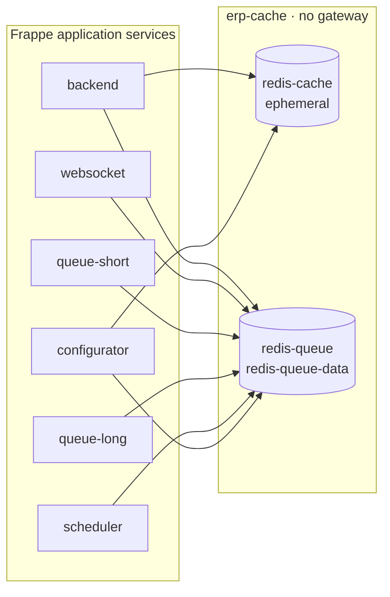

# `redis` — cache and queue

> **Target state.** This page describes the system as it is meant to be. The
> remaining code work is tracked in [`IMPLEMENTATION.md`](../../IMPLEMENTATION.md).
> When this page and the code disagree, this page is authoritative.

## What this role is for

`redis` runs the two Redis services that Frappe needs:

- `redis-cache` stores short-lived cached values. Losing it is cheap; the application rebuilds the cache.
- `redis-queue` stores background jobs and the pub/sub messages used by Socket.IO. Losing it can lose queued work and drops live real-time connections.

The services are deliberately small and internal. Neither publishes a host port. Neither has a password, because the network is the security boundary.

## At a glance

| Item | Value |
|---|---|
| Role path | `roles/redis` |
| Called by | `playbooks/site.yml`, `playbooks/update.yml` |
| Runs as | A named admin, becoming `deployowner` through `sudo` with the admin's own password |
| Depends on | `erp-cache` exists |
| Used by | The `erp` backend, workers, scheduler, websocket and configurator |
| Main tags | none specific; the role is usually run as a whole |

## Where this comes from in frappe_docker

The upstream `frappe_docker` repository adds Redis with `overrides/compose.redis.yaml`. That file defines exactly two services:

- `redis-cache`
- `redis-queue`

Only `redis-queue` has a named volume, `redis-queue-data`. The upstream base Compose file also sets `redis_socketio` to the queue endpoint for backward compatibility. It does not run a separate Socket.IO Redis service.

This deployment keeps the same data model and service names, but runs Redis as its own Compose project under `<base_dir>/redis`. MariaDB and Redis therefore have their own lifecycle and do not disappear when the application Compose project is recreated.

The upstream image tag is not repeated here. The version is the `redis_image` value in `group_vars/all/main.yml`.

## What Redis stores

| Service | Data | If it is lost | Persistent volume |
|---|---|---|---|
| `redis-cache` | Rendered pages, fragments and other short-lived values | The application repopulates the cache; requests may be slower for a short time | No |
| `redis-queue` | RQ jobs and queue metadata; the same instance carries Socket.IO pub/sub (not persisted) | Queued jobs may be lost; live Socket.IO clients reconnect | `redis-queue-data` for RQ data |

The two services are separate on purpose. A cache restart must not take the job queue down, and a queue restart must not wipe the cache.

## Topology

**Figure 1 — Redis topology.** Only the Frappe services that need Redis share
`erp-cache` with it; MariaDB is on `erp-db`, and no Redis port is
published on the host.



The public frontend, Traefik, CrowdSec and MariaDB are not on this network. Only
the Frappe services that need Redis join `erp-cache`. MariaDB is on the
separate `erp-db` network, so a compromised Redis container cannot reach the
database.

## Inputs

| Variable | Default or source | Required | What it controls |
|---|---|---|---|
| `redis_image` | Pinned in `group_vars/all/main.yml` | no | Image for both Redis services |
| `base_dir` | Environment group variable | yes | Parent directory for the Redis Compose project |

There is no Redis password variable. That is not an oversight; see [Why Redis has no password](#why-redis-has-no-password).

## What the role creates and changes

### File

| Path | Mode | Purpose |
|---|---|---|
| `<base_dir>/redis/compose.yaml` | `0644` | The two Redis services |

There is no `.env`. Redis has no secret to render.

### Volumes and network

| Object | Type | Purpose |
|---|---|---|
| `redis-queue-data` | Named volume | RQ jobs and queue metadata; mounted at `/data` in `redis-queue` |
| `erp-cache` | External internal network | Redis traffic with no internet gateway |

`redis-cache` has no persistent volume. Its data is disposable by design.

### Containers

| Container | Command | Network | Ports | Volume |
|---|---|---|---|---|
| `redis-cache` | Redis server with the role's cache settings | `erp-cache` | none | none |
| `redis-queue` | Redis server with the role's queue settings | `erp-cache` | none | `redis-queue-data` |

Both use:

- `restart: unless-stopped`
- health check `redis-cli ping`
- log rotation at `10m` per file and three files
- the same pinned image

The queue service is the only Redis member with a volume. If the cache container is recreated, its cache is empty. That is expected.

## How Frappe connects

The `configurator` service writes the Redis endpoints into Frappe's common site configuration:

| Setting | Value |
|---|---|
| `redis_cache` | `redis://redis-cache:6379` |
| `redis_queue` | `redis://redis-queue:6379` |
| `redis_socketio` | `redis://redis-queue:6379` |

The third value is an upstream compatibility setting, not a third server. Socket.IO uses the queue endpoint. The `websocket` service must therefore be able to reach `redis-queue` on `erp-cache`.

If you rename a service, change both the Compose service name and the corresponding setting in the `erp` role. A name that resolves from one project but not the other produces a connection error at startup.

## Why Redis has no password

Redis is reachable only from `erp-cache`, an internal Docker network with no gateway. The trust boundary is the network, not a password.

That choice has consequences:

- Any container attached to `erp-cache` can read and write Redis.
- Do not attach the public frontend, Traefik, CrowdSec, MariaDB or an unrelated
  container to that network.
- Keep MariaDB on `erp-db`. Adding it to `erp-cache` would undo the
  database/cache separation for no functional gain.
- Do not publish port `6379`, not even on `127.0.0.1`.
- Queue messages can contain business data. Treat Redis as sensitive internal state, not as a public cache.
- There is no TLS between Frappe and Redis because the traffic never leaves the host's Docker network.

If the trust boundary changes, add authentication and TLS as a deliberate design change. Do not expose the unauthenticated service to compensate.

## Persistence and data loss

Redis is not a zero-loss job store.

`redis-queue` keeps its data in the `redis-queue-data` volume. By default, Redis writes point-in-time RDB snapshots. A crash between snapshots can lose the jobs accepted since the last successful snapshot. Upstream `frappe_docker` does not enable append-only persistence.

The target therefore says:

- `redis-cache` is disposable.
- `redis-queue` survives a normal container recreate because its volume is retained.
- `redis-queue` does **not** guarantee that every accepted job survives a host crash or an unclean stop.
- Redis is not part of the MariaDB-and-sites backup pair. See [`backup`](backup.md).
- If job durability becomes a requirement, enabling append-only persistence or moving the queue to a durable broker is a design change, not a documentation change.

Do not run `docker compose down -v` against the Redis project. It removes the queue volume and makes the loss permanent.

## Memory and eviction

The upstream Redis override does not set a hard memory limit or an eviction policy. The cache can therefore grow until the host or container limit is reached.

Monitor memory before changing the workload:

```bash
docker exec redis-cache redis-cli info memory
docker exec redis-queue redis-cli info memory
docker exec redis-cache redis-cli dbsize
docker exec redis-queue redis-cli dbsize
```

A `maxmemory` policy for the cache is a deliberate change. Never put an eviction policy on the queue that can silently discard jobs. A memory alert is a signal to review cache keys and job growth, not a reason to flush the queue.

## Startup and readiness

`playbooks/site.yml` and `playbooks/update.yml` create the network, start MariaDB
and Redis, and wait for the data stores before starting the application.

The target waits for both Redis services, not only the cache:

- `redis-cache` answers `PING`.
- `redis-queue` answers `PING`.

A queue that is not ready when `configurator` runs produces a site configuration failure that looks like an application problem. The readiness gate must therefore cover both services in both playbooks.

Within the `erp` project, Redis is already running as a separate project. Compose cannot use `depends_on: service_healthy` across projects, which is why the readiness gate lives in the playbooks.

## Verification

### Services

```bash
docker ps --filter name=redis-
docker exec redis-cache redis-cli ping
docker exec redis-queue redis-cli ping
docker inspect --format '{{.State.Health.Status}}' redis-cache
docker inspect --format '{{.State.Health.Status}}' redis-queue
```

Expected result: both `PING` commands return `PONG`; both health states are `healthy`.

### Persistence

```bash
docker exec redis-queue redis-cli info persistence
docker volume inspect redis-queue-data
```

`rdb_last_bgsave_status` should be `ok`. `aof_enabled` is expected to be `0`; the upstream target does not use AOF. Check that `redis-queue-data` exists before relying on queue state across a recreate.

### Network membership

```bash
docker network inspect erp-cache \
  --format '{{range .Containers}}{{.Name}} {{end}}'
docker network inspect erp-db \
  --format '{{range .Containers}}{{.Name}} {{end}}'
```

The cache network should contain `redis-cache`, `redis-queue`, `configurator`,
`backend`, `websocket`, `queue-short`, `queue-long` and `scheduler`. It must not
contain MariaDB, `traefik`, `frappe-frontend` or `crowdsec`.

The database network should contain MariaDB, `configurator`, `backend`,
`queue-short`, `queue-long` and `scheduler`. It must not contain Redis, the
websocket, the frontend, Traefik or CrowdSec.

### From the application

```bash
docker inspect backend --format '{{json .NetworkSettings.Networks}}'
docker logs --tail 50 websocket
docker logs --tail 50 queue-short
docker logs --tail 50 queue-long
```

The backend must show `erp-cache`; the websocket must show it too; the worker logs must not contain repeated connection-refused errors.

Do not use `KEYS *` on a production Redis instance. It can block the server while it scans the keyspace. Use `DBSIZE`, `INFO keyspace` and targeted application tools instead.

## Failure modes

| Symptom | Likely cause | First check |
|---|---|---|
| `Connection refused` from the backend | Redis is down, or the backend is not on `erp-cache` | `docker ps`; `docker network inspect erp-cache` |
| Cache health check fails | Redis cannot bind, or the container is restarting | `docker logs redis-cache` |
| Queue health check fails | Redis cannot write `/data`, or the volume is missing | `docker logs redis-queue`; `docker volume inspect redis-queue-data` |
| Configurator exits with a Redis error | A Redis service is not ready or is on the wrong network | `docker logs configurator`; check both Redis health states |
| Queue jobs stop | `redis-queue` or a worker is down | `docker logs redis-queue`; `docker logs queue-short`; `docker logs queue-long` |
| Real-time updates stop | `redis-queue` is down, or `websocket` cannot reach it | `docker logs websocket`; network membership |
| Memory grows without bound | Cache keys have no expiry, or the workload is larger than the host | `INFO memory`; review cache use before changing eviction |
| Jobs disappear after a restart | RDB snapshot interval and no AOF | This is expected behavior; confirm whether the queue needs a durability change |
| Queue volume is gone | Someone ran `docker compose down -v` or deleted the volume | Restore from a deliberate backup or accept the loss; do not pretend the jobs are recoverable |

## Changing Redis

### Change the image

1. Take a MariaDB and sites-volume backup.
2. Read the release notes for the pinned Redis image.
3. Stop the workers and scheduler so they do not dequeue work during the change.
4. Ask the queue to write a snapshot with `docker exec redis-queue redis-cli BGSAVE`, then wait for `rdb_last_bgsave_status: ok` in `INFO persistence`.
5. Update `redis_image` in `group_vars/all/main.yml`.
6. Run `playbooks/site.yml` in development.
7. Verify cache, queue, Socket.IO and background jobs.
8. Apply the same change in production during a maintenance window.

A Redis major-version change may require a compatible RDB format. Do not assume an old snapshot can be loaded by a new major version; test the upgrade in development and keep the previous image available for rollback.

### Clear the cache

Clearing the cache is safe for the application:

```bash
docker exec redis-cache redis-cli FLUSHDB
```

Do not clear the queue unless you intend to discard queued jobs:

```bash
# Destructive. Confirm that losing the queue is acceptable.
docker exec redis-queue redis-cli FLUSHDB
```

### Stop and start

Use the Redis Compose project directly for a controlled restart:

```bash
cd <base_dir>/redis
docker compose stop
docker compose up -d
```

Use `down` without `-v` only when you intend to remove the containers. Use `down -v` only when you intend to delete the queue volume as well.

## Implementation checklist

- [ ] `redis-cache` and `redis-queue` are separate services on the same pinned
      image.
- [ ] Neither service publishes a host port, and neither has a password.
- [ ] Both services join only `erp-cache`.
- [ ] Only `redis-queue` has a volume; the cache is disposable.
- [ ] The queue uses RDB snapshots, not AOF; recent jobs can be lost on a crash.
- [ ] `redis_socketio` points at `redis-queue`, not a third server.
- [ ] Health checks use `redis-cli ping`, and both `site.yml` and `update.yml` wait for both services.
- [ ] The queue is never evicted or flushed as a memory fix.

## Related pages

- [`erp`](erp.md) for the services that connect to Redis.
- [`mariadb`](mariadb.md) for the other internal data service.
- [`backup`](backup.md) for what is and is not in the backup pair.
- [`ROLES.md`](../ROLES.md) for the shared network and volume inventory.
- [`RUNBOOK.md`](../RUNBOOK.md#weekly) for routine checks.
