# `traefik` — public edge, TLS and WAF enforcement

> **Target state.** This page describes the system as it is meant to be. The
> remaining code work is tracked in [`IMPLEMENTATION.md`](../../IMPLEMENTATION.md).
> When this page and the code disagree, this page is authoritative.

## What this role is for

`traefik` is the only part of the application stack that the public internet can reach. It listens on ports 80 and 443, obtains and renews TLS certificates, matches the requested hostname, applies security middleware and forwards the request to the Frappe frontend.

It also runs the private dashboard and the Docker socket proxy. The proxy is how Traefik discovers containers without giving the edge container direct access to the Docker socket.

Since the target design includes CrowdSec AppSec, Traefik is also the **HTTP enforcement point** for the web application firewall. The CrowdSec bouncer plugin checks IP decisions and forwards the request to AppSec. AppSec is fail-closed: if it is unreachable or errors, Traefik returns `403`.

## At a glance

| Item | Value |
|---|---|
| Role path | `roles/traefik` |
| Called by | `playbooks/traefik.yml`, `playbooks/site.yml`, `playbooks/update.yml` |
| Runs as | A named admin, becoming `deployowner` through `sudo` with the admin's own password |
| Depends on | `docker`; the host is reachable on ports 80 and 443; DNS points at the host or at Cloudflare; `crowdsec` for LAPI and AppSec |
| Used by | The public application, the dashboard, CrowdSec and the socket proxy |
| Main tags | `traefik`, `edge`, `tls`, `crowdsec`, `appsec` |

## The request path

**Figure 1 — Public and dashboard paths.** The public app router and the dashboard
router are separate; they do not share an allowlist.

```mermaid
flowchart TB
    subgraph pub["Public app router"]
        direction LR
        p1["Visitor<br/>browser or API"] --> p2["DNS<br/>direct or Cloudflare"]
        p2 --> p3["Traefik<br/>TLS and router"]
        p3 --> p4["crowdsec-bouncer<br/>IP decision first"]
        p4 --> p5["AppSec<br/>crowdsec:7422<br/>fail-closed WAF"]
        p5 --> p6["cloudflare-allow<br/>proxy mode only"]
        p6 --> p7["rate limit<br/>CSP and headers"]
        p7 --> p8["frappe-frontend<br/>nginx on 8080"]
        p8 --> p9["backend<br/>bench serve"]
    end

    subgraph dash["Private dashboard"]
        direction LR
        d1["Your machine<br/>SSH tunnel"] --> d2["127.0.0.1:443<br/>on the server"]
        d2 --> d3["dashboard router<br/>private allowlist"]
        d3 --> d4["Traefik API<br/>dashboard only"]
    end

    subgraph host["Host-level enforcement"]
        direction LR
        h1["CrowdSec LAPI<br/>127.0.0.1:8080"] --> h2["host firewall bouncer<br/>nftables input and forward"]
        h2 --> h3["SSH and forwarded<br/>container traffic"]
    end
```



> **Important:** Cloudflare is optional. In direct mode the visitor reaches Traefik directly. In Cloudflare proxy mode, Cloudflare is in front and the app router accepts Cloudflare plus the private network. The dashboard never accepts a public address, even in proxy mode.

> **Two enforcement layers.** The Traefik bouncer enforces HTTP decisions and AppSec. The host firewall bouncer enforces the same decisions at layer 3 and layer 4. In Cloudflare proxy mode, the host bouncer cannot see the real visitor address, so Traefik and AppSec remain the primary HTTP enforcement point.

## Inputs

### Image and runtime

| Variable | Default or source | Required | What it controls |
|---|---|---|---|
| `traefik_image` | Pinned in `group_vars/all/main.yml` | no | Traefik image; never `latest` |
| `socket_proxy_image` | Pinned in `group_vars/all/main.yml` | no | Docker API filter proxy |
| `traefik_log_level` | `INFO` | no | Traefik daemon log level |
| `traefik_cpus_limit` | `1.00` | no | CPU limit for Traefik |
| `traefik_memory_limit` | `512M` | no | Memory limit for Traefik |
| `tz` | `UTC` | no | Timezone used in container logs |

### Routing and rate limits

| Variable | Default or source | Required | What it controls |
|---|---|---|---|
| `traefik_dashboard_host` | `traefik.<domain>` in the environment file | yes | Hostname of the private dashboard |
| `traefik_cert_resolver` | Chosen by edge mode | yes | Certificate resolver used by routers: `http` or `cloudflare` |
| `traefik_rate_average` | `20` | no | Sustained requests per minute for the general limiter |
| `traefik_rate_burst` | `40` | no | Short burst for the general limiter |
| `frappe_rate_average` | `50` | no | Sustained requests per minute for the application limiter |
| `frappe_rate_burst` | `100` | no | Short burst for the application limiter |
| `traefik_origin_cloudflare_only` | `false` | yes | Attach `cloudflare-allow` to the public app router |
| `traefik_allowlist_ips` | Cloudflare, localhost and private ranges | no | Addresses accepted by `cloudflare-allow` |
| `traefik_trusted_ips` | Mode-dependent | yes | Addresses whose `X-Forwarded-For` Traefik believes |
| `cloudflare_ips` | Published Cloudflare ranges | no | Shared upstream list used by the entrypoint, `cloudflare-allow` and the CrowdSec bouncer |

### Certificates and secrets

| Variable | Default or source | Required | What it controls |
|---|---|---|---|
| `cloudflare_acme_server` | Selected by environment | yes | Let's Encrypt directory URL; development uses staging, production uses the public endpoint |
| `vault_cloudflare_email` → `cloudflare_email` | Vault | yes in every mode | ACME account contact |
| `vault_cf_token` → `cf_token` | Vault | only Cloudflare DNS modes | Zone-scoped Cloudflare API token with `Zone:Zone:Read` and `Zone:DNS:Edit` |
| `vault_traefik_dashboard_users` → `traefik_dashboard_users` | Vault | yes | One bcrypt hash per named admin for dashboard basic auth; no shared `admin` credential |
| `acme_staging_url` | Let's Encrypt staging URL | no | Staging endpoint for development |
| `acme_prod_url` | Let's Encrypt production URL | no | Production endpoint |

The ACME email is needed even in direct mode. Despite its `cloudflare` variable name, it is the Let's Encrypt account contact, not a Cloudflare credential.

### CrowdSec integration

| Variable | Default or source | Required | What it controls |
|---|---|---|---|
| `traefik_crowdsec_enabled` | `true` in the target state | yes | Load the bouncer plugin and attach it to routers |
| `traefik_crowdsec_network` | `crowdsec-net` | no | Private network shared with CrowdSec |
| `traefik_bouncer_plugin` | `github.com/maxlerebourg/crowdsec-bouncer-traefik-plugin` | no | Bouncer plugin source |
| `traefik_bouncer_version` | Pinned in `group_vars/all/main.yml` | no | Bouncer plugin version |
| `traefik_bouncer_mode` | `stream` | yes | Cached decision stream; no LAPI call per request |
| `traefik_bouncer_update_interval` | `10` seconds | no | How often the stream is refreshed |
| `traefik_bouncer_update_max_failure` | `0` | yes | Fail closed when the decision stream cannot be refreshed |
| `traefik_bouncer_stream_startup_block` | `true` | yes | Wait for the initial decision stream before serving |
| `traefik_bouncer_appsec_enabled` | `true` | yes | Forward requests to AppSec |
| `traefik_bouncer_appsec_host` | `crowdsec:7422` | yes | AppSec listener on the private network |
| `traefik_bouncer_appsec_failure_block` | `true` | yes | Block when AppSec returns an error |
| `traefik_bouncer_appsec_unreachable_block` | `true` | yes | Block when AppSec is unreachable |
| `traefik_bouncer_appsec_body_limit` | `10485760` | no | Maximum request body forwarded to AppSec |
| `traefik_bouncer_appsec_unreadable_body_block` | `true` | yes | Block a body AppSec cannot read; any relaxation is a recorded exception |
| `vault_crowdsec_key` → `crowdsec_key` | Vault | yes | LAPI and AppSec key used by the Traefik bouncer |

The target bouncer settings are:

```yaml
crowdsecMode: stream
updateIntervalSeconds: 10
updateMaxFailure: 0
streamStartupBlock: true
crowdsecAppsecEnabled: true
crowdsecAppsecHost: crowdsec:7422
crowdsecAppsecFailureBlock: true
crowdsecAppsecUnreachableBlock: true
crowdsecAppsecBodyLimit: 10485760
crowdsecAppsecUnreadableBodyBlock: true
crowdsecLapiKeyFile: /run/secrets/crowdsec_lapi_key
```

The values are deliberately fail-closed. Read them as one decision, not as independent tuning knobs:

- `streamStartupBlock: true` means Traefik waits for the first decision list before it serves traffic. A Traefik start with LAPI unavailable does not become an unprotected start.
- `updateMaxFailure: 0` means a failed stream refresh is a failure. Traefik does not silently continue with a stale list.
- `crowdsecAppsecFailureBlock` and `crowdsecAppsecUnreachableBlock` mean an AppSec problem is a `403`, not an uninspected request.
- `crowdsecAppsecBodyLimit` means only the first 10 MB is inspected. It is a resource bound, not a statement that the rest of the body is safe.
- `crowdsecAppsecUnreadableBodyBlock` means a body AppSec cannot buffer is blocked instead of forwarded uninspected. If a legitimate HTTP/2 upload cannot be read, the exception is narrow and recorded; it is not a path exclusion.

The AppSec key defaults to the LAPI key; there is no second AppSec secret. The bouncer key is not written into the dynamic configuration. The role stores it in a Compose secret:

| Path | Mode | Purpose |
|---|---|---|
| `<base_dir>/traefik/secrets/crowdsec-lapi-key` | `0600` | Host-side secret file with no trailing newline |
| `/run/secrets/crowdsec_lapi_key` inside the container | provided by Compose | Read by `crowdsecLapiKeyFile` |

`cloudflare_ips` is not a CrowdSec credential. It appears in the bouncer configuration because the plugin needs to know whose `X-Forwarded-For` header it can trust. In Cloudflare proxy mode, trusting the Cloudflare ranges lets CrowdSec ban the real visitor instead of the Cloudflare edge. In direct and DNS-only modes, the bouncer trusts only the local proxy path; the selected edge mode owns that list.

### Dashboard authentication

Each admin gets their own dashboard username and bcrypt hash. The role renders one `user:hash` line per admin into a Compose secret, and the `dashboard-auth` middleware reads it with `basicAuth.usersFile`:

| Path | Mode | Purpose |
|---|---|---|
| `<base_dir>/traefik/secrets/dashboard-users` | `0600` | One `user:hash` line per admin |
| `/run/secrets/dashboard_users` inside the container | provided by Compose | Read by `basicAuth.usersFile` |

There is no shared dashboard `admin` password. Adding or removing an admin means changing their entry in the vault map and re-running `traefik.yml`.

## Edge modes

Each environment chooses one mode. The mode is a set of values, not a separate code path.

| Mode | Path | Certificate | Trusted proxy list | Public app allowlist |
|---|---|---|---|---|
| Direct | visitor → Traefik | HTTP-01 on port 80 | `127.0.0.1/32` | none |
| Cloudflare DNS, no proxy | visitor → Traefik; Cloudflare only answers DNS | DNS-01 with Cloudflare | `127.0.0.1/32` | none |
| Cloudflare proxy | visitor → Cloudflare → Traefik | DNS-01 with Cloudflare | localhost plus Cloudflare ranges | `cloudflare-allow` |

`traefik_trusted_ips` is an entrypoint setting. It tells Traefik whose forwarding header is believable. It does not block anyone. The router allowlist is the blocking control.

In Cloudflare proxy mode, `cloudflare-allow` accepts Cloudflare and the private network. That private-network exception is deliberate: it lets the host and the LAN reach the app without going out to Cloudflare and back. It is also why the edge network must stay limited to Traefik and the frontend.

The host firewall bouncer cannot block the real visitor behind Cloudflare at layer 3 or layer 4. Do not weaken the Traefik bouncer because the host bouncer exists; in proxy mode, Traefik and AppSec are the HTTP control.

## What the role creates and changes

### Directories and files

| Path | Mode | Purpose |
|---|---|---|
| `<base_dir>/traefik` | `0755` | Traefik Compose project |
| `<base_dir>/traefik/configs` | `0755` | Static and dynamic configuration |
| `<base_dir>/traefik/configs/traefik.yaml` | `0644` | Static configuration |
| `<base_dir>/traefik/configs/config.yaml` | `0644` | Routers, middlewares and TLS options |
| `<base_dir>/traefik/secrets` | `0700` | Compose secret directory |
| `<base_dir>/traefik/secrets/crowdsec-lapi-key` | `0600` | LAPI and AppSec bouncer key; never in the dynamic config |
| `<base_dir>/traefik/secrets/dashboard-users` | `0600` | Per-admin dashboard `user:hash` lines |
| `<base_dir>/traefik/.env` | `0600` | Runtime environment; no bouncer key and no dashboard password |
| `<base_dir>/traefik/compose.yaml` | `0644` | Compose project |

### Networks and volumes

| Object | Type | Purpose |
|---|---|---|
| `traefik-public` | External bridge | Traefik to `frappe-frontend` |
| `docker-proxynet` | Internal bridge | Traefik to `socket-proxy` |
| `crowdsec-net` | External private bridge | Traefik to CrowdSec LAPI and AppSec |
| `traefik-acme` | Named volume | ACME account, certificates and keys |
| `traefik-logs` | Named volume | Access log and daemon log, shared read-only with CrowdSec |

### Containers

| Container | Image | Networks | Ports | Volumes | Health check |
|---|---|---|---|---|---|
| `traefik-log-init` | `traefik_image` (pinned) | none | none | `traefik-logs` | one-shot; must exit 0 |
| `traefik` | `traefik_image` (pinned) | `traefik-public`, `docker-proxynet`, `crowdsec-net` | 80, 443 | static config, dynamic config, `traefik-acme`, `traefik-logs`, Compose secrets | `traefik healthcheck --ping` |
| `socket-proxy` | `socket_proxy_image` (pinned) | `docker-proxynet` | none | `/var/run/docker.sock` read-only | HTTP probe on 2375 |

`traefik-log-init` exists because Docker creates a named volume owned by root, while Traefik runs as user `65532`. The one-shot container changes the volume ownership and exits. Traefik waits for it to complete successfully.

### Static configuration

| Section | Setting | Purpose |
|---|---|---|
| `global` | `sendAnonymousUsage: false` | No telemetry |
| `ping` | enabled | Supports the container health check |
| `api` | dashboard enabled, insecure disabled | The dashboard is available only through the protected router |
| `entryPoints.web` | port 80, redirect to HTTPS | All HTTP is upgraded |
| `entryPoints.websecure` | port 443, TLS, forwarded headers | The public HTTPS listener |
| `providers.docker` | `socket-proxy:2375`, `exposedByDefault: false` | Discover only containers that opt in with labels |
| `providers.file` | `/etc/traefik/dynamic` | Load routers and middlewares from the dynamic file |
| `certificatesResolvers` | `http` and `cloudflare` | HTTP-01 for direct mode; DNS-01 for Cloudflare modes |
| `log` | file in `traefik-logs` | Operational log |
| `accessLog` | JSON, no buffering | The input for CrowdSec's Traefik parser |
| `experimental.plugins` | CrowdSec bouncer | Loaded only when `traefik_crowdsec_enabled` is true |

The access log keeps only the headers the detection chain needs: `user-agent`, `cf-ray`, `cf-connecting-ip` and `x-forwarded-for`. All other request headers are dropped.

### Dynamic configuration

The dynamic file defines middlewares. They are attached to routers, not to the entrypoint.

| Middleware | Applies to | Purpose |
|---|---|---|
| `crowdsec-bouncer` | Public app and dashboard, when enabled | Check the IP decision stream, then send the request to AppSec and enforce the verdict |
| `cloudflare-allow` | Public app, only in Cloudflare proxy mode | Accept Cloudflare and the private network; reject everything else |
| Private dashboard allowlist | Dashboard only | Accept localhost and the private network; never accept the public internet |
| `dashboard-auth` | Dashboard only | Per-admin basic auth from the users file; no shared login |
| `rate-limit-default` | Dashboard | General request limit |
| `rate-limit-frappe` | Public app | Higher limit for desk and API traffic |
| `security-headers` | Dashboard | HSTS, no framing, MIME sniffing protection, no indexing |
| `security-headers-frappe` | Public app | Same protections, with same-origin framing for Frappe desk |
| `frappe-csp` | Public app | Content Security Policy tuned for Frappe |

The public app router uses this order when every optional part is enabled:

```text
crowdsec-bouncer → cloudflare-allow → rate-limit-frappe → frappe-csp → security-headers-frappe
```

AppSec runs **inside** `crowdsec-bouncer`, after the IP decision check and before the allowlist. That ordering has two consequences:

- A banned address is rejected before any WAF work.
- A request that is not banned but is malformed or matches a WAF rule is rejected by AppSec before it reaches Frappe.

The dashboard router uses a separate chain. It never uses `cloudflare-allow`. It uses the same CrowdSec plugin instance because the plugin is global to Traefik; the dashboard is private, so its exposure is limited to an SSH tunnel.

### Routers

| Router | Host | Entrypoint | Service | Visibility |
|---|---|---|---|---|
| `frappe-frontend` | `domain` | `websecure` | `frappe-frontend:8080` | Public, with the mode's access rules |
| `dashboard` | `traefik_dashboard_host` | `websecure` | `api@internal` | Private only |

The public app router is defined in the `erp` Compose labels because it belongs to the frontend container. The dashboard router is defined in the Traefik Compose labels because it belongs to Traefik itself.

## TLS

| Mode | Challenge | Requirement |
|---|---|---|
| Direct | HTTP-01 | Port 80 must be reachable from the internet |
| Cloudflare DNS, no proxy | DNS-01 | Cloudflare token with `Zone:Zone:Read` and `Zone:DNS:Edit`; works with grey cloud |
| Cloudflare proxy | DNS-01 | The same token; works with orange cloud |

HTTP-01 and DNS-01 both use the ACME account email. The certificate is stored in the `traefik-acme` volume and survives container recreation.

TLS options enforce a minimum modern TLS version, a modern cipher list, explicit curves and strict SNI. A newer TLS version is negotiated when the client supports it.

The development environment uses the Let's Encrypt staging CA by design. A browser warning there is expected; the certificate is not publicly trusted.

## Security invariants

- Traefik runs as an unprivileged user, with a read-only root filesystem and all Linux capabilities dropped.
- Traefik never mounts the Docker socket. It talks to `socket-proxy`, which allows only the read-only API endpoints it needs.
- `socket-proxy` has `POST=0`, `BUILD=0`, `COMMIT=0`, `EXEC=0`, `SECRETS=0` and `SWARM=0`.
- The Docker provider uses `exposedByDefault: false`. A container must set `traefik.enable=true`.
- The dashboard is never attached to a public allowlist and is never exposed on an insecure port.
- The dashboard uses one basic-auth entry per named admin. There is no shared dashboard login.
- `cloudflare-allow` is attached only to the public app router, and only in Cloudflare proxy mode.
- The entrypoint trusted-proxy list is not an allowlist. It only decides whose forwarded header Traefik believes.
- CrowdSec's LAPI and AppSec are on `crowdsec-net`. Application containers are not members.
- The LAPI key is mounted as a Compose secret, not written into `dynamic.yaml` or the container environment.
- `clientTrustedIPs` is empty. There is no broad IP bypass and no path exclusion for `/app`, `/api`, `/assets` or `/files`.
- AppSec is fail-closed. `streamStartupBlock` is true and `updateMaxFailure` is `0`.
- The host firewall bouncer is a separate layer. It does not replace the Traefik bouncer or UFW.
- The application router does not publish a host port. All traffic arrives through Traefik.

## Idempotency and change behaviour

- A change to the static config, dynamic config, `.env`, Compose file or secret file notifies the `Restart traefik` handler. The Compose project is restarted.
- The handler restarts only the Traefik project, not the application stack.
- The directory and network tasks are idempotent.
- A certificate is requested when a router first uses a hostname. Renewal is automatic.
- `traefik-log-init` runs on each project start and exits; this is expected.
- Because `streamStartupBlock` is true, a Traefik start waits for the initial decision stream. If CrowdSec is unavailable at that moment, Traefik does not serve traffic. `site.yml` starts the Traefik play first so `traefik-logs` and `crowdsec-net` exist, then starts CrowdSec in the next play; the plugin waits during that gap. A standalone `traefik.yml` on a host with no CrowdSec starts the container but does not produce a serving site.
- A bouncer key rotation requires a Traefik restart so the mounted secret is re-read.
- Adding, removing or rotating a dashboard user rewrites the users file and restarts Traefik. Dashboard sessions are interrupted and the public edge restarts briefly; plan it accordingly.
- Changing the edge mode requires updating all three mode values, then running `traefik.yml` and `site.yml` so both the Traefik router and the app router pick up the change.
- Changing an AppSec rule set happens in the CrowdSec role, not here. It still requires the WAF acceptance suite and a Traefik-side verification.

## Verification

### Container health

```bash
docker ps --filter name=traefik --filter name=socket-proxy
docker inspect --format '{{.State.Health.Status}}' traefik
docker inspect --format '{{.State.Health.Status}}' socket-proxy
```

### Public application

```bash
curl --silent --show-error --fail \
  --resolve erp.example.com:443:127.0.0.1 \
  https://erp.example.com/api/method/ping
```

This sends the real hostname and TLS name to the local edge while bypassing public DNS and Cloudflare. A successful response proves routing, TLS, the bouncer and AppSec all allow the request. In development, add `--insecure`; the staging CA is not publicly trusted.

### Certificate

```bash
echo | openssl s_client -connect 127.0.0.1:443 \
  -servername erp.example.com -verify_return_error 2>&1 \
  | grep -E 'subject=|issuer=|Verify return code'
```

In development, the staging CA is expected to fail public trust. In production, the result must be `Verify return code: 0 (ok)`.

### Dashboard

```bash
ssh -N -p "$SSH_PORT" -L 8443:127.0.0.1:443 \
  "$SSH_LOGIN_USER"@"$TARGET_SERVER_HOST"
```

Add the dashboard hostname to your local hosts file as `127.0.0.1`, then open `https://<dashboard-host>:8443`. The certificate must match the dashboard hostname, and the Host header must match it too.

### Middleware and logs

```bash
docker logs --tail 50 traefik
```

Open the authenticated dashboard through the SSH tunnel and read `/api/rawdata` there. It shows the loaded routers and middlewares. The log shows certificate, plugin and routing errors. There is no unauthenticated API port: `api.insecure` is false.

### Bouncer and AppSec chain

```bash
docker run --rm --network container:traefik alpine \
  wget -qO- http://crowdsec:8080/health
docker exec crowdsec cscli bouncers list
docker exec crowdsec cscli metrics show appsec
```

`crowdsec-bouncer-traefik-plugin` must appear in `cscli bouncers list` with a recent pull. `Processed` in the AppSec metrics must increase when a request passes through Traefik.

### A known WAF block and a normal request

Use the WAF acceptance suite in [`WAF.md`](../WAF.md#frappe-workflow-acceptance-suite). At minimum:

```bash
# normal request: must not be 403
curl --silent --show-error --fail \
  --resolve erp.example.com:443:127.0.0.1 \
  https://erp.example.com/api/method/ping

# known virtual-patch probe: must be 403 from AppSec
curl --silent --show-error -o /dev/null -w '%{http_code}\n' \
  --resolve erp.example.com:443:127.0.0.1 \
  'https://erp.example.com/vendor/phpunit/phpunit/src/Util/PHP/eval-stdin.php'
```

The first command must succeed. The second must return `403`. If the second returns `200`, the WAF is not enforcing the rule set you think it is.

### Secret files

```bash
sudo ls -l <base_dir>/traefik/secrets/
sudo awk -F: '{print $1}' <base_dir>/traefik/secrets/dashboard-users | sort
```

Both files must be mode `0600` and owned by the stack owner. The LAPI key must not appear in `dynamic.yaml`, `.env` or `docker inspect`. The dashboard file must contain one line per named admin and no plaintext password. The Ansible tasks that write these files and render the Compose file use `no_log: true`; the values must not appear in a failed task's output.

## Failure modes

| Symptom | Likely cause | First check |
|---|---|---|
| Browser shows no certificate | ACME challenge failed, or the DNS record points elsewhere | `docker logs traefik`; check port 80 or the Cloudflare token |
| `404 page not found` | The Host rule does not match, or the router is not loaded | `curl -H 'Host: ...'`; inspect `/api/rawdata` through the authenticated dashboard |
| `403 Forbidden` on the public app in proxy mode | The request did not come from Cloudflare or the private network | Confirm the DNS record is orange; check `cloudflare-allow` sources |
| `403 Forbidden` on a normal request | AppSec matched a rule, AppSec is down, or the bouncer key is rejected | `cscli metrics show appsec`; `cscli alerts list`; `cscli bouncers list`; `docker logs traefik` |
| Every request returns `403` after a restart | AppSec is unavailable, or the initial decision stream cannot reach LAPI | `docker run --rm --network container:traefik alpine wget -qO- http://crowdsec:8080/health`; `docker exec crowdsec cscli metrics show appsec` |
| Traefik will not start | Plugin version is invalid, the secret file is missing, or the initial stream cannot load | `docker logs traefik`; check `traefik_bouncer_version`; check the Compose secret |
| `502 Bad Gateway` | Traefik reached the frontend, but the frontend cannot reach the backend | `docker logs frappe-frontend`; `docker logs backend` |
| Dashboard unreachable | The SSH tunnel is down, the private allowlist is wrong, or the Host header is wrong | Test with `curl --resolve` from the host; inspect the dashboard router |
| Dashboard login rejected | The admin has no line in `dashboard-users`, or the bcrypt hash is wrong | Check the usernames file; regenerate that admin's hash; re-run `traefik.yml` |
| CrowdSec middleware missing | `traefik_crowdsec_enabled` is false, or the plugin failed to load | Inspect `/api/rawdata` through the authenticated dashboard; check the Traefik log |
| Docker discovery fails | `socket-proxy` is down or its API whitelist is too narrow | `docker logs socket-proxy`; `docker run --rm --network container:traefik alpine wget -qO- http://socket-proxy:2375/version` |

## Changing the edge

1. Choose the mode and set `traefik_cert_resolver`, `traefik_trusted_ips` and `traefik_origin_cloudflare_only` together.
2. Run `playbooks/traefik.yml` in check mode.
3. Apply it.
4. Run `playbooks/site.yml` so the application router is recreated with the new mode.
5. Run `playbooks/smoke.yml`.
6. In Cloudflare proxy mode, verify that a direct request to the server IP is rejected and a request through Cloudflare succeeds.

### Changing the bouncer or AppSec settings

The bouncer settings are part of the edge, not a per-request experiment. Change them in the repository, review the diff, and apply them in a maintenance window if the change can make Traefik restart.

- A change to `crowdsecAppsecEnabled`, `streamStartupBlock` or `updateMaxFailure` can take the site down. Do it with CrowdSec healthy and with a rollback ready.
- A change to the plugin version can prevent Traefik from starting. Check the plugin registry version before applying it.
- Do not update the plugin and the CrowdSec engine together.
- If a WAF rule change causes a `403` spike, follow [`WAF.md`](../WAF.md#monitoring-and-incident-response). Do not disable AppSec globally as the fix.

## Implementation checklist

- [ ] Traefik publishes only ports 80 and 443 and never mounts the Docker socket.
- [ ] `socket-proxy` allows only the read-only API endpoints Traefik needs.
- [ ] The dashboard is reachable only through a private allowlist and an SSH
      tunnel, and every admin has a named credential.
- [ ] `cloudflare-allow` is attached only to the public app router, and only in
      Cloudflare proxy mode.
- [ ] The trusted-proxy list is separate from the allowlist.
- [ ] The LAPI key is mounted as a Compose secret and never written to a config
      file or the environment.
- [ ] The bouncer is fail-closed: `streamStartupBlock` is true and
      `updateMaxFailure` is `0`.
- [ ] Development uses the staging CA; production uses the public CA.

## Related pages

- [`ROLES.md`](../ROLES.md) for the shared network and volume inventory.
- [`ARCHITECTURE.md`](../ARCHITECTURE.md#detection-and-enforcement) for the edge and layered enforcement model.
- [`crowdsec`](crowdsec.md) for the detection chain, AppSec listener and notifications.
- [`crowdsec-firewall-bouncer`](crowdsec-firewall-bouncer.md) for host-level nftables enforcement.
- [`WAF.md`](../WAF.md) for the WAF policy, acceptance suite and exceptions.
- [`erp`](erp.md) for the public app router labels.
- [`RUNBOOK.md`](../RUNBOOK.md#choose-the-edge-mode) for the mode commands.
- [`SECRETS.md`](../SECRETS.md#crowdsec-keys) for the bouncer key and Cloudflare token.
